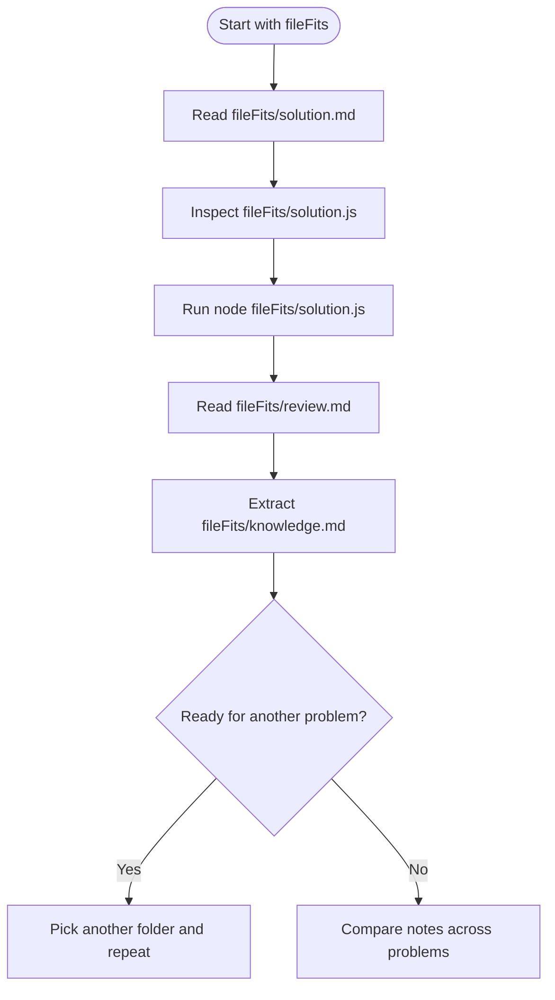
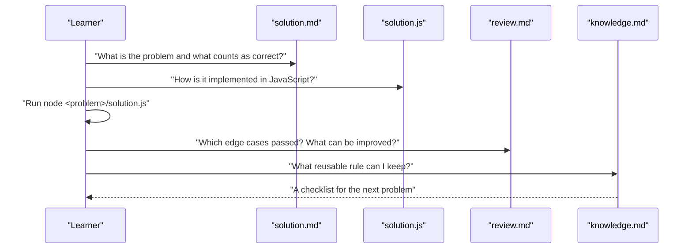
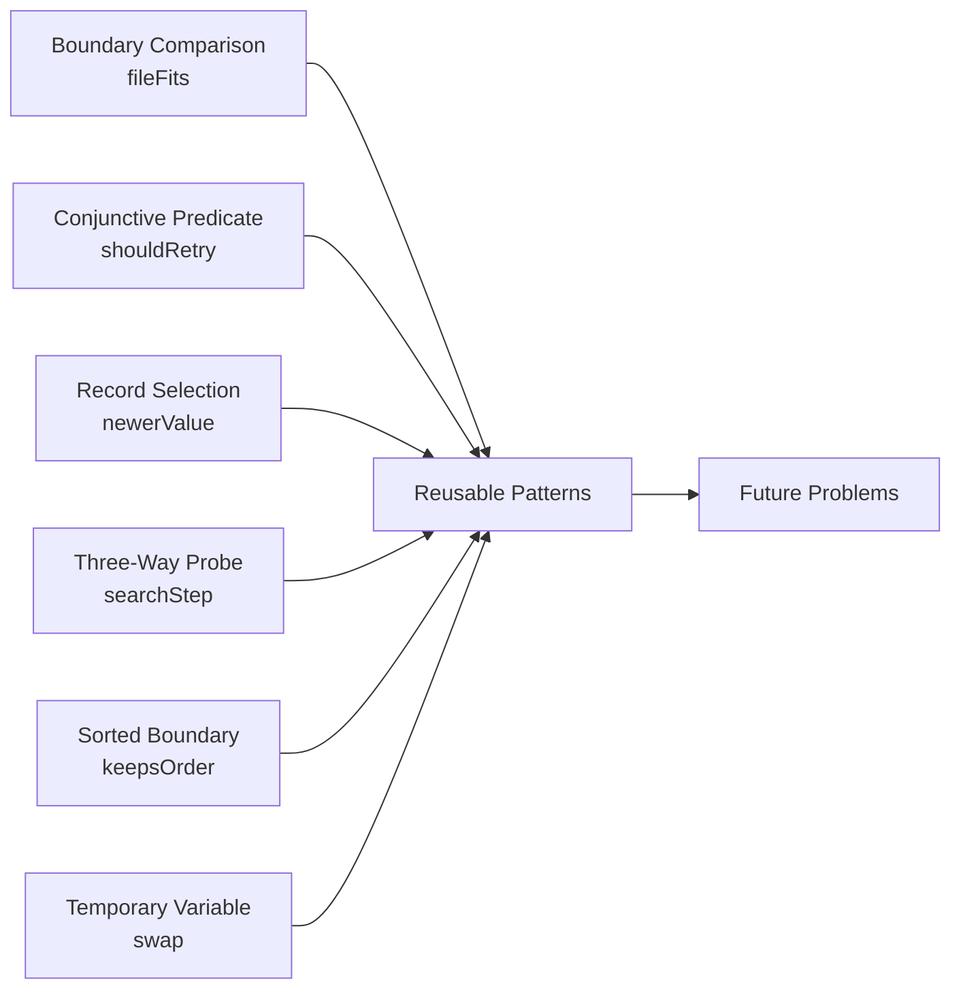

# Getting Started

<cite>
**Referenced Files in This Document**
- [README.md](file://README.md)
- [fileFits/solution.js](file://fileFits/solution.js)
- [fileFits/solution.md](file://fileFits/solution.md)
- [fileFits/review.md](file://fileFits/review.md)
- [fileFits/knowledge.md](file://fileFits/knowledge.md)
- [shouldRetry/solution.js](file://shouldRetry/solution.js)
- [shouldRetry/solution.md](file://shouldRetry/solution.md)
- [shouldRetry/review.md](file://shouldRetry/review.md)
- [shouldRetry/knowledge.md](file://shouldRetry/knowledge.md)
- [newerValue/solution.js](file://newerValue/solution.js)
- [newerValue/solution.md](file://newerValue/solution.md)
- [newerValue/review.md](file://newerValue/review.md)
- [newerValue/knowledge.md](file://newerValue/knowledge.md)
- [searchStep/solution.js](file://searchStep/solution.js)
- [searchStep/solution.md](file://searchStep/solution.md)
- [searchStep/review.md](file://searchStep/review.md)
- [searchStep/knowledge.md](file://searchStep/knowledge.md)
- [keepsOrder/solution.js](file://keepsOrder/solution.js)
- [keepsOrder/solution.md](file://keepsOrder/solution.md)
- [keepsOrder/review.md](file://keepsOrder/review.md)
- [keepsOrder/knowledge.md](file://keepsOrder/knowledge.md)
- [swap/solution.js](file://swap/solution.js)
- [swap/solution.md](file://swap/solution.md)
- [swap/review.md](file://swap/review.md)
- [swap/knowledge.md](file://swap/knowledge.md)
</cite>

## Table of Contents
1. [Introduction](#introduction)
2. [Project Structure](#project-structure)
3. [Prerequisites](#prerequisites)
4. [How to Run Solutions](#how-to-run-solutions)
5. [The Four-File Template](#the-four-file-template)
6. [Working Through the First Problem](#working-through-the-first-problem)
7. [Learning Workflow](#learning-workflow)
8. [Troubleshooting](#troubleshooting)
9. [Conclusion](#conclusion)

## Introduction
This repository is a personal educational archive of algorithmic decision problems solved in JavaScript. Each problem lives in its own folder together with:

- The submitted solution code
- A structured write-up explaining the problem, analysis, approach, complexity, and edge cases
- An AI review covering correctness, edge cases, performance, and code quality
- Reusable knowledge distilled from the problem — patterns that apply beyond that single exercise

It is not a library or application. You are meant to read the documentation, understand the reasoning, run the solution, and connect each problem to broader algorithmic thinking.

**Section sources**
- [README.md:1-12](file://README.md#L1-L12)

## Project Structure
Every problem follows the same four-file layout:

```text
<problemName>/
├── solution.js     # Submitted solution code
├── solution.md     # Problem overview, analysis, approach, complexity, edge cases
├── review.md       # AI review of correctness, edge cases, performance, quality
└── knowledge.md    # Generalizable lessons for future problems
```

Currently, the archive contains six problems:

| Problem | Topic | Main idea |
|---|---|---|
| `fileFits` | Boundary comparison, boolean expressions | Decide whether a file fits in remaining drive space |
| `shouldRetry` | Boolean conjunction, retry gating | Decide whether another attempt is allowed |
| `newerValue` | Tie-breaking comparison, record selection | Return the value belonging to the newer update |
| `searchStep` | Three-way comparison, binary-search probe | Return found/left/right based on probing an ordered sequence |
| `keepsOrder` | Sorted-order boundary check, boolean predicate | Check whether an incoming value preserves sorted order |
| `swap` | Value exchange, temporary variable | Exchange two values using a temporary variable |

```mermaid
graph TB
  Root["Repository Root"]
  FileFits["fileFits/"]
  ShouldRetry["shouldRetry/"]
  NewerValue["newerValue/"]
  SearchStep["searchStep/"]
  KeepsOrder["keepsOrder/"]
  Swap["swap/"]

  Root --> FileFits
  Root --> ShouldRetry
  Root --> NewerValue
  Root --> SearchStep
  Root --> KeepsOrder
  Root --> Swap

  FileFits --> FF_Sol["solution.js"]
  FileFits --> FF_Doc["solution.md"]
  FileFits --> FF_Rev["review.md"]
  FileFits --> FF_Know["knowledge.md"]

  ShouldRetry --> SR_Sol["solution.js"]
  ShouldRetry --> SR_Doc["solution.md"]
  ShouldRetry --> SR_Rev["review.md"]
  ShouldRetry --> SR_Know["knowledge.md"]

  NewerValue --> NV_Sol["solution.js"]
  NewerValue --> NV_Doc["solution.md"]
  NewerValue --> NV_Rev["review.md"]
  NewerValue --> NV_Know["knowledge.md"]

  SearchStep --> SS_Sol["solution.js"]
  SearchStep --> SS_Doc["solution.md"]
  SearchStep --> SS_Rev["review.md"]
  SearchStep --> SS_Know["knowledge.md"]

  KeepsOrder --> KO_Sol["solution.js"]
  KeepsOrder --> KO_Doc["solution.md"]
  KeepsOrder --> KO_Rev["review.md"]
  KeepsOrder --> KO_Know["knowledge.md"]

  Swap --> SW_Sol["solution.js"]
  Swap --> SW_Doc["solution.md"]
  Swap --> SW_Rev["review.md"]
  Swap --> SW_Know["knowledge.md"]
```



**Diagram sources**
- [README.md:12-38](file://README.md#L12-L38)

**Section sources**
- [README.md:12-38](file://README.md#L12-L38)

## Prerequisites
You only need Node.js installed. The solutions are plain JavaScript with no external dependencies.

- **Runtime:** Node.js
- **Verification version:** v24.22.1 (used by this archive)
- **Package manager:** Not required
- **Editor:** Any editor that can open `.js`, `.md`, and terminal commands

If you already have Node.js installed, verify it with your terminal before continuing.

**Section sources**
- [README.md:40-58](file://README.md#L40-L58)

## How to Run Solutions
Run a solution from the repository root using `node <folder>/solution.js`.

### Examples
- Run the boundary-comparison problem:
  ```bash
  node fileFits/solution.js
  ```
- Run the retry-gating problem:
  ```bash
  node shouldRetry/solution.js
  ```
- Run the tie-breaking selection problem:
  ```bash
  node newerValue/solution.js
  ```
- Run the three-way comparison problem:
  ```bash
  node searchStep/solution.js
  ```
- Run the sorted-order boundary-check problem:
  ```bash
  node keepsOrder/solution.js
  ```
- Run the value-exchange problem:
  ```bash
  node swap/solution.js
  ```

Important: individual solution files may not print anything on their own. Their expected behavior, test cases, and verification results are documented in the corresponding `solution.md` and `review.md` files. Use the solution as an executable reference while reading the written explanation.

**Section sources**
- [README.md:40-58](file://README.md#L40-L58)

## The Four-File Template
Each problem folder uses four complementary files. Read them together; they represent one complete learning cycle.

| File | Purpose | When to read it |
|---|---|---|
| `solution.js` | The exact solution code saved verbatim | When you want to see how the idea is implemented in JavaScript |
| `solution.md` | Full write-up: problem, constraints, analysis, approach, pseudocode, complexity, edge cases, takeaways | When you want to understand why the solution works |
| `review.md` | AI review: correctness, verified edge cases, performance, code quality, recommended changes | When you want to learn what went right, what was improved, and what could be idiomatic |
| `knowledge.md` | Reusable, problem-agnostic lessons | When you want to carry a pattern into the next problem |

### Reading Order Recommendation
1. Start with `solution.md` to understand the problem and reasoning.
2. Look at `solution.js` to see the implementation.
3. Read `review.md` to check correctness, edge cases, and style improvements.
4. Read `knowledge.md` to extract the reusable rule.
5. Run `node <problem>/solution.js` to connect the document to actual code.

**Section sources**
- [README.md:12-38](file://README.md#L12-L38)

## Working Through the First Problem
Let us walk through `fileFits` as a complete example.

### What the problem asks
Given a drive capacity, the amount already used, and a file size, decide whether the file fits. Filling the drive exactly is allowed.

### Expected behavior
- `(capacity=100, used=70, size=20)` → `true`
- `(capacity=100, used=70, size=30)` → `true` because exact fill is allowed
- `(capacity=100, used=70, size=31)` → `false`

### How to study it
1. Open `fileFits/solution.md` and read the problem overview, requirements, analysis, and approach.
2. Open `fileFits/solution.js` and observe the function signature and condition.
3. Run `node fileFits/solution.js`.
4. Read `fileFits/review.md` to see which edge cases were executed and what stylistic improvement is recommended.
5. Read `fileFits/knowledge.md` to capture the general lesson about boundary comparisons and returning boolean expressions directly.



**Diagram sources**
- [fileFits/solution.md:1-138](file://fileFits/solution.md#L1-L138)
- [fileFits/solution.js:1-10](file://fileFits/solution.js#L1-L10)
- [fileFits/review.md:1-67](file://fileFits/review.md#L1-L67)
- [fileFits/knowledge.md:1-50](file://fileFits/knowledge.md#L1-L50)

**Section sources**
- [fileFits/solution.md:1-138](file://fileFits/solution.md#L1-L138)
- [fileFits/solution.js:1-10](file://fileFits/solution.js#L1-L10)
- [fileFits/review.md:1-67](file://fileFits/review.md#L1-L67)
- [fileFits/knowledge.md:1-50](file://fileFits/knowledge.md#L1-L50)

## Learning Workflow
The most useful habit is to treat every problem as a small research project rather than just a coding exercise.



### Connecting Problems to Patterns
Although the current problems look different, they share recurring themes around predicates, comparisons, and simple data movement:

| Problem | Core Pattern | Reusable Insight |
|---|---|---|
| `fileFits` | Translate wording into a relational operator | Exact-fill means inclusive bounds; return the comparison directly |
| `shouldRetry` | Combine two conditions with logical AND | \"Only when\" signals conjunction; equality belongs to the stop side |
| `newerValue` | Select a record by key, then extract payload | Do not confuse argument order with domain order; ties fix the operator |
| `searchStep` | Three-way comparison returning a discrete result | A probe returns more than true/false; match, less-than, greater-than map to distinct outcomes |
| `keepsOrder` | Sorted-order boundary check | Preserve monotonicity by comparing against the relevant boundary rather than sorting |
| `swap` | Value exchange via temporary variable | Temporary storage is the clearest way to avoid losing either original value |



**Diagram sources**
- [fileFits/knowledge.md:1-50](file://fileFits/knowledge.md#L1-L50)
- [shouldRetry/knowledge.md:1-54](file://shouldRetry/knowledge.md#L1-L54)
- [newerValue/knowledge.md:1-58](file://newerValue/knowledge.md#L1-L58)
- [searchStep/knowledge.md:1-58](file://searchStep/knowledge.md#L1-L58)
- [keepsOrder/knowledge.md:1-58](file://keepsOrder/knowledge.md#L1-L58)
- [swap/knowledge.md:1-58](file://swap/knowledge.md#L1-L58)

**Section sources**
- [fileFits/knowledge.md:1-50](file://fileFits/knowledge.md#L1-L50)
- [shouldRetry/knowledge.md:1-54](file://shouldRetry/knowledge.md#L1-L54)
- [newerValue/knowledge.md:1-58](file://newerValue/knowledge.md#L1-L58)
- [searchStep/knowledge.md:1-58](file://searchStep/knowledge.md#L1-L58)
- [keepsOrder/knowledge.md:1-58](file://keepsOrder/knowledge.md#L1-L58)
- [swap/knowledge.md:1-58](file://swap/knowledge.md#L1-L58)

## Troubleshooting
| Symptom | Likely Cause | Fix |
|---|---|---|
| `node` command not found | Node.js is not installed or not on PATH | Install Node.js and restart your terminal |
| Solution appears to do nothing | The file defines functions but does not call them | Check `solution.md` and `review.md` for expected behavior and test cases |
| Confusion about boundaries | Unclear whether the limit is inclusive or exclusive | Look for phrases like \"exactly allowed\", \"reaching the limit means stop\", or \"at least\" |
| Empty string answer behaves unexpectedly | Truthiness shortcuts replaced `""` with another value | Return the stored value directly instead of using `||` or truthy checks |
| Cannot find where a test case is defined | Tests are embedded in the documentation, not in a test runner | Search `solution.md` and `review.md` for verified input/output tables |

**Section sources**
- [README.md:40-58](file://README.md#L40-L58)
- [fileFits/review.md:28-46](file://fileFits/review.md#L28-L46)
- [shouldRetry/review.md:28-52](file://shouldRetry/review.md#L28-L52)
- [newerValue/review.md:28-48](file://newerValue/review.md#L28-L48)

## Conclusion
Use this archive as a study loop:

1. Pick a folder.
2. Read `solution.md` first.
3. Inspect `solution.js`.
4. Run `node <problem>/solution.js`.
5. Read `review.md` to validate correctness and learn improvements.
6. Save the reusable rule from `knowledge.md`.
7. Repeat with the next problem and compare patterns.

Over time, the folders stop being isolated exercises and become a connected collection of decisions: boundary operators, conjunctive predicates, record selection, three-way probes, sorted-order checks, temporary-variable swaps, and the discipline of writing down what makes a solution correct.