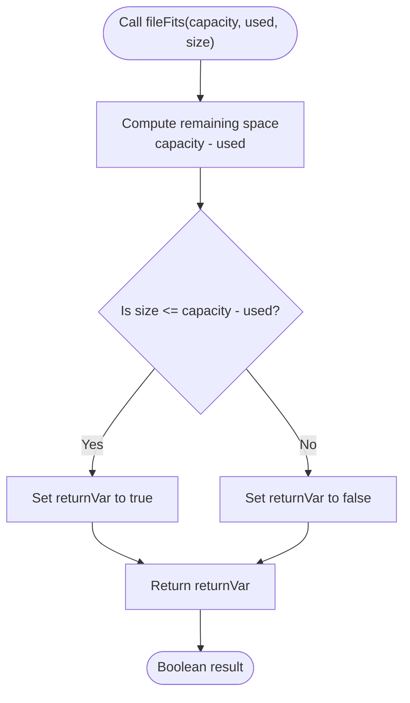

# Implementation Reference

<cite>
**Referenced Files in This Document**
- [solution.js](file://fileFits/solution.js)
- [knowledge.md](file://fileFits/knowledge.md)
- [review.md](file://fileFits/review.md)
- [solution.md](file://fileFits/solution.md)
</cite>

## Table of Contents
1. [Introduction](#introduction)
2. [Function Signature and Contract](#function-signature-and-contract)
3. [Current Source Listing](#current-source-listing)
4. [Arithmetic Reduction](#arithmetic-reduction)
5. [Implementation Details](#implementation-details)
6. [Recommended Simplified Form](#recommended-simplified-form)
7. [Practical Examples](#practical-examples)
8. [Integration Guide](#integration-guide)
9. [Complexity](#complexity)
10. [Troubleshooting](#troubleshooting)
11. [Conclusion](#conclusion)

## Introduction
The `fileFits` function answers a single, well-scoped question: given a drive's total capacity, the amount already used, and the size of a requested file, can that file be stored without exceeding the drive? The problem is intentionally small — one arithmetic comparison — so the documentation focuses on precise contract semantics, boundary behavior, and the recommended idiomatic JavaScript form.

## Function Signature and Contract
| Element | Specification |
|---|---|
| **Name** | `fileFits` |
| **Parameters** | `capacity`: number (non-negative integer, 0–1000)<br/>`used`: number (non-negative integer, 0–1000)<br/>`size`: number (non-negative integer, 0–1000) |
| **Invariant** | `used ≤ capacity` holds before every call; the drive is never over-committed by construction. |
| **Return type** | boolean |
| **Return semantics** | `true` when the requested `size` fits within the remaining space, including the exact-fill case where `used + size` equals `capacity`. Otherwise `false`. |
| **Side effects** | None. Pure function with no I/O, mutation, or external state. |
| **Dependencies** | None beyond JavaScript built-ins. |

The natural-language requirement “filling the drive exactly is allowed” pins the comparison to inclusive (`≤`) rather than strict (`<`). A zero-size file needs no additional space and therefore always fits under the stated invariant.

**Section sources**
- [solution.md:10-27](file://fileFits/solution.md#L10-L27)
- [knowledge.md:1-21](file://fileFits/knowledge.md#L1-L21)

## Current Source Listing
The repository’s verified implementation is saved verbatim in `solution.js`. It contains eight executable lines plus blank lines:

```javascript
function fileFits(capacity, used, size) {
  let returnVar 
  
  if (size <= capacity - used){
    returnVar = true
  } else {
    returnVar = false
  }
  return returnVar;
}
```

Key observations from the source:
- The function receives three parameters named exactly as specified in the contract.
- The core decision condition is `size <= capacity - used`.
- A local variable `returnVar` is assigned through an `if/else` block and then returned.
- There are no input validations, logging, configuration reads, or side effects.

**Section sources**
- [solution.js:1-10](file://fileFits/solution.js#L1-L10)

## Arithmetic Reduction
The natural-language statement maps directly to one relational expression:

1. Compute remaining free space: `capacity - used`.
2. Ask whether the requested file fits into that remainder: `size ≤ capacity - used`.
3. Return the result of that comparison.

This is equivalent to checking whether the post-write usage stays within bounds: `used + size ≤ capacity`. Both forms are correct here because all inputs are bounded by 1000, so JavaScript’s numeric representation introduces no overflow concern.

| Requirement wording | Comparison |
|---|---|
| “fits”, “at most”, “filling exactly is allowed” | `<=` |
| “strictly less”, “must leave room” | `<` |
| “at least”, “no fewer than” | `>=` |

The phrase “exactly is allowed” is what selects `<=`; it is the central correctness decision for this function.

**Section sources**
- [solution.md:28-53](file://fileFits/solution.md#L28-L53)
- [knowledge.md:1-21](file://fileFits/knowledge.md#L1-L21)

## Implementation Details
The current implementation follows a straightforward control-flow pattern:



**Diagram sources**
- [solution.js:1-10](file://fileFits/solution.js#L1-L10)

### Behavior Under Constraints
- Because `used ≤ capacity`, free space `capacity - used` is always non-negative.
- A zero-size request satisfies `0 ≤ capacity - used`, so it returns `true` without any special branch.
- Negative inputs and `used > capacity` are excluded by the problem constraints and do not need defensive checks.
- No iteration, allocation, or branching beyond the single conditional is required.

**Section sources**
- [knowledge.md:22-50](file://fileFits/knowledge.md#L22-L50)
- [solution.md:28-53](file://fileFits/solution.md#L28-L53)

## Recommended Simplified Form
In JavaScript, a comparison expression such as `size <= capacity - used` is itself a boolean value. Assigning `true` or `false` to a local variable inside an `if/else` is redundant control flow — often called *boolean laundering*.

| Aspect | Current form | Recommended form |
|---|---|---|
| Body length | Eight executable lines | One line |
| Mutable state | `let returnVar` | None |
| Control flow | Explicit `if/else` | Direct return |
| Readability | Describes mechanism | Describes intent |
| Correctness | Verified | Identical logic |

The recommended replacement is:

```javascript
function fileFits(capacity, used, size) {
  return size <= capacity - used;
}
```

This preserves the author’s exact condition while removing the middleman. The review explicitly recommends this change while noting that no algorithmic correction is needed.

**Section sources**
- [review.md:37-60](file://fileFits/review.md#L37-L60)
- [solution.md:94-112](file://fileFits/solution.md#L94-L112)
- [knowledge.md:10-21](file://fileFits/knowledge.md#L10-L21)

## Practical Examples
All examples below assume the documented constraints: each argument is a non-negative integer at most 1000, and `used ≤ capacity`.

| Scenario | Call | Expected | Reason |
|---|---|---:|---|
| Example from specification | `fileFits(100, 70, 20)` | `true` | Remaining space is 30; 20 fits. |
| Exact fill | `fileFits(100, 70, 30)` | `true` | 70 + 30 = 100; exact fill is allowed. |
| Over-capacity by one | `fileFits(100, 70, 31)` | `false` | 70 + 31 = 101 exceeds capacity. |
| Full drive, empty file | `fileFits(100, 100, 0)` | `true` | Zero-size file needs no extra space. |
| Full drive, non-empty file | `fileFits(100, 100, 1)` | `false` | No free space remains. |
| Minimum bounds | `fileFits(0, 0, 0)` | `true` | Empty drive accepts zero-size file. |
| Maximum bounds, exact fill | `fileFits(1000, 0, 1000)` | `true` | Boundary at maximum capacity. |
| Maximum bounds, full drive | `fileFits(1000, 1000, 1000)` | `false` | Drive already full. |
| Empty usage, empty file | `fileFits(100, 0, 0)` | `true` | Free space is 100; zero fits. |

These cases were executed against Node.js v24.22.1 and verified in the repository’s review record.

**Section sources**
- [review.md:21-35](file://fileFits/review.md#L21-L35)
- [solution.md:10-27](file://fileFits/solution.md#L10-L27)
- [solution.md:113-138](file://fileFits/solution.md#L113-L138)

## Integration Guide
Using `fileFits` involves only importing the module and passing three numbers:

1. Import the module containing `fileFits`.
2. Provide `capacity`, `used`, and `size` as numbers.
3. Use the returned boolean to decide whether to proceed with storage.

There are no configuration options, environment variables, initialization steps, callbacks, or external dependencies. The function is pure and synchronous.

A minimal integration shape is:

```javascript
import { fileFits } from "./fileFits/solution";

const canStore = fileFits(capacity, used, size);
```

Because the function has no side effects, it can be called repeatedly with different arguments without state management.

[No sources needed since this section provides general integration guidance]

## Complexity
| Metric | Complexity | Explanation |
|---|---:|---|
| Time | O(1) | One subtraction, one comparison, fixed work regardless of input values. |
| Space | O(1) | No collections or recursion; the simplified form uses no auxiliary memory. |

The operation is optimal: any decision based on these three scalars requires at least one comparison.

**Section sources**
- [review.md:36-40](file://fileFits/review.md#L36-L40)
- [solution.md:91-93](file://fileFits/solution.md#L91-L93)

## Troubleshooting
| Symptom | Likely cause | Resolution |
|---|---|---|
| Returns `false` for a zero-size file | Misunderstanding the invariant or using a strict `<` operator | Verify `used ≤ capacity` and use inclusive `<=`; zero-size files fit automatically. |
| Incorrect exact-fill behavior | Using `<` instead of `<=` | Replace the strict comparison with `<=` to allow `used + size === capacity`. |
| Unexpected results with large inputs | Passing values outside [0, 1000] | Enforce the problem’s input bounds at the integration layer; the function assumes valid inputs. |
| Confusion about defensive validation | Adding guards for `used > capacity` or negative numbers | Remove them; the contract guarantees they cannot occur and they add untested branches. |
| Difficulty reading the current implementation | Boolean laundering through `returnVar` | Adopt the recommended single-line form that returns the comparison directly. |

The repository’s review found no correctness issues and identified the redundant `if/else` as the only meaningful improvement.

**Section sources**
- [review.md:13-60](file://fileFits/review.md#L13-L60)
- [knowledge.md:22-50](file://fileFits/knowledge.md#L22-L50)

## Conclusion
`fileFits` is a minimal, correct, and optimal utility whose entire logic reduces to one inclusive comparison between the requested file size and the remaining drive space. The current repository implementation passes all verified cases but wraps the boolean-valued expression in unnecessary control flow. Replacing the `if/else` + `returnVar` pattern with a direct `return size <= capacity - used` yields the idiomatic JavaScript form while preserving identical behavior, improving readability, and eliminating mutable state.

[No sources needed since this section summarizes without analyzing specific files]