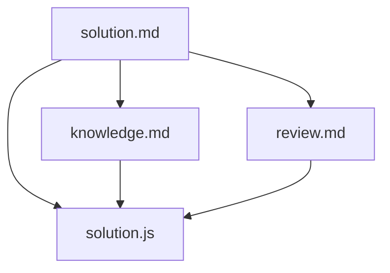
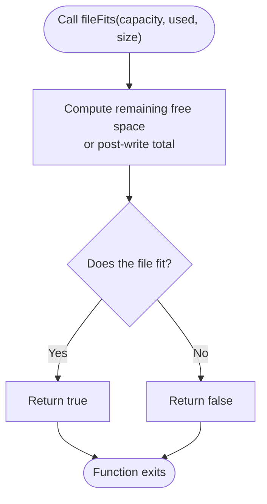
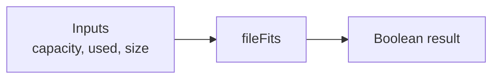
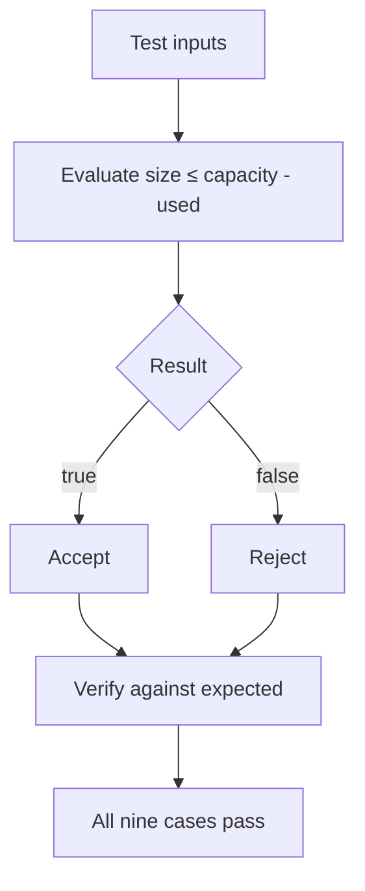
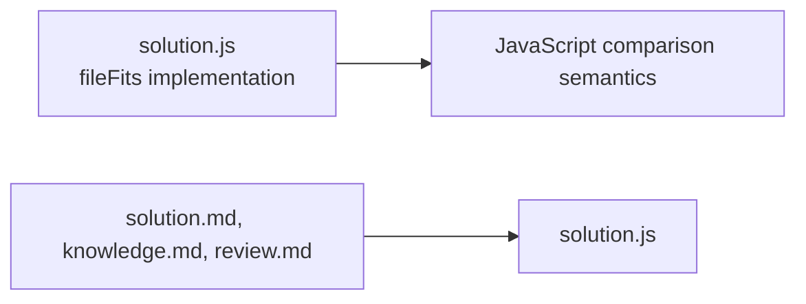

# Problem Analysis & Solution Walkthrough

<cite>
**Referenced Files in This Document**
- [solution.md](file://fileFits/solution.md)
- [solution.js](file://fileFits/solution.js)
- [knowledge.md](file://fileFits/knowledge.md)
- [review.md](file://fileFits/review.md)
</cite>

## Table of Contents
1. [Introduction](#introduction)
2. [Project Structure](#project-structure)
3. [Core Components](#core-components)
4. [Architecture Overview](#architecture-overview)
5. [Detailed Component Analysis](#detailed-component-analysis)
6. [Dependency Analysis](#dependency-analysis)
7. [Performance Considerations](#performance-considerations)
8. [Troubleshooting Guide](#troubleshooting-guide)
9. [Conclusion](#conclusion)

## Introduction
This document explains the step-by-step reasoning behind `fileFits`, a function that decides whether a file can be stored on a drive given its total capacity, current usage, and the file size. The goal is to make the design choices transparent: how the problem statement becomes an arithmetic expression, why the comparison must be inclusive, how pseudocode collapses into a single return value, and what each test case validates.

The function signature is `fileFits(capacity, used, size)` and it returns a boolean. The drive may be filled exactly — if the new total equals the capacity, the file still fits.

**Section sources**
- [solution.md:1-18](file://fileFits/solution.md#L1-L18)

## Project Structure
The repository contains four focused files for this problem:

| File | Purpose |
|---|---|
| `solution.md` | Full solution record: problem overview, constraints, analysis, pseudocode, complexity, edge cases, and improvement recommendations. |
| `solution.js` | Executable JavaScript implementation. |
| `knowledge.md` | Reusable knowledge about boundary comparisons, boolean laundering, and invariant-driven simplification. |
| `review.md` | Verification report covering correctness, edge cases, performance, code quality, and recommended changes. |



**Diagram sources**
- [solution.md:1-138](file://fileFits/solution.md#L1-L138)
- [solution.js:1-10](file://fileFits/solution.js#L1-L10)
- [knowledge.md:1-50](file://fileFits/knowledge.md#L1-L50)
- [review.md:1-67](file://fileFits/review.md#L1-L67)

**Section sources**
- [solution.md:1-138](file://fileFits/solution.md#L1-L138)
- [solution.js:1-10](file://fileFits/solution.js#L1-L10)
- [knowledge.md:1-50](file://fileFits/knowledge.md#L1-L50)
- [review.md:1-67](file://fileFits/review.md#L1-L67)

## Core Components
The only runtime component is the `fileFits` function. Its logic reduces the natural-language question “does the file fit?” to one arithmetic relationship.

Key responsibilities:
- Accept three integer inputs within `[0, 1000]`.
- Assume the pre-condition `used ≤ capacity`.
- Decide whether adding the file would exceed capacity.
- Return `true` when the file fits, including exact fills; otherwise return `false`.



**Diagram sources**
- [solution.md:21-40](file://fileFits/solution.md#L21-L40)
- [solution.js:1-10](file://fileFits/solution.js#L1-L10)

**Section sources**
- [solution.md:18-40](file://fileFits/solution.md#L18-L40)
- [solution.js:1-10](file://fileFits/solution.js#L1-L10)

## Architecture Overview
At the architectural level, `fileFits` is a stateless pure function with no side effects, no external dependencies, and no control flow beyond a single decision. It maps directly from input tuple `(capacity, used, size)` to a boolean outcome.



[No sources needed since this diagram shows conceptual data flow, not a specific code structure]

## Detailed Component Analysis

### Step 1: Restate the Problem and Constraints
The problem asks whether a file of `size` megabytes can be written to a drive whose total capacity is `capacity` and whose current usage is `used`. Important constraints are:
- All three values are whole numbers between `0` and `1000`.
- The drive is never over-committed before the write: `used ≤ capacity`.
- Exact fill is allowed: if `used + size == capacity`, the answer is `true`.
- A zero-size file needs no extra space and therefore always fits.

These constraints define the valid input domain and the boundary behavior at equality.

**Section sources**
- [solution.md:1-18](file://fileFits/solution.md#L1-L18)
- [solution.md:19-25](file://fileFits/solution.md#L19-L25)

### Step 2: Translate Wording into Free-Space Logic
The core insight is to identify the relevant resource state after writing the file:
- Post-write used amount: `used + size`.
- Remaining free space: `capacity - used`.

The question “does the file fit?” becomes one of these equivalent statements:
- `size ≤ capacity - used`
- `used + size ≤ capacity`

Choosing either form is fine here because all values are small enough that JavaScript number semantics do not introduce overflow or precision concerns.

**Section sources**
- [solution.md:26-40](file://fileFits/solution.md#L26-L40)
- [knowledge.md:1-14](file://fileFits/knowledge.md#L1-L14)

### Step 3: Choose Between Strict and Inclusive Boundaries
The wording “filling the drive exactly is allowed” pins down the comparison operator:
- Use `≤` (inclusive), not `<` (strict).
- This means the boundary case where `used + size == capacity` returns `true`.

A reusable rule is to map requirement phrasing directly to operators:
- “fits,” “at most,” “exactly allowed” → `≤`.
- “strictly less,” “must leave room” → `<`.
- “at least,” “no fewer than” → `≥`.

**Section sources**
- [solution.md:26-33](file://fileFits/solution.md#L26-L33)
- [knowledge.md:1-14](file://fileFits/knowledge.md#L1-L14)

### Step 4: Write Pseudocode Before Code
Before writing language-specific code, express the algorithm as pseudocode. Two equivalent forms are useful:

```text
FUNCTION fileFits(capacity, used, size)
    RETURN size ≤ capacity - used
END FUNCTION
```

Or equivalently:

```text
FUNCTION fileFits(capacity, used, size)
    RETURN used + size ≤ capacity
END FUNCTION
```

Pseudocode clarifies the decision without distracting syntax details. It also makes the O(1) nature obvious: there is no loop, no recursion, and no data structure.

**Section sources**
- [solution.md:41-61](file://fileFits/solution.md#L41-L61)

### Step 5: Collapse Pseudocode Into One Comparison
In JavaScript, a relational comparison already evaluates to a boolean. Therefore, the implementation can return the comparison directly rather than wrapping it in an `if/else`.

Current implementation pattern:
```javascript
function fileFits(capacity, used, size) {
  let returnVar 

  if (size <= capacity - used){
    returnVar = true
  } else {
    returnVar = false
  }
  return returnVar;
}
```

Recommended idiomatic version:
```javascript
function fileFits(capacity, used, size) {
  return size <= capacity - used;
}
```

Both versions implement the same logic. The second removes a mutable local variable and redundant branching.

**Section sources**
- [solution.js:1-10](file://fileFits/solution.js#L1-L10)
- [solution.md:79-96](file://fileFits/solution.md#L79-L96)
- [knowledge.md:15-35](file://fileFits/knowledge.md#L15-L35)
- [review.md:35-60](file://fileFits/review.md#L35-L60)

### Step 6: Why Zero-Size Input Needs No Special Case
Because the problem guarantees `used ≤ capacity`, the free space `capacity - used` is always non-negative. Therefore `0 ≤ capacity - used` is always true, so a zero-size file always fits. Adding an explicit branch such as “if size equals zero, return true” would duplicate logic already covered by the main comparison and could hide the real decision.

This is an example of exploiting a guaranteed invariant instead of defensively branching against impossible states.

**Section sources**
- [solution.md:31-37](file://fileFits/solution.md#L31-L37)
- [knowledge.md:36-49](file://fileFits/knowledge.md#L36-L49)

### Step 7: Complexity Bounds and Their Meaning
| Metric | Complexity | Conceptual Meaning |
|---|---:|---|
| Time | O(1) | The function performs a fixed number of arithmetic and relational operations. Running time does not grow with input magnitude. |
| Space | O(1) | No arrays, objects, stacks, or recursion are used. At most one scalar local variable exists in the current implementation. |

O(1) time means every call takes essentially the same amount of work regardless of whether the drive has 0 MB or 1000 MB. O(1) auxiliary space means memory use does not scale with input.

**Section sources**
- [solution.md:97-108](file://fileFits/solution.md#L97-L108)
- [review.md:27-33](file://fileFits/review.md#L27-L33)

### Step 8: Edge Cases and What Each Validates
All nine executed cases were verified with Node.js and produced expected results.

| Scenario | Input `(capacity, used, size)` | Expected | Why It Matters |
|---|---|---:|---|
| Example from problem | `(100, 70, 20)` | `true` | Confirms basic fit below capacity. |
| Exact fill | `(100, 70, 30)` | `true` | Validates the inclusive `≤` boundary. |
| One unit over | `(100, 70, 31)` | `false` | Confirms rejection above capacity. |
| Full drive, empty file | `(100, 100, 0)` | `true` | Tests maximum `used` with zero-size input. |
| Full drive, non-empty file | `(100, 100, 1)` | `false` | Tests maximum `used` with a positive request. |
| Minimum bounds | `(0, 0, 0)` | `true` | Tests lower boundaries for all parameters. |
| Maximum bounds, exact fill | `(1000, 0, 1000)` | `true` | Tests upper bound with exact fill. |
| Maximum bounds, full drive | `(1000, 1000, 1000)` | `false` | Tests upper bound with an over-capacity request. |
| No usage, empty file | `(100, 0, 0)` | `true` | Tests free-drive zero-size behavior. |

Together, these cases cover:
- Below-boundary fit.
- Equality boundary.
- Above-boundary rejection.
- Lower bounds (`0`).
- Upper bounds (`1000`).
- Full drive behavior.
- Empty drive behavior.
- Zero-size file behavior.



**Diagram sources**
- [solution.md:109-133](file://fileFits/solution.md#L109-L133)
- [review.md:15-26](file://fileFits/review.md#L15-L26)

**Section sources**
- [solution.md:109-133](file://fileFits/solution.md#L109-L133)
- [review.md:15-26](file://fileFits/review.md#L15-L26)

### Step 9: Improvement Recommendations
The review identifies one meaningful improvement: eliminate boolean laundering.

Current code assigns `true` or `false` to `returnVar` inside an `if/else`, then returns that variable. Since the comparison itself is already a boolean, this pattern adds unnecessary control flow and a mutable variable.

Recommended change:
- Delete `returnVar`.
- Replace the `if/else` block with a single return of the comparison.
- Keep the same condition: `size <= capacity - used`.

Additional guidance:
- Do not add defensive checks for negative values or `used > capacity`; the problem guarantees they cannot occur.
- Algorithmically, nothing else needs improvement because the operation is already optimal O(1).

**Section sources**
- [solution.md:79-96](file://fileFits/solution.md#L79-L96)
- [solution.md:117-127](file://fileFits/solution.md#L117-L127)
- [knowledge.md:15-35](file://fileFits/knowledge.md#L15-L35)
- [review.md:35-67](file://fileFits/review.md#L35-L67)

## Dependency Analysis
`fileFits` has no runtime dependencies. The documentation files depend conceptually on the implementation, but the JavaScript file itself depends only on built-in JavaScript comparison semantics.



**Diagram sources**
- [solution.js:1-10](file://fileFits/solution.js#L1-L10)
- [solution.md:1-138](file://fileFits/solution.md#L1-L138)
- [knowledge.md:1-50](file://fileFits/knowledge.md#L1-L50)
- [review.md:1-67](file://fileFits/review.md#L1-L67)

**Section sources**
- [solution.js:1-10](file://fileFits/solution.js#L1-L10)
- [solution.md:1-138](file://fileFits/solution.md#L1-L138)
- [knowledge.md:1-50](file://fileFits/knowledge.md#L1-L50)
- [review.md:1-67](file://fileFits/review.md#L1-L67)

## Performance Considerations
The function is already optimal:
- Time complexity is O(1) because it performs one subtraction and one comparison.
- Space complexity is O(1) because it uses no growing structures or recursion.
- The current implementation uses one local variable; the simplified version uses none.

There is no faster algorithmic approach for a single decision over constant-sized numeric inputs. Optimization should focus on readability rather than asymptotic performance.

[No sources needed since this section provides general guidance based on previously analyzed files]

## Troubleshooting Guide
Common mistakes and how to recognize them:

| Symptom | Likely Cause | Fix |
|---|---|---|
| Exact-fill case fails | Used strict `<` instead of inclusive `≤` | Change the comparison to allow equality. |
| Zero-size file unexpectedly rejected | Added an incorrect special-case branch | Remove the branch; rely on `size ≤ capacity - used`. |
| Over-complex implementation | Boolean laundering through `if/else` and a temporary variable | Return the comparison directly. |
| Defensive validation added unnecessarily | Checking for negative inputs or `used > capacity` | Remove guards; the problem guarantees valid inputs. |
| Boundary tests inconsistent | Mixing inclusive and strict logic across branches | Keep one consistent comparison across all paths. |

Use the nine documented edge cases as a regression checklist whenever the logic is changed.

**Section sources**
- [solution.md:26-37](file://fileFits/solution.md#L26-L37)
- [solution.md:79-127](file://fileFits/solution.md#L79-L127)
- [knowledge.md:1-49](file://fileFits/knowledge.md#L1-L49)
- [review.md:15-67](file://fileFits/review.md#L15-L67)

## Conclusion
`fileFits` demonstrates how a clear problem statement can be reduced to a single, correct comparison. The critical design choice is recognizing that “exactly allowed” requires an inclusive boundary. Once the free-space relationship is identified, pseudocode collapses naturally into one expression. The nine executed edge cases validate minimum bounds, maximum bounds, exact fill, full drive, empty drive, and zero-size input. The only remaining improvement is stylistic: return the comparison directly and avoid boolean laundering. Algorithmically, the solution is already minimal, readable, and optimal.

[No sources needed since this section summarizes without analyzing specific files]