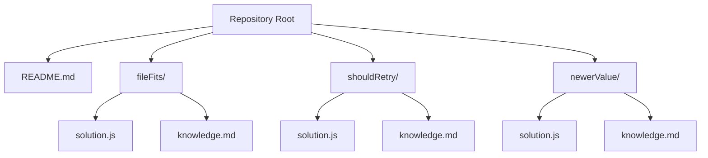
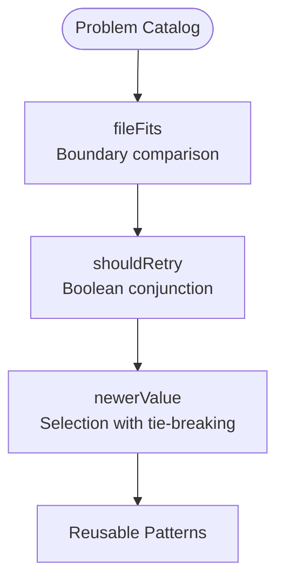
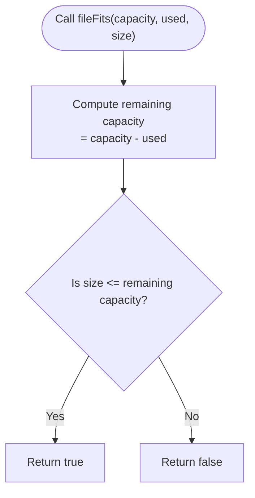
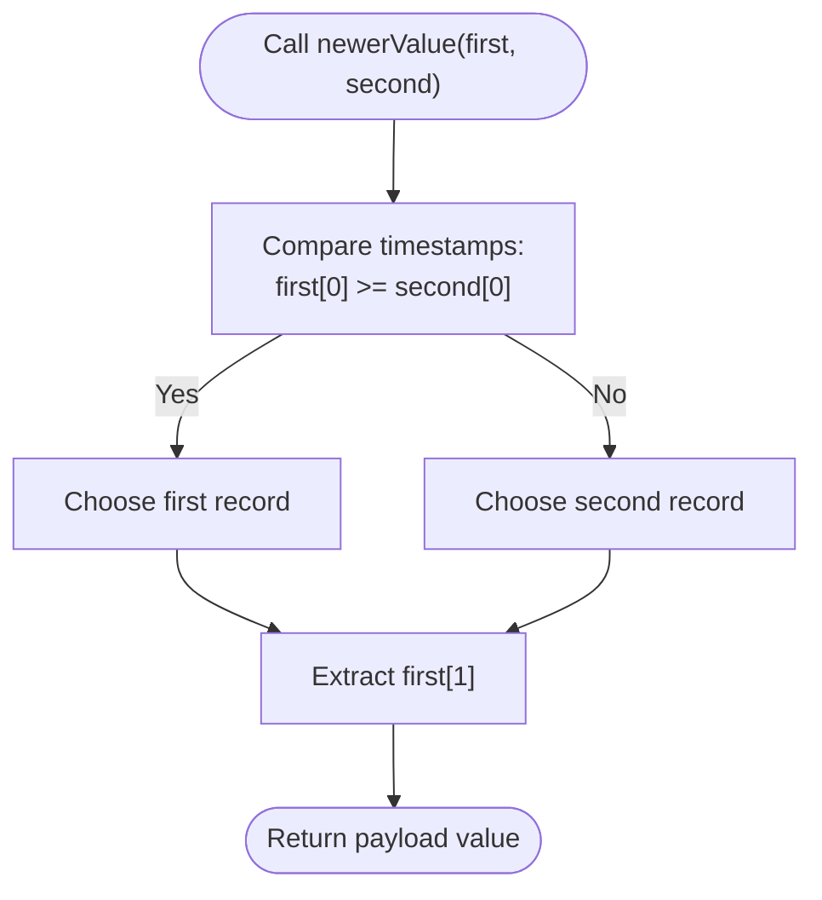
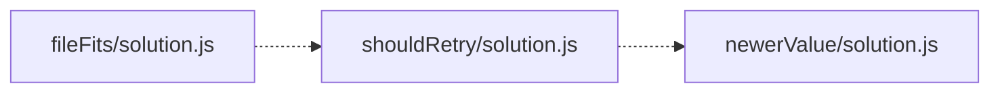

# Problem Catalog

<cite>
**Referenced Files in This Document**   
- [README.md](file://README.md)
- [fileFits/solution.js](file://fileFits/solution.js)
- [fileFits/knowledge.md](file://fileFits/knowledge.md)
- [shouldRetry/solution.js](file://shouldRetry/solution.js)
- [shouldRetry/knowledge.md](file://shouldRetry/knowledge.md)
- [newerValue/solution.js](file://newerValue/solution.js)
- [newerValue/knowledge.md](file://newerValue/knowledge.md)
</cite>

## Table of Contents
1. [Introduction](#introduction)
2. [Project Structure](#project-structure)
3. [Core Components](#core-components)
4. [Architecture Overview](#architecture-overview)
5. [Detailed Component Analysis](#detailed-component-analysis)
6. [Dependency Analysis](#dependency-analysis)
7. [Performance Considerations](#performance-considerations)
8. [Troubleshooting Guide](#troubleshooting-guide)
9. [Conclusion](#conclusion)

## Introduction
This document catalogs three related algorithmic decision functions from the repository: `fileFits`, `shouldRetry`, and `newerValue`. They form a progression from simple boundary comparison to boolean gating, then to record selection with tie-breaking rules.

The problems share common themes:
- Translating natural-language constraints into precise comparisons.
- Returning predicates directly instead of laundering booleans through branches.
- Handling edge cases such as exact boundaries, equality, and positional versus domain order.
- Recognizing reusable patterns that apply beyond each individual problem.

These functions are intentionally small so that the learning focus stays on reasoning about inputs, outputs, operators, and invariants rather than on infrastructure or framework complexity.

## Project Structure
Each problem lives in its own folder containing:
- A verbatim solution file.
- A structured write-up describing the problem, approach, complexity, and verified edge cases.
- An AI review summarizing correctness and quality.
- A knowledge file distilling generalizable lessons.



**Diagram sources**
- [README.md:7-27](file://README.md#L7-L27)

**Section sources**
- [README.md:1-27](file://README.md#L1-L27)

## Core Components
The catalog focuses on three decision functions:

| Function | Purpose | Inputs | Output | Primary Concept |
|---|---|---|---|---|
| `fileFits` | Decide whether a file fits given storage capacity and current usage | `capacity`, `used`, `size` | Boolean | Boundary comparison and inclusive inequality |
| `shouldRetry` | Gate retry policy using failure state, attempt count, and limit | `failed`, `attempts`, `limit` | Boolean | Conjunctive predicate and short-circuit evaluation |
| `newerValue` | Select one of two records by timestamp and return its payload | `first`, `second` arrays with `[timestamp, value]` | Payload value | Record selection, field separation, and tie-breaking |

**Section sources**
- [fileFits/solution.js:1-10](file://fileFits/solution.js#L1-L10)
- [shouldRetry/solution.js:1-8](file://shouldRetry/solution.js#L1-L8)
- [newerValue/solution.js:1-5](file://newerValue/solution.js#L1-L5)

## Architecture Overview
At this scale, the “architecture” is a flat set of independent decision functions. Each function has no side effects, no shared mutable state, and no cross-imports. The relationship is conceptual rather than programmatic:



[No sources needed since this diagram shows conceptual workflow, not actual code structure]

## Detailed Component Analysis

### `fileFits`: Storage Capacity Boundary Checking

#### Problem Statement
Determine whether a file of size `size` can be stored when the storage has total capacity `capacity` and `used` space is already occupied. The wording allows filling the drive exactly, so equal free space must still count as fitting.

#### Input/Output Specification
- **Inputs:**
  - `capacity`: total storage capacity.
  - `used`: currently used space.
  - `size`: requested file size.
- **Output:** Boolean indicating whether the file fits.

#### Solution Approach
1. Compute remaining capacity as `capacity - used`.
2. Compare `size` against remaining capacity using an inclusive less-than-or-equal operator because exact fit is allowed.
3. Return the resulting boolean directly.

The implementation stores the result in a variable before returning it, which is valid but non-idiomatic for pure boolean decisions.

#### Time and Space Complexity
- **Time:** O(1). One subtraction and one comparison.
- **Space:** O(1). No additional data structures; only a local variable holding a boolean.

#### Key Algorithmic Concepts
- Translate natural-language boundary words like “fits” and “exactly is allowed” into `<=`.
- Use available invariants: if constraints guarantee `used <= capacity`, then `capacity - used >= 0`, so zero-size files trivially fit without extra branches.
- Avoid boolean laundering: prefer returning the comparison expression directly.



**Diagram sources**
- [fileFits/solution.js:1-10](file://fileFits/solution.js#L1-L10)

#### Edge Cases and Constraint Handling
- Exact fit: `size === capacity - used` should return true.
- Zero-size file: should fit whenever remaining capacity is non-negative.
- Overfill: `size > capacity - used` should return false.
- Defensive checks for invalid states such as negative values or `used > capacity` are unnecessary when those states are excluded by problem constraints.

#### Reusable Pattern
Boundary-comparison pattern:
1. Identify the resource state after the change.
2. Pick the correct operator from inclusive vs strict wording.
3. Test the exact-boundary case separately.

**Section sources**
- [fileFits/solution.js:1-10](file://fileFits/solution.js#L1-L10)
- [fileFits/knowledge.md:1-50](file://fileFits/knowledge.md#L1-L50)

### `shouldRetry`: Boolean Conjunction and Retry Policy Gating

#### Problem Statement
Decide whether a failed operation should be retried based on whether the operation failed, how many attempts have been made, and the maximum allowed limit. Retry is permitted only when both the operation failed and the attempt count is still below the limit.

#### Input/Output Specification
- **Inputs:**
  - `failed`: whether the last operation failed.
  - `attempts`: number of attempts already made.
  - `limit`: maximum allowed attempts.
- **Output:** Boolean indicating whether another retry is allowed.

#### Solution Approach
1. Check that the operation actually failed.
2. Check that the attempt count is strictly below the limit.
3. Combine both conditions with logical AND.
4. Return the combined predicate directly.

The implementation uses an explicit branch, but the core logic is a conjunctive gate.

#### Time and Space Complexity
- **Time:** O(1). Two condition checks and one logical AND.
- **Space:** O(1). No auxiliary storage.

#### Key Algorithmic Concepts
- “Only when A and B” maps to conjunction.
- Boundary phrases determine strictness: “reaching the limit means stop” implies `<`, not `<=`.
- Short-circuit evaluation matters semantically: place the safety-critical or cheapest check first.
- Keep the predicate separate from the retry loop mechanism.

```mermaid
sequenceDiagram
  participant Caller as "Caller"
  participant Retry as "shouldRetry"
  participant Loop as "Retry Loop"

  Caller->>Retry: Evaluate(failed, attempts, limit)
  Retry->>Retry: Check failed
  Retry->>Retry: Check attempts < limit
  Retry-->>Caller: Boolean result
  alt Retry allowed
    Caller->>Loop: Perform next attempt
    Loop->>Retry: Evaluate again
  else Stop
    Caller->>Caller: Exit retry loop
  end
```

**Diagram sources**
- [shouldRetry/solution.js:1-8](file://shouldRetry/solution.js#L1-L8)
- [shouldRetry/knowledge.md:43-54](file://shouldRetry/knowledge.md#L43-L54)

#### Edge Cases and Constraint Handling
- Success followed by retry request: should return false even if under the limit.
- Exactly at the limit: should return false because reaching the limit stops retries.
- Failed at zero attempts: depends on whether the first attempt counts as an attempt; here, `attempts` represents attempts already made.
- Mixing up “attempts already made” with “next attempt number” causes off-by-one errors.

#### Reusable Pattern
Conjunctive-gate pattern:
1. Write the truth rule in plain language.
2. Choose the operator for each boundary.
3. Order conditions deliberately for clarity and short-circuit behavior.
4. Verify rows where one condition is true and the other is false.

**Section sources**
- [shouldRetry/solution.js:1-8](file://shouldRetry/solution.js#L1-L8)
- [shouldRetry/knowledge.md:1-54](file://shouldRetry/knowledge.md#L1-L54)

### `newerValue`: Record Selection with Tie-Breaking Rules

#### Problem Statement
Given two update records, each represented as an array containing a timestamp and a value, select the newer record and return its associated value. If timestamps are equal, the tie goes to the first argument.

#### Input/Output Specification
- **Inputs:**
  - `first`: `[timestamp, value]`
  - `second`: `[timestamp, value]`
- **Output:** The value from the newer record, or from `first` when timestamps are equal.

#### Solution Approach
1. Compare timestamps at index 0.
2. Choose the entire record based on the comparison.
3. Extract the payload at index 1 from the selected record.

The implementation performs selection first and payload extraction second, which cleanly separates the two responsibilities.

#### Time and Space Complexity
- **Time:** O(1). One comparison and two array accesses.
- **Space:** O(1). No new objects or arrays are created.

#### Key Algorithmic Concepts
- Positional order (parameter position) is different from domain order (chronological timestamp).
- Selection is not extremum extraction: return the chosen record’s payload, not just the larger timestamp.
- Equality probe determines the tie-breaking rule: `>=` gives ties to the left operand; `>` gives them to the right.
- Empty strings and other falsy payloads are valid data and must not be replaced by fallback defaults.



**Diagram sources**
- [newerValue/solution.js:1-5](file://newerValue/solution.js#L1-L5)

#### Edge Cases and Constraint Handling
- Equal timestamps: must return the value from `first`.
- First timestamp greater: return `first[1]`.
- Second timestamp greater: return `second[1]`.
- Empty string value: must be preserved as valid data.
- Comparing indices and returning indices by mistake is a common defect; compare `[0]`, return `[1]`.

#### Reusable Pattern
Two-candidate selection pattern:
1. Identify the comparison key and the returned payload.
2. Encode the tie rule explicitly through the operator and operand order.
3. Add an equality test case.
4. Avoid truthiness shortcuts on payloads.

**Section sources**
- [newerValue/solution.js:1-5](file://newerValue/solution.js#L1-L5)
- [newerValue/knowledge.md:1-58](file://newerValue/knowledge.md#L1-L58)

## Dependency Analysis
The three solutions are independent modules. There are no imports between them, no shared state, and no external dependencies.



The dotted arrows represent pedagogical progression rather than runtime dependencies.

**Diagram sources**
- [fileFits/solution.js:1-10](file://fileFits/solution.js#L1-L10)
- [shouldRetry/solution.js:1-8](file://shouldRetry/solution.js#L1-L8)
- [newerValue/solution.js:1-5](file://newerValue/solution.js#L1-L5)

**Section sources**
- [README.md:44-55](file://README.md#L44-L55)
- [fileFits/solution.js:1-10](file://fileFits/solution.js#L1-L10)
- [shouldRetry/solution.js:1-8](file://shouldRetry/solution.js#L1-L8)
- [newerValue/solution.js:1-5](file://newerValue/solution.js#L1-L5)

## Performance Considerations
All three functions operate in constant time and constant space. Their performance characteristics are dominated by simple arithmetic, comparisons, and array indexing. Optimization opportunities are minimal:
- Replace non-idiomatic boolean laundering with direct returns.
- Avoid defensive branches for states excluded by problem constraints.
- Keep selection and payload extraction as distinct steps to reduce cognitive load.

[No sources needed since this section provides general guidance]

## Troubleshooting Guide
Common mistakes and their fixes across the three problems:

| Symptom | Likely Cause | Fix |
|---|---|---|
| Exact-fit case fails | Used `<` instead of `<=` | Match inclusive wording with `<=` |
| Retry happens at the limit | Used `<=` instead of `<` | Use strict inequality when reaching the limit stops retries |
| Retry never occurs after success | Missing failure check or inverted condition | Require both failure and budget availability |
| Tie returns the wrong record | Operator or operand order does not encode the tie rule | Use `>=` for ties going to the first argument |
| Wrong value returned | Compared and returned the same index | Compare timestamps at index 0, return payload at index 1 |
| Empty string disappears | Used truthiness shortcut like `a || b` | Return the stored value directly |
| Off-by-one in retry count | Confused “attempts already made” with “next attempt number” | Read the noun phrase carefully and verify with boundary tests |

**Section sources**
- [fileFits/knowledge.md:1-50](file://fileFits/knowledge.md#L1-L50)
- [shouldRetry/knowledge.md:1-54](file://shouldRetry/knowledge.md#L1-L54)
- [newerValue/knowledge.md:1-58](file://newerValue/knowledge.md#L1-L58)

## Conclusion
These three problems illustrate a useful progression in algorithmic thinking:

1. `fileFits` teaches precise translation of boundary wording into operators and the importance of invariant-driven simplification.
2. `shouldRetry` adds conjunctive predicates, short-circuit semantics, and integration with retry loops.
3. `newerValue` introduces record selection, field separation, and explicit tie-breaking rules.

Together they demonstrate reusable patterns: compare first, return second; pick operators from natural language; test exact boundaries; avoid redundant control flow; and keep selection logic separate from payload extraction. These patterns generalize far beyond storage checks, retry policies, and timestamp comparisons.

[No sources needed since this section summarizes without analyzing specific files]