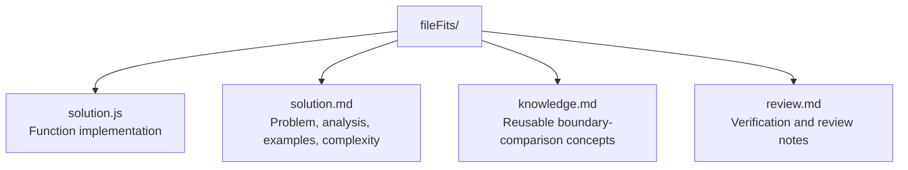
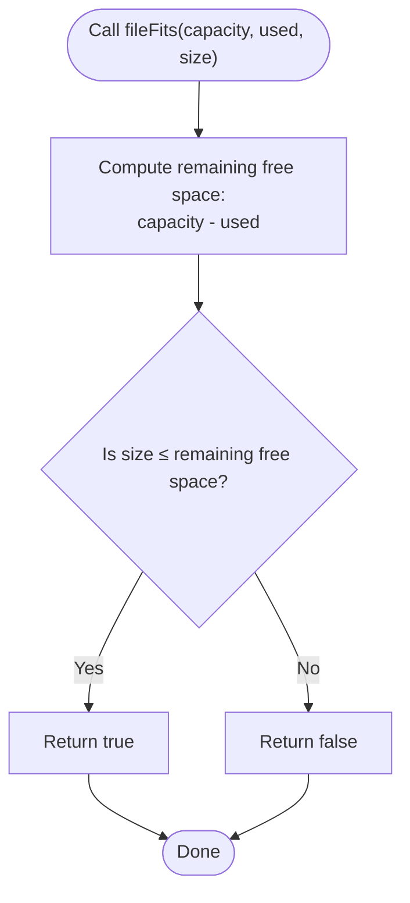
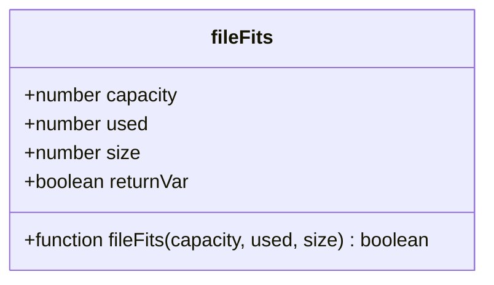
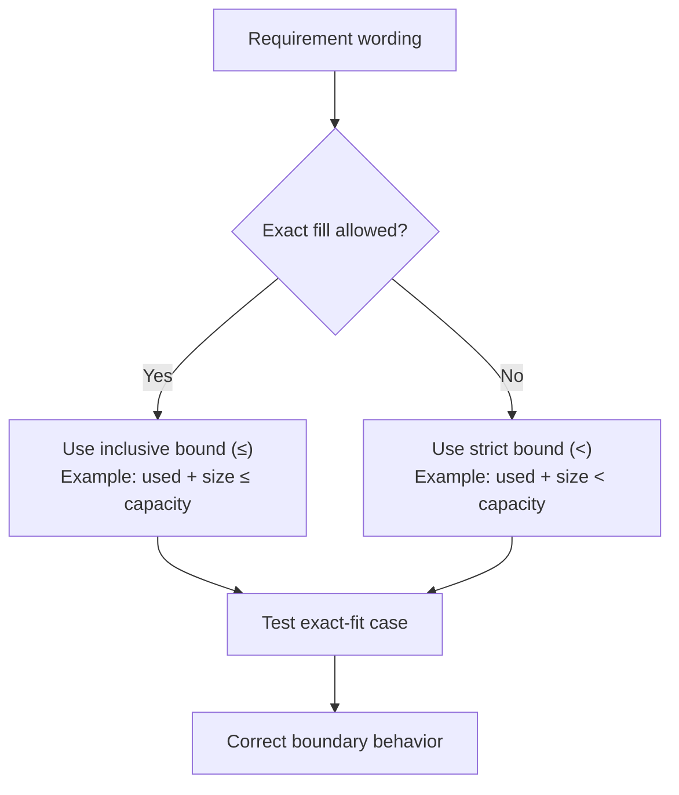
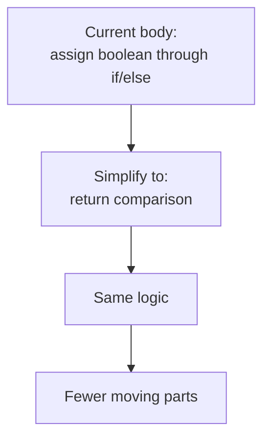

# fileFits — Storage Capacity Boundary Check

<cite>
**Referenced Files in This Document**
- [solution.js](file://fileFits/solution.js)
- [solution.md](file://fileFits/solution.md)
- [knowledge.md](file://fileFits/knowledge.md)
- [review.md](file://fileFits/review.md)
</cite>

## Table of Contents
1. [Introduction](#introduction)
2. [Project Structure](#project-structure)
3. [Core Components](#core-components)
4. [Architecture Overview](#architecture-overview)
5. [Detailed Component Analysis](#detailed-component-analysis)
6. [Dependency Analysis](#dependency-analysis)
7. [Performance Considerations](#performance-considerations)
8. [Troubleshooting Guide](#troubleshooting-guide)
9. [Conclusion](#conclusion)

## Introduction
This document explains the `fileFits` algorithm, which checks whether a file can be stored on a drive given its total capacity, already used space, and the size of the file to write. The core decision is a single arithmetic boundary comparison: the file fits when the remaining free space is at least as large as the requested size. Because the problem allows filling the drive exactly, the correct operator is inclusive (`≤`), not strict (`<`).

The implementation returns a boolean directly from that comparison. Time and auxiliary space complexity are both O(1).

## Project Structure
The `fileFits` problem lives under its own directory with four files:

- `solution.js`: executable JavaScript implementation.
- `solution.md`: full solution record, including problem statement, reasoning, pseudocode, complexity, edge cases, and improvement notes.
- `knowledge.md`: reusable, problem-agnostic notes about boundary comparisons and idiomatic boolean returns in JavaScript.
- `review.md`: verification log showing all test cases passed and code-quality feedback.

**Diagram sources**
- [solution.js:1-10](file://fileFits/solution.js#L1-L10)
- [solution.md:1-138](file://fileFits/solution.md#L1-L138)
- [knowledge.md:1-50](file://fileFits/knowledge.md#L1-L50)
- [review.md:1-67](file://fileFits/review.md#L1-L67)

**Section sources**
- [solution.js:1-10](file://fileFits/solution.js#L1-L10)
- [solution.md:1-138](file://fileFits/solution.md#L1-L138)
- [knowledge.md:1-50](file://fileFits/knowledge.md#L1-L50)
- [review.md:1-67](file://fileFits/review.md#L1-L67)

## Core Components
The only program component is the `fileFits` function. It accepts three numeric parameters and returns a boolean.

| Parameter | Meaning | Constraint |
|---|---|---|
| `capacity` | Total storage capacity in megabytes | Whole number in `[0, 1000]` |
| `used` | Already consumed space in megabytes | Whole number; invariant `used ≤ capacity` |
| `size` | File size to write in megabytes | Whole number in `[0, 1000]` |

Return value:

| Value | Meaning |
|---|---|
| `true` | The file fits, including the exact-fill boundary where `used + size = capacity` |
| `false` | Writing the file would exceed capacity |

Key constraint: because `used ≤ capacity`, free space is never negative before the write. Therefore a zero-size file always fits without a special branch.

**Section sources**
- [solution.md:1-40](file://fileFits/solution.md#L1-L40)
- [knowledge.md:1-50](file://fileFits/knowledge.md#L1-L50)

## Architecture Overview
At the system level, `fileFits` is a pure function: it has no side effects, reads only its parameters, and depends only on arithmetic and relational operators.

**Diagram sources**
- [solution.js:1-10](file://fileFits/solution.js#L1-L10)
- [solution.md:25-40](file://fileFits/solution.md#L25-L40)

## Detailed Component Analysis

### Function Signature and Parameters
The function signature is `fileFits(capacity, used, size)`. All three inputs are non-negative whole numbers up to 1000. The invariant `used ≤ capacity` means callers guarantee the drive is not already over-committed.

**Section sources**
- [solution.js:1-2](file://fileFits/solution.js#L1-L2)
- [solution.md:17-24](file://fileFits/solution.md#L17-L24)

### Implementation Logic
The implementation computes the remaining free space as `capacity - used` and compares the requested `size` against it using an inclusive bound. The result is assigned to a local variable and returned.

**Diagram sources**
- [solution.js:1-10](file://fileFits/solution.js#L1-L10)

The current body uses an `if/else` block to assign `true` or `false` to `returnVar`. This is logically equivalent to returning the comparison expression directly, because the comparison itself evaluates to a boolean in JavaScript.

**Section sources**
- [solution.js:1-10](file://fileFits/solution.js#L1-L10)
- [solution.md:80-105](file://fileFits/solution.md#L80-L105)
- [review.md:39-67](file://fileFits/review.md#L39-L67)

### Why `used + size ≤ capacity` Is Preferred Conceptually
Although the repository implementation uses `size ≤ capacity - used`, the conceptual formulation `used + size ≤ capacity` expresses the requirement more directly: after writing the file, the new total usage must not exceed capacity. Both forms are mathematically equivalent here and interchangeable for these constraints.

The preferred conceptual form avoids thinking about a separately computed “free space” variable and instead asks a single question about the post-write state. In languages where integer overflow is possible, choosing between subtracting first versus adding first can matter; in this repository’s JavaScript context with values bounded by 1000, either form is safe.

**Section sources**
- [solution.md:30-40](file://fileFits/solution.md#L30-L40)
- [solution.md:60-75](file://fileFits/solution.md#L60-L75)

### Operator Selection: Inclusive `≤` Versus Strict `<`
The most important correctness decision is the choice of comparison operator. The problem states that filling the drive exactly is allowed, so the boundary case `used + size = capacity` must return `true`. That fixes the operator as inclusive (`≤`).

If the requirement were stricter — for example, requiring some reserved space — then a strict operator (`<`) or a further adjusted bound would be necessary. The knowledge document explicitly maps wording such as “fits,” “at most,” and “filling exactly is allowed” to `<=`, and “strictly less” or “must leave room” to `<`.

**Diagram sources**
- [knowledge.md:1-20](file://fileFits/knowledge.md#L1-L20)
- [solution.md:30-40](file://fileFits/solution.md#L30-L40)

**Section sources**
- [knowledge.md:1-20](file://fileFits/knowledge.md#L1-L20)
- [solution.md:30-40](file://fileFits/solution.md#L30-L40)
- [review.md:15-38](file://fileFits/review.md#L15-L38)

### Edge Cases
The following scenarios are covered by the repository’s documentation and verified tests:

| Scenario | Inputs | Expected | Reason |
|---|---|---:|---|
| Normal fit | `(100, 70, 20)` | `true` | Remaining free space is 30; 20 ≤ 30 |
| Exact fill | `(100, 70, 30)` | `true` | New usage equals capacity; exact fill is allowed |
| One unit over | `(100, 70, 31)` | `false` | New usage exceeds capacity |
| Full drive, empty file | `(100, 100, 0)` | `true` | Zero-size file needs no extra space |
| Full drive, non-empty file | `(100, 100, 1)` | `false` | Any positive size exceeds zero free space |
| Minimum bounds | `(0, 0, 0)` | `true` | Empty drive and empty file fit |
| Maximum bounds, exact fill | `(1000, 0, 1000)` | `true` | Fits exactly |
| Maximum bounds, full drive | `(1000, 1000, 1000)` | `false` | Adding another 1000 would exceed capacity |
| No usage, empty file | `(100, 0, 0)` | `true` | Zero-size file always fits |

The zero-size rule does not require a special branch because the invariant `used ≤ capacity` guarantees free space is non-negative, making `0 ≤ capacity - used` always true.

**Section sources**
- [solution.md:9-24](file://fileFits/solution.md#L9-L24)
- [solution.md:40-45](file://fileFits/solution.md#L40-L45)
- [solution.md:95-115](file://fileFits/solution.md#L95-L115)
- [review.md:21-38](file://fileFits/review.md#L21-L38)

### Negative Inputs and Defensive Checks
The problem constraints specify non-negative inputs in `[0, 1000]` and the invariant `used ≤ capacity`. Consequently, defensive validation for negative values or over-committed drives is unnecessary for this problem. Adding such branches would introduce untested paths and obscure the core comparison.

That said, if this function were embedded in a larger system that cannot trust its callers, input validation could be added at the integration boundary rather than inside the pure algorithm.

**Section sources**
- [solution.md:17-24](file://fileFits/solution.md#L17-L24)
- [solution.md:105-115](file://fileFits/solution.md#L105-L115)
- [knowledge.md:22-35](file://fileFits/knowledge.md#L22-L35)
- [review.md:54-67](file://fileFits/review.md#L54-L67)

### Idiomatic Improvement
The current implementation assigns `true` or `false` through an `if/else` block. Since the comparison expression already evaluates to a boolean, the idiomatic simplification is to return the comparison directly. This removes mutable state and reduces the function to one logical line while preserving identical behavior.

**Diagram sources**
- [solution.js:1-10](file://fileFits/solution.js#L1-L10)
- [solution.md:80-105](file://fileFits/solution.md#L80-L105)
- [review.md:39-67](file://fileFits/review.md#L39-L67)

**Section sources**
- [solution.js:1-10](file://fileFits/solution.js#L1-L10)
- [solution.md:80-105](file://fileFits/solution.md#L80-L105)
- [knowledge.md:12-20](file://fileFits/knowledge.md#L12-L20)
- [review.md:39-67](file://fileFits/review.md#L39-L67)

## Dependency Analysis
`fileFits` has no external dependencies. It depends only on JavaScript’s built-in arithmetic subtraction and relational comparison operators. Its surrounding documentation files provide human-readable specifications, reusable knowledge, and verification results but do not affect runtime behavior.

**Diagram sources**
- [solution.js:1-10](file://fileFits/solution.js#L1-L10)
- [solution.md:1-138](file://fileFits/solution.md#L1-L138)
- [knowledge.md:1-50](file://fileFits/knowledge.md#L1-L50)
- [review.md:1-67](file://fileFits/review.md#L1-L67)

**Section sources**
- [solution.js:1-10](file://fileFits/solution.js#L1-L10)
- [solution.md:1-138](file://fileFits/solution.md#L1-L138)
- [knowledge.md:1-50](file://fileFits/knowledge.md#L1-L50)
- [review.md:1-67](file://fileFits/review.md#L1-L67)

## Performance Considerations
Time complexity is O(1): the function performs a fixed subtraction and a fixed comparison regardless of input magnitude. Space complexity is O(1): it uses at most one scalar local variable, and the simplified form uses none.

There is no loop, recursion, or data structure allocation. Every input value can change the answer, so no algorithm can solve this problem with fewer than one meaningful comparison; the current approach is optimal.

**Section sources**
- [solution.md:60-75](file://fileFits/solution.md#L60-L75)
- [solution.md:105-115](file://fileFits/solution.md#L105-L115)
- [review.md:30-38](file://fileFits/review.md#L30-L38)

## Troubleshooting Guide

### Symptom: Exact-fill case returns `false`
**Cause:** Using a strict operator (`<`) instead of an inclusive operator (`≤`).  
**Fix:** Change the comparison to allow equality. The problem explicitly permits filling the drive exactly.

**Section sources**
- [solution.md:30-40](file://fileFits/solution.md#L30-L40)
- [knowledge.md:1-20](file://fileFits/knowledge.md#L1-L20)
- [review.md:15-38](file://fileFits/review.md#L15-L38)

### Symptom: Zero-size file incorrectly fails
**Cause:** Unnecessary special-case logic that overrides the general comparison, or incorrect handling of the boundary.  
**Fix:** Rely on the general comparison. With `used ≤ capacity`, free space is non-negative, so a zero-size file always satisfies `size ≤ capacity - used`.

**Section sources**
- [solution.md:40-45](file://fileFits/solution.md#L40-L45)
- [knowledge.md:22-35](file://fileFits/knowledge.md#L22-L35)
- [review.md:21-38](file://fileFits/review.md#L21-L38)

### Symptom: Extra validation for negative or invalid inputs slows or confuses the code
**Cause:** Adding defensive branches for inputs excluded by the problem constraints.  
**Fix:** Keep the pure algorithm focused on the required comparison. Add input validation at the caller boundary if the surrounding system cannot guarantee valid inputs.

**Section sources**
- [solution.md:105-115](file://fileFits/solution.md#L105-L115)
- [knowledge.md:22-35](file://fileFits/knowledge.md#L22-L35)
- [review.md:54-67](file://fileFits/review.md#L54-L67)

### Symptom: Code is harder to read than necessary
**Cause:** Boolean laundering through an `if/else` block and a temporary variable.  
**Fix:** Return the comparison expression directly.

**Section sources**
- [solution.js:1-10](file://fileFits/solution.js#L1-L10)
- [solution.md:80-105](file://fileFits/solution.md#L80-L105)
- [knowledge.md:12-20](file://fileFits/knowledge.md#L12-L20)
- [review.md:39-67](file://fileFits/review.md#L39-L67)

## Conclusion
The `fileFits` algorithm demonstrates how a small storage-capacity check reduces to a single, carefully chosen arithmetic comparison. The central design decisions are:

1. Express the condition as a boundary check on remaining capacity.
2. Select the inclusive operator (`≤`) because exact-fill is permitted.
3. Trust the problem’s invariants to eliminate unnecessary special cases.
4. Prefer returning the boolean comparison directly rather than wrapping it in control flow.

These ideas generalize beyond drive-space checks to any “does X fit within Y?” constraint-checking problem. The key pattern is translating natural-language constraints into precise boundary operators and validating them with boundary probes: exactly at the limit, one unit over, and zero request.