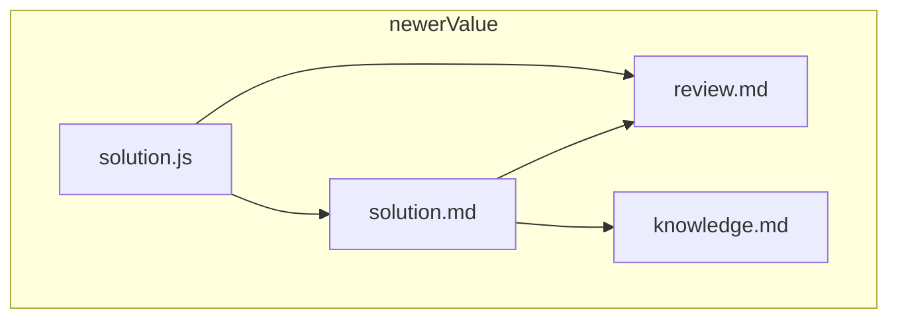
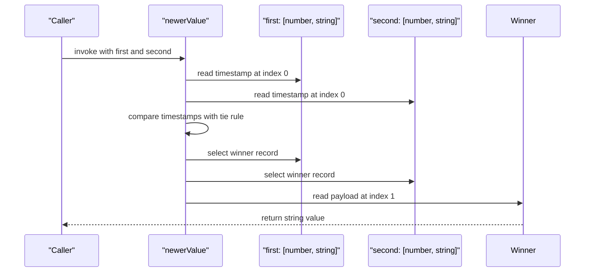
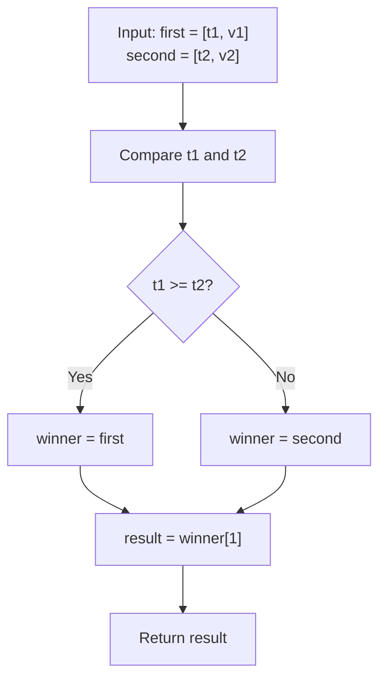
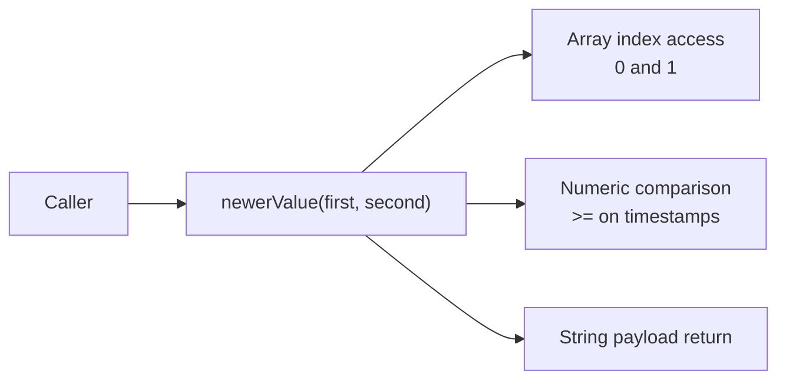

# newerValue — Record Selection with Tie-Breaking

<cite>
**Referenced Files in This Document**
- [solution.js](file://newerValue/solution.js)
- [solution.md](file://newerValue/solution.md)
- [knowledge.md](file://newerValue/knowledge.md)
- [review.md](file://newerValue/review.md)
</cite>

## Table of Contents
1. [Introduction](#introduction)
2. [Problem Statement and Contract](#problem-statement-and-contract)
3. [Project Structure](#project-structure)
4. [Architecture Overview](#architecture-overview)
5. [Detailed Component Analysis](#detailed-component-analysis)
6. [Dependency Analysis](#dependency-analysis)
7. [Performance Considerations](#performance-considerations)
8. [Troubleshooting Guide](#troubleshooting-guide)
9. [Conclusion](#conclusion)

## Introduction
The `newerValue` algorithm solves a small but representative selection problem: given two timestamped records, return the payload of the more recent one, and return the first record's payload when timestamps are equal. Each input is a two-element array whose first element is a numeric timestamp and whose second element is a string payload. The function returns that payload as a string.

This document explains the problem statement, input/output contract, solution approach, tie-breaking semantics, edge cases, complexity, and broader algorithmic concepts such as separating key fields from payloads, implementing custom tie-breaking rules, and choosing between predefined alternatives rather than computing an extremum. It also connects the pattern to database query selection strategies and API response routing logic.

## Problem Statement and Contract
The function receives two updates, each represented as `[timestamp, value]`. The timestamp is an integer in the range `[0, 1000]`; the value is a string up to 20 characters long, including the empty string. The goal is to return the value associated with the update having the larger timestamp. If both timestamps are equal, the first argument wins.

| Aspect | Specification |
|---|---|
| Input `first` | Two-element array `[number, string]` |
| Input `second` | Two-element array `[number, string]` |
| Timestamp range | Integer in `[0, 1000]` |
| Value length | Up to 20 characters; empty string is valid |
| Comparison field | Index `0`, interpreted as timestamp |
| Payload field | Index `1`, interpreted as string value |
| Return type | String |
| Tie rule | Equal timestamps → return the first argument's value |
| Ordering assumption | Argument position does not imply chronological order |

**Section sources**
- [solution.md:3-22](file://newerValue/solution.md#L3-L22)
- [solution.js:1-5](file://newerValue/solution.js#L1-L5)

## Project Structure
The `newerValue` module consists of four files:

| File | Purpose |
|---|---|
| `solution.js` | Implementation of the `newerValue` function. |
| `solution.md` | Formal problem description, constraints, pseudocode, implementation notes, complexity analysis, test coverage, and key takeaways. |
| `knowledge.md` | Reusable knowledge about positional versus domain order, record selection, tie-breaking operators, and truthiness pitfalls. |
| `review.md` | Verification summary, correctness checks, edge-case results, performance assessment, code-quality observations, and recommended changes. |



**Diagram sources**
- [solution.js:1-5](file://newerValue/solution.js#L1-L5)
- [solution.md:1-147](file://newerValue/solution.md#L1-L147)
- [knowledge.md:1-58](file://newerValue/knowledge.md#L1-L58)
- [review.md:1-61](file://newerValue/review.md#L1-L61)

## Architecture Overview
At a conceptual level, `newerValue` is a pure selection function with no external dependencies. It takes two typed records, applies a domain-specific ordering rule (timestamp-based), enforces a deterministic tie-breaker (positional first), and returns a value extracted from the chosen record.



**Diagram sources**
- [solution.js:1-5](file://newerValue/solution.js#L1-L5)
- [solution.md:3-13](file://newerValue/solution.md#L3-L13)

This diagram maps directly to the actual function call flow: two inputs arrive, their timestamps are compared, a record is selected, and its payload is returned.

## Detailed Component Analysis

### Solution Approach
The implementation selects the winning record by comparing `first[0]` and `second[0]`, then reads `returnValue[1]` to extract the payload.

Key design decisions:

- **Comparison key**: index `0` holds the timestamp used for ordering.
- **Payload extraction**: index `1` holds the string value returned to the caller.
- **Tie-breaking operator**: `>=` makes the first record win when timestamps are equal.
- **Selection before extraction**: the function chooses the whole record first, avoiding premature focus on the payload.
- **No truthiness fallback**: the payload is indexed directly so empty strings remain valid results.



**Diagram sources**
- [solution.js:1-5](file://newerValue/solution.js#L1-L5)
- [knowledge.md:11-22](file://newerValue/knowledge.md#L11-L22)

**Section sources**
- [solution.js:1-5](file://newerValue/solution.js#L1-L5)
- [solution.md:23-47](file://newerValue/solution.md#L23-L47)
- [knowledge.md:11-22](file://newerValue/knowledge.md#L11-L22)

### Positional Ordering vs Domain-Specific Ordering
A central insight is that “first” in the specification refers to the positional first argument, not the chronologically earlier record. For example, calling the function with the numerically older timestamp as the first argument can still produce the first argument’s value because it is newer.

| Order | Meaning | Example implication |
|---|---|---|
| Positional | Where the value appears in the function signature | `first` is parameter position one |
| Temporal / logical | Which event happened later | Larger timestamp means newer |
| Traversal | Loop or iteration order | Not relevant here since there is no loop |

This distinction matters because a naive reader might assume `first` is always chronologically earlier, which the examples explicitly contradict.

**Section sources**
- [knowledge.md:3-10](file://newerValue/knowledge.md#L3-L10)
- [solution.md:3-13](file://newerValue/solution.md#L3-L13)

### Tie-Breaking Semantics
The tie rule is encoded by the combination of operator and operand order. With `first` tested first, using `>=` keeps `first` when timestamps match. Using `>` would instead hand ties to `second`.

| Requirement | Expression | Tie goes to |
|---|---|---|
| Newer wins, ties → first | `first[0] >= second[0] ? first : second` | first |
| Newer wins, ties → second | `first[0] > second[0] ? first : second` | second |
| Alternative form | `second[0] > first[0] ? second : first` | first on equality |

The equality case is the only input that discriminates between `>=` and `>`, making it the essential probe for verifying the intended tie-breaking behavior.

**Section sources**
- [knowledge.md:23-36](file://newerValue/knowledge.md#L23-L36)
- [solution.md:31-47](file://newerValue/solution.md#L31-L47)
- [review.md:16-28](file://newerValue/review.md#L16-L28)

### Concrete Examples from the Repository
The repository documents several concrete calls and expected outputs:

| Call | Expected Result | Reason |
|---|---:|---|
| `[10, "ready"], [12, "busy"]` | `"busy"` | Second timestamp is larger. |
| `[20, "online"], [15, "offline"]` | `"online"` | First timestamp is larger. |
| `[5, "first"], [5, "second"]` | `"first"` | Timestamps are equal; first wins. |
| `[0, "x"], [1, ""]` | `""` | Newer record has an empty string payload. |
| `[0, ""], [0, "x"]` | `""` | Tie goes to first; first payload is empty. |
| `[7, ""], [7, ""]` | `""` | Both timestamps tie and both payloads are empty. |
| `[0, "min"], [1000, "max"]` | `"max"` | Upper-bound newer timestamp wins. |
| `[1000, "max"], [0, "min"]` | `"max"` | Upper-bound older timestamp loses. |

These cases verify strict ordering, positional-first tie-breaking, empty-string payloads, and boundary timestamps.

**Section sources**
- [solution.md:7-13](file://newerValue/solution.md#L7-L13)
- [solution.md:96-118](file://newerValue/solution.md#L96-L118)
- [review.md:29-53](file://newerValue/review.md#L29-L53)

### Algorithmic Concepts

#### Separating Key Fields from Payload Data
Each record stores two different kinds of information at fixed indices. Index `0` is the sort key; index `1` is the data returned to the caller. Mixing these indices is a common defect. The correct decomposition is:

```text
winner = compare(items) ? itemA : itemB
result = winner.payload
```

This separation ensures the comparison operates on timestamps while the return value comes from payloads.

**Section sources**
- [knowledge.md:11-22](file://newerValue/knowledge.md#L11-L22)
- [solution.md:23-30](file://newerValue/solution.md#L23-L30)

#### Implementing Custom Tie-Breaking Rules
Tie-breaking is not just a detail of the comparison operator; it is a contract requirement. The same “newer wins” rule can yield different answers depending on whether ties go to the first or second record. Test the equality case explicitly to prove the intended rule.

**Section sources**
- [knowledge.md:23-36](file://newerValue/knowledge.md#L23-L36)
- [review.md:16-28](file://newerValue/review.md#L16-L28)

#### Selecting Between Alternatives Versus Computing an Extremum
Functions like `Math.max(a[0], b[0])` compute an extremum value, not the record that produced it. When the answer requires associated data, selection is the correct primitive. Here, we need the payload attached to the newer timestamp, not merely the largest timestamp itself.

**Section sources**
- [knowledge.md:37-43](file://newerValue/knowledge.md#L37-L43)
- [solution.md:31-47](file://newerValue/solution.md#L31-L47)

#### Truthiness Pitfalls with Empty Strings
An empty string is valid data. Patterns such as `a || b` or conditional truthiness checks can replace a legitimate empty payload with another value. The implementation avoids this by indexing the selected record directly.

**Section sources**
- [knowledge.md:44-49](file://newerValue/knowledge.md#L44-L49)
- [solution.md:38-47](file://newerValue/solution.md#L38-L47)
- [review.md:16-28](file://newerValue/review.md#L16-L28)

### Reference Semantics and Immutability
The function returns `returnValue[1]`, where `returnValue` references one of the input arrays. No copy is made. This is safe under the stated contract because nothing mutates the returned string, and the original records are not mutated either. Copying would add unnecessary work and could hide missing immutability conventions.

**Section sources**
- [knowledge.md:50-54](file://newerValue/knowledge.md#L50-L54)
- [review.md:44-53](file://newerValue/review.md#L44-L53)

### Code Quality Observations
The review identifies behavioral correctness but suggests readability improvements:

| Recommendation | Rationale |
|---|---|
| Use `const` for the selected record | The binding is assigned once and never reassigned. |
| Rename `returnValue` to `winner` or `newerUpdate` | The variable holds a record, not the final string value. |
| Add a trailing semicolon after the ternary assignment | Improves consistency with the following `return` statement. |
| Optionally inline the ternary into `return` | Shorter, but hides the explicit select-then-extract structure. |

These changes do not alter behavior.

**Section sources**
- [review.md:44-61](file://newerValue/review.md#L44-L61)
- [solution.md:78-94](file://newerValue/solution.md#L78-L94)

## Dependency Analysis
`newerValue` has no external runtime dependencies beyond JavaScript language primitives. Its internal dependency chain is minimal:



There are no circular dependencies, no imports, and no side effects.

**Diagram sources**
- [solution.js:1-5](file://newerValue/solution.js#L1-L5)

**Section sources**
- [solution.js:1-5](file://newerValue/solution.js#L1-L5)

## Performance Considerations
The algorithm performs exactly one numeric comparison and one array index read before returning the payload. There are no loops, recursion, allocations, or copies.

| Metric | Complexity | Explanation |
|---|---:|---|
| Time | O(1) | Constant number of comparisons and index reads. |
| Space | O(1) | One local binding referencing an existing input array; no new storage. |

Because the decision depends only on the two timestamps, any correct algorithm must examine them; O(1) time is optimal.

**Section sources**
- [review.md:40-43](file://newerValue/review.md#L40-L43)
- [solution.md:100-107](file://newerValue/solution.md#L100-L107)

## Troubleshooting Guide

### Common Defects
| Symptom | Likely Cause | Fix |
|---|---|---|
| Wrong record on ties | Used `>` instead of `>=` with `first` as the left operand. | Change the operator so the first record wins on equality. |
| Returns timestamp instead of value | Returned the maximum timestamp or confused key and payload indices. | Select the record first, then return index `1`. |
| Empty string replaced unexpectedly | Used truthiness fallback such as `a || b`. | Return the payload by direct indexing. |
| Assumed first argument is chronologically older | Confused positional order with temporal order. | Treat arguments as unordered pairs and compare timestamps. |
| Name confusion around intermediate variables | Variable named `returnValue` actually holds a record. | Rename to `winner` or similar to reflect its type. |

### Recommended Tests
Use the equality case to discriminate between `>=` and `>`:

- `[5, "first"], [5, "second"]` should return `"first"`.
- `[0, ""], [0, "x"]` should return `""`.
- `[7, ""], [7, ""]` should return `""`.

Also verify reverse ordering and empty-string payloads:

- `[20, "online"], [15, "offline"]` should return `"online"`.
- `[10, "ready"], [12, "busy"]` should return `"busy"`.
- `[0, "x"], [1, ""]` should return `""`.
- `[0, "min"], [1000, "max"]` should return `"max"`.

**Section sources**
- [knowledge.md:37-54](file://newerValue/knowledge.md#L37-L54)
- [solution.md:96-118](file://newerValue/solution.md#L96-L118)
- [review.md:29-53](file://newerValue/review.md#L29-L53)

## Conclusion
The `newerValue` algorithm demonstrates a clean pattern for record selection with explicit tie-breaking semantics. It separates the comparison key from the payload, encodes the tie rule through the comparison operator and operand order, and returns the selected payload without truthiness interference. Its time and space complexity are optimal at O(1).

Beyond this specific function, the same pattern appears widely:

- **Database queries:** selecting the latest row per group often requires comparing timestamps and applying a tie rule such as primary-key order.
- **API response routing:** choosing between cached and live responses may involve comparing timestamps and returning the appropriate payload.
- **Event processing:** picking the most recent event among competing candidates requires distinguishing key fields from payload fields and defining deterministic tie-breaking behavior.

The repository’s documentation and verified tests confirm that the current implementation satisfies the specification, handles all documented edge cases, and remains simple enough to extend safely as requirements evolve.