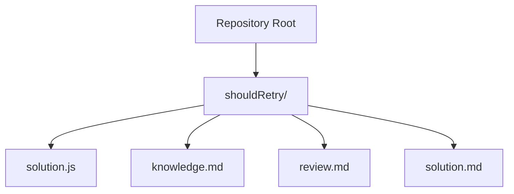
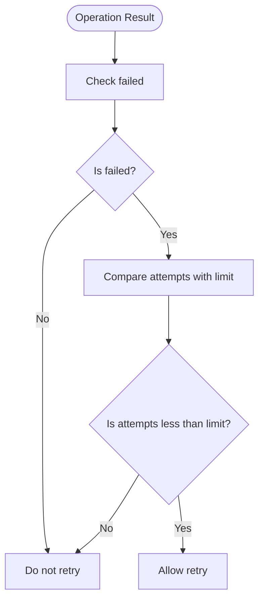
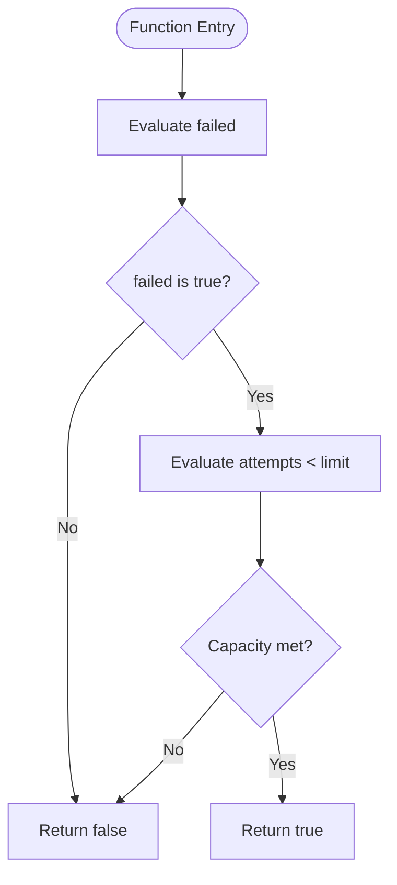
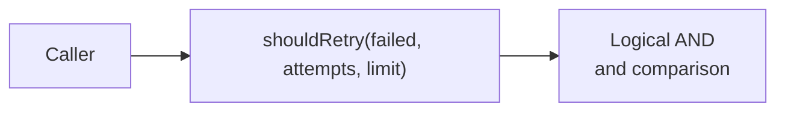

# shouldRetry — Retry Policy Gating

<cite>
**Referenced Files in This Document**
- [shouldRetry/solution.js](file://shouldRetry/solution.js)
- [shouldRetry/knowledge.md](file://shouldRetry/knowledge.md)
- [shouldRetry/review.md](file://shouldRetry/review.md)
- [shouldRetry/solution.md](file://shouldRetry/solution.md)
</cite>

## Table of Contents
1. [Introduction](#introduction)
2. [Project Structure](#project-structure)
3. [Core Components](#core-components)
4. [Architecture Overview](#architecture-overview)
5. [Detailed Component Analysis](#detailed-component-analysis)
6. [Dependency Analysis](#dependency-analysis)
7. [Performance Considerations](#performance-considerations)
8. [Troubleshooting Guide](#troubleshooting-guide)
9. [Conclusion](#conclusion)
10. [Appendices](#appendices)

## Introduction
This document explains the `shouldRetry` algorithm, which gates retry behavior using a simple but important policy: an operation should be retried only when it failed, and the current number of attempts is still below the allowed limit. The function returns a boolean that can be used directly by retry loops, task schedulers, or policy engines to decide whether another attempt is permitted.

The core idea is predicate composition: combine a failure indicator with a capacity check through logical AND so that both conditions must hold for retry to proceed. This pattern generalizes well to other policy checks such as authorization rules, validation pipelines, and rate-limiting decisions.

## Project Structure
The `shouldRetry` feature lives in its own directory alongside supporting documentation files:



**Diagram sources**
- [shouldRetry/solution.js](file://shouldRetry/solution.js)
- [shouldRetry/knowledge.md](file://shouldRetry/knowledge.md)
- [shouldRetry/review.md](file://shouldRetry/review.md)
- [shouldRetry/solution.md](file://shouldRetry/solution.md)

**Section sources**
- [shouldRetry/solution.js](file://shouldRetry/solution.js)
- [shouldRetry/knowledge.md](file://shouldRetry/knowledge.md)
- [shouldRetry/review.md](file://shouldRetry/review.md)
- [shouldRetry/solution.md](file://shouldRetry/solution.md)

## Core Components
The primary component is the `shouldRetry` function itself. It encapsulates the retry policy gate and exposes a single, predictable contract:

| Parameter | Type   | Meaning                                                                                      |
|-----------|--------|----------------------------------------------------------------------------------------------|
| `failed`  | boolean | Whether the last operation execution resulted in failure.                                    |
| `attempts`| number  | How many times the operation has already been attempted; usually zero-based or one-based depending on caller convention. |
| `limit`   | number  | Maximum allowed attempts before retry is no longer permitted.                                |
| Return    | boolean | `true` means another attempt is allowed; `false` means stop retrying.                         |

The return value is designed for direct use in conditionals and loop guards without further transformation.

**Section sources**
- [shouldRetry/solution.js](file://shouldRetry/solution.js)

## Architecture Overview
At runtime, `shouldRetry` participates in a small decision pipeline:



This flow highlights short-circuit evaluation: if the operation did not fail, there is no need to inspect attempt counts because retry cannot be justified.

**Diagram sources**
- [shouldRetry/solution.js](file://shouldRetry/solution.js)

**Section sources**
- [shouldRetry/solution.js](file://shouldRetry/solution.js)

## Detailed Component Analysis

### Problem Statement
Determine whether an operation may be retried based on three simultaneous requirements:
- The operation must have failed.
- The current attempt count must still be under the configured limit.
- Both conditions must hold at the same time.

If any requirement is false, retry must be denied.

### Input Contract
The function accepts:
- `failed`: boolean indicating failure status.
- `attempts`: numeric attempt counter.
- `limit`: numeric maximum attempt threshold.

It returns a boolean:
- `true` → retry is allowed.
- `false` → retry is denied.

### Solution Approach: Logical AND Composition
The retry rule composes two predicates:
1. Failure predicate: `failed` is true.
2. Capacity predicate: `attempts < limit`.

These are combined with logical AND. Because JavaScript evaluates logical expressions left-to-right and stops as soon as the result is determined, this implementation benefits from short-circuit evaluation. If `failed` is false, the capacity check is skipped entirely.

#### Implementation Flow


**Diagram sources**
- [shouldRetry/solution.js](file://shouldRetry/solution.js)

#### Concrete Code Example Reference
The implementation follows the described flow. See:
- [shouldRetry/solution.js](file://shouldRetry/solution.js)

For usage examples and test-oriented references, see:
- [shouldRetry/solution.md](file://shouldRetry/solution.md)

### Optimization Opportunities

#### Eliminate Redundant Boolean Assignments
A common anti-pattern is to assign the result of a comparison to a temporary variable solely to return it later. For example:

```javascript
let ok = attempts < limit;
return ok;
```

This adds an unnecessary assignment and intermediate storage. A cleaner form returns the comparison directly:

```javascript
return attempts < limit;
```

In the context of `shouldRetry`, after confirming failure, the function can return the result of the capacity check directly instead of storing it in a separate variable.

#### Prefer Direct Comparison Returns
Instead of:

```javascript
if (attempts < limit) {
  return true;
} else {
  return false;
}
```

Prefer returning the comparison expression itself. This reduces branching, clarifies intent, and makes the predicate easier to reason about.

#### Simplify Complex Boolean Expressions
When composing multiple policies, prefer readable predicate functions composed with logical operators rather than deeply nested conditionals. Examples include:
- Authorization: `hasPermission && roleAllowed && resourceAccessible`
- Validation: `isPresent && isValidFormat && meetsPolicy`
- Rate limiting: `underQuota && withinWindow && notThrottled`

This approach keeps each predicate focused, testable, and reusable.

**Section sources**
- [shouldRetry/solution.js](file://shouldRetry/solution.js)
- [shouldRetry/solution.md](file://shouldRetry/solution.md)

### Common Pitfalls in Predicate Composition

| Pitfall                          | Why It Is Problematic                                                   | Recommended Fix                                                |
|----------------------------------|------------------------------------------------------------------------|----------------------------------------------------------------|
| Wrong operator order             | May change semantics or lose short-circuit benefits.                   | Put cheaper or more selective predicates first.                |
| Using bitwise OR/AND             | Operates on numbers and coerces booleans; unsafe for policy logic.     | Use logical `&&` and `||`.                                     |
| Implicit coercion                | Values like `0`, `""`, or `null` can coerce unexpectedly.              | Keep explicit boolean types where possible.                    |
| Overcomplicated conditionals     | Hard to read, hard to test, easy to get wrong.                         | Extract named predicates and compose them logically.           |
| Not documenting attempt semantics | Callers may misinterpret zero-based vs one-based counters.             | Clarify whether `attempts` counts past attempts or total tries. |
| Ignoring non-positive limits     | Invalid configuration can produce surprising results.                  | Validate `limit` and handle edge cases explicitly.             |

**Section sources**
- [shouldRetry/review.md](file://shouldRetry/review.md)

### Time and Space Complexity
- Time complexity: **O(1)**. The function performs a constant number of comparisons and logical operations.
- Space complexity: **O(1)**. No additional data structures are allocated beyond primitive inputs and return values.

**Section sources**
- [shouldRetry/knowledge.md](file://shouldRetry/knowledge.md)

## Dependency Analysis
`shouldRetry` is intentionally self-contained. Its dependencies are minimal:



There are no external libraries, side effects, or shared mutable state. This makes the function highly portable and safe to reuse across retry loops, schedulers, middleware, and policy evaluators.

**Diagram sources**
- [shouldRetry/solution.js](file://shouldRetry/solution.js)

**Section sources**
- [shouldRetry/solution.js](file://shouldRetry/solution.js)

## Performance Considerations
- Short-circuit evaluation avoids unnecessary work when the operation succeeded.
- Primitive comparisons are extremely fast and predictable.
- Avoid wrapping the call in extra layers unless required by architecture; keep the hot path lean.
- When composing multiple retry policies, evaluate the most selective predicate first to reduce average cost.

[No sources needed since this section provides general guidance]

## Troubleshooting Guide

### Symptom: Retry Always Stops
Possible causes:
- `failed` is always false.
- `attempts` is already equal to or greater than `limit`.
- Attempt counting is off-by-one relative to the caller’s expectation.

Actions:
- Verify the failure signal from the upstream operation.
- Inspect `attempts` and `limit` values at the call site.
- Confirm whether `attempts` represents past attempts or total planned attempts.

Reference:
- [shouldRetry/review.md](file://shouldRetry/review.md)

### Symptom: Retry Keeps Running Beyond Expectation
Possible causes:
- `limit` is too large or undefined.
- `attempts` is not incremented correctly.
- The caller retries even when `shouldRetry` returns false.

Actions:
- Add logging around the retry decision.
- Enforce valid ranges for `limit`.
- Ensure the retry loop uses `shouldRetry` as its guard.

Reference:
- [shouldRetry/review.md](file://shouldRetry/review.md)

### Symptom: Confusing Behavior with Non-Boolean Inputs
Possible causes:
- `failed` is being passed as a string, number, or object.
- `attempts` or `limit` are strings or `NaN`.

Actions:
- Normalize inputs at the boundary layer.
- Add type assertions or validation where the function is called.
- Prefer explicit boolean parameters for clarity.

Reference:
- [shouldRetry/knowledge.md](file://shouldRetry/knowledge.md)

## Conclusion
`shouldRetry` demonstrates how a clear business rule can be expressed as a small, efficient predicate. By combining failure detection with a capacity check through logical AND, it provides a reliable gate for retry logic while benefiting from short-circuit evaluation. The same composition pattern scales to broader policy systems, including authorization, validation, and rate limiting. Keeping the implementation simple, explicit, and free of redundant assignments improves readability, performance, and maintainability.

[No sources needed since this section summarizes without analyzing specific files]

## Appendices

### API Summary
- Function name: `shouldRetry`
- Parameters:
  - `failed`: boolean
  - `attempts`: number
  - `limit`: number
- Returns: boolean
- Side effects: none
- Complexity: O(1) time, O(1) space

Reference:
- [shouldRetry/solution.js](file://shouldRetry/solution.js)
- [shouldRetry/knowledge.md](file://shouldRetry/knowledge.md)

### Usage Pattern Reference
Use `shouldRetry` as the guard for retry loops:
- Compute `failed` from the operation result.
- Track `attempts` incrementally.
- Configure `limit` according to business policy.
- Continue retrying only when `shouldRetry(failed, attempts, limit)` is true.

Reference:
- [shouldRetry/solution.md](file://shouldRetry/solution.md)