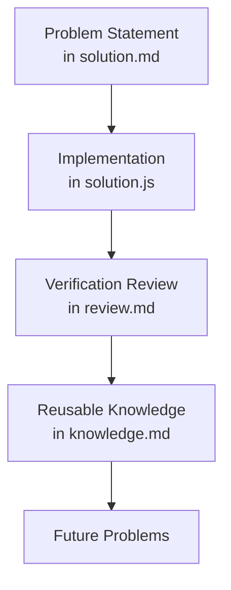
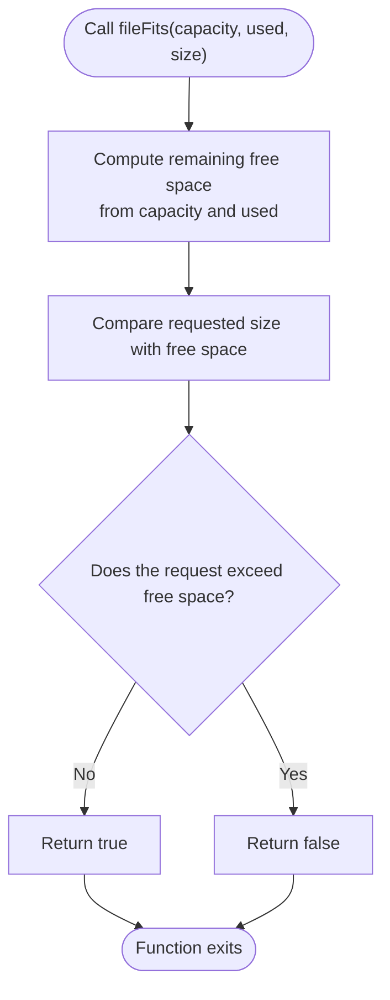
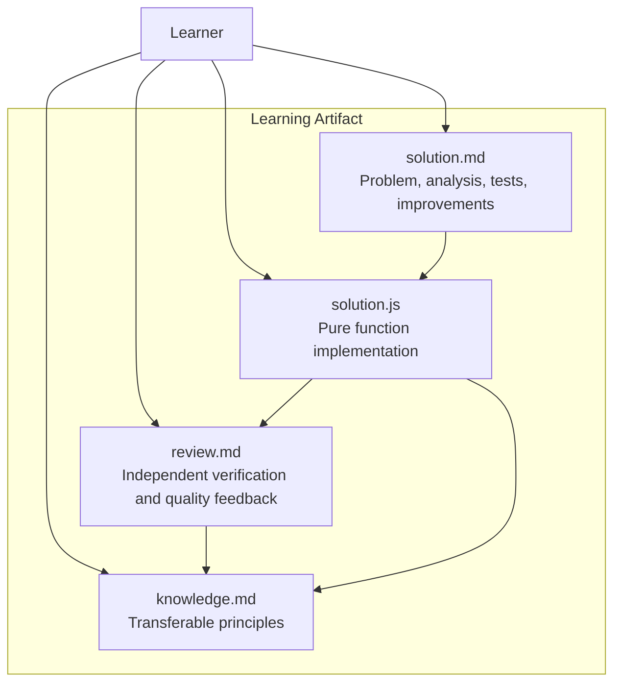
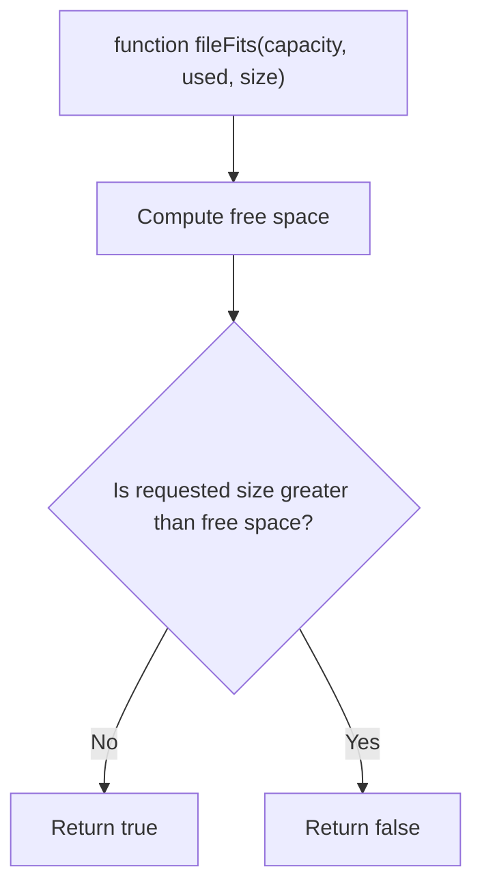
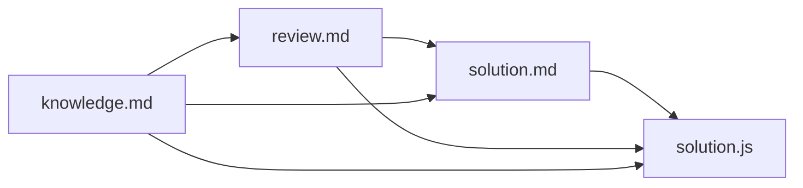

# Project Overview

<cite>
**Referenced Files in This Document**
- [solution.js](file://fileFits/solution.js)
- [solution.md](file://fileFits/solution.md)
- [review.md](file://fileFits/review.md)
- [knowledge.md](file://fileFits/knowledge.md)
</cite>

## Table of Contents
1. [Introduction](#introduction)
2. [Project Structure](#project-structure)
3. [Core Components](#core-components)
4. [Architecture Overview](#architecture-overview)
5. [Detailed Component Analysis](#detailed-component-analysis)
6. [Dependency Analysis](#dependency-analysis)
7. [Performance Considerations](#performance-considerations)
8. [Troubleshooting Guide](#troubleshooting-guide)
9. [Conclusion](#conclusion)
10. [Appendices](#appendices)

## Introduction
This repository is an educational exercise that documents how to solve a simple boundary-comparison problem in JavaScript and, more importantly, how to learn from it. The project asks one clear question: given a drive with a known total capacity and some already used space, can a new file fit? The solution is modeled as the pure function `fileFits(capacity, used, size)`, which returns a boolean indicating whether writing the file would exceed the drive’s limit.

The purpose goes beyond producing working code. It shows learners how to move from natural-language requirements — such as “filling the drive exactly is allowed” — into precise algorithmic decisions like choosing an inclusive comparison operator. It also demonstrates a repeatable learning workflow: read the problem, study the implementation, execute documented test cases, and extract transferable principles for future problems.

The target audience includes beginners who are transitioning from reading English-style specifications to writing deterministic code, as well as intermediate learners who want to practice extracting reusable patterns from small, self-contained exercises.

## Project Structure
The project consists of four complementary files organized under `fileFits/`:

| File | Role | Audience and Use |
|---|---|---|
| `solution.js` | Implementation of the single pure function `fileFits` | Read to see the concrete JavaScript decision logic. |
| `solution.md` | Problem record and analysis | Read first to understand the requirement, constraints, reasoning, complexity, edge cases, and improvement suggestions. |
| `review.md` | Independent verification review | Read after studying the implementation to see executed test results and code-quality feedback. |
| `knowledge.md` | Reusable knowledge | Read last to extract generalizable principles for other boundary-comparison problems. |

**Diagram sources**
- [solution.md:1-138](file://fileFits/solution.md#L1-L138)
- [solution.js:1-10](file://fileFits/solution.js#L1-L10)
- [review.md:1-67](file://fileFits/review.md#L1-L67)
- [knowledge.md:1-50](file://fileFits/knowledge.md#L1-L50)

**Section sources**
- [solution.md:1-138](file://fileFits/solution.md#L1-L138)
- [solution.js:1-10](file://fileFits/solution.js#L1-L10)
- [review.md:1-67](file://fileFits/review.md#L1-L67)
- [knowledge.md:1-50](file://fileFits/knowledge.md#L1-L50)

## Core Components
The project centers on one function:

- **Function:** `fileFits(capacity, used, size)`
- **Inputs:**
  - `capacity`: total drive capacity in megabytes.
  - `used`: space already occupied on the drive.
  - `size`: size of the file to write.
- **Output:** `true` if the file fits without exceeding capacity; otherwise `false`.
- **Real-world mapping:** Think of `capacity` as the storage quota, `used` as what has already been written, and `size` as the incoming data. The function answers whether the system should accept or reject the write operation based solely on available space.

The implementation computes free space by subtracting `used` from `capacity` and compares the requested `size` against that remainder. The exact-fill rule means equality is accepted, so the correct boundary comparison is inclusive.

**Diagram sources**
- [solution.js:1-10](file://fileFits/solution.js#L1-L10)
- [solution.md:20-40](file://fileFits/solution.md#L20-L40)

**Section sources**
- [solution.js:1-10](file://fileFits/solution.js#L1-L10)
- [solution.md:1-40](file://fileFits/solution.md#L1-L40)

## Architecture Overview
At a high level, this project is not a runtime application but a learning artifact. Its “architecture” describes how four files cooperate to support one complete learning cycle.

**Diagram sources**
- [solution.js:1-10](file://fileFits/solution.js#L1-L10)
- [solution.md:1-138](file://fileFits/solution.md#L1-L138)
- [review.md:1-67](file://fileFits/review.md#L1-L67)
- [knowledge.md:1-50](file://fileFits/knowledge.md#L1-L50)

The flow emphasizes that correctness is not assumed from a single source. The implementation is analyzed in `solution.md`, independently verified in `review.md`, and distilled into reusable ideas in `knowledge.md`.

**Section sources**
- [solution.md:1-138](file://fileFits/solution.md#L1-L138)
- [review.md:1-67](file://fileFits/review.md#L1-L67)

## Detailed Component Analysis

### Pure Function: `fileFits`
The implementation exposes a single entry point with no side effects, no global state, and no external dependencies. This makes it easy to reason about, test, and reuse.

Key responsibilities:
- Accept three numeric inputs representing storage capacity, current usage, and the requested file size.
- Decide whether adding the file would violate the capacity constraint.
- Return a boolean result directly tied to the business rule.

**Diagram sources**
- [solution.js:1-10](file://fileFits/solution.js#L1-L10)

#### Correctness Notes
- The inclusive comparison handles the exact-fill case correctly.
- The zero-size file does not require a special branch because the invariant `used ≤ capacity` guarantees that free space is non-negative.
- No defensive validation is needed for negative values or over-committed drives because the problem statement constrains those inputs.

#### Code Quality Notes
- The current implementation assigns `true` or `false` through an `if/else` block before returning a variable. This pattern is logically correct but redundant in JavaScript because the comparison itself produces a boolean.
- The recommended simplification is to return the comparison expression directly, preserving the same logic while removing unnecessary mutable state.

**Section sources**
- [solution.js:1-10](file://fileFits/solution.js#L1-L10)
- [solution.md:40-80](file://fileFits/solution.md#L40-L80)
- [review.md:35-67](file://fileFits/review.md#L35-L67)

### Problem Record: `solution.md`
This file is the primary learning document. It translates natural-language requirements into a precise algorithmic condition and validates that understanding through examples, pseudocode, complexity analysis, and edge cases.

Highlights:
- Defines the input/output contract clearly.
- Explains why the inclusive boundary matters.
- Shows equivalent formulations of the core condition.
- Lists executed edge cases, including minimum bounds, maximum bounds, full drives, and zero-size files.
- Recommends a stylistic simplification without changing algorithmic behavior.

**Section sources**
- [solution.md:1-138](file://fileFits/solution.md#L1-L138)

### Verification Review: `review.md`
This file acts as an independent checker. It confirms correctness, documents executed test outcomes, analyzes performance, and identifies code-quality improvements.

Highlights:
- Confirms all nine test cases pass.
- Validates the boundary comparison and free-space computation.
- Identifies boolean laundering as a learning opportunity rather than a correctness defect.
- Recommends returning the comparison directly instead of using an intermediate variable.

**Section sources**
- [review.md:1-67](file://fileFits/review.md#L1-L67)

### Reusable Knowledge: `knowledge.md`
This file extracts principles that apply beyond this specific problem. It is designed to be referenced when solving later problems involving limits, quotas, budgets, or thresholds.

Highlights:
- Maps requirement wording to comparison operators.
- Warns against unnecessary boolean laundering in JavaScript and related languages.
- Encourages using guaranteed invariants to avoid defensive branches.
- Provides a decision checklist for “does X fit” problems.

**Section sources**
- [knowledge.md:1-50](file://fileFits/knowledge.md#L1-L50)

## Dependency Analysis
Because this is a small educational project, dependencies are minimal and intentional:

- `solution.js` depends only on JavaScript language semantics.
- `solution.md` references and explains `solution.js`.
- `review.md` independently verifies `solution.js` and comments on its style.
- `knowledge.md` generalizes lessons learned from both the implementation and the review.

**Diagram sources**
- [solution.js:1-10](file://fileFits/solution.js#L1-L10)
- [solution.md:1-138](file://fileFits/solution.md#L1-L138)
- [review.md:1-67](file://fileFits/review.md#L1-L67)
- [knowledge.md:1-50](file://fileFits/knowledge.md#L1-L50)

There are no circular runtime dependencies. The conceptual dependency is pedagogical: the review and knowledge files depend on having understood both the problem and the implementation.

**Section sources**
- [solution.js:1-10](file://fileFits/solution.js#L1-L10)
- [solution.md:1-138](file://fileFits/solution.md#L1-L138)
- [review.md:1-67](file://fileFits/review.md#L1-L67)
- [knowledge.md:1-50](file://fileFits/knowledge.md#L1-L50)

## Performance Considerations
The function performs a constant number of arithmetic and relational operations, so its time complexity is O(1). It uses no arrays, maps, recursion, or I/O, so auxiliary space complexity is O(1). Because the decision depends on every input value, any correct algorithm must examine the relevant inputs at least once; therefore, this constant-time approach is optimal.

For learners, the important takeaway is not just that the solution is fast, but that simplicity is part of correctness here. Adding unnecessary validation or branching around impossible inputs would increase cognitive load without improving real behavior under the stated constraints.

[No sources needed since this section provides general guidance]

## Troubleshooting Guide
Common learner issues and how this project addresses them:

| Issue | How to resolve it | Where to look |
|---|---|---|
| Choosing `<` instead of `<=` | Remember that “filling exactly is allowed” requires an inclusive boundary. | [solution.md:1-40](file://fileFits/solution.md#L1-L40), [knowledge.md:1-20](file://fileFits/knowledge.md#L1-L20) |
| Writing a separate branch for zero-size files | Use the invariant `used ≤ capacity` to recognize that zero-size files always fit. | [solution.md:20-40](file://fileFits/solution.md#L20-L40), [knowledge.md:21-35](file://fileFits/knowledge.md#L21-L35) |
| Using `if/else` to convert a comparison into `true`/`false` | Return the comparison expression directly in JavaScript. | [solution.md:80-110](file://fileFits/solution.md#L80-L110), [review.md:45-67](file://fileFits/review.md#L45-L67), [knowledge.md:12-25](file://fileFits/knowledge.md#L12-L25) |
| Uncertain whether test coverage is sufficient | Check the executed cases covering minimum bounds, maximum bounds, exact fill, full drive, and zero-size requests. | [solution.md:100-138](file://fileFits/solution.md#L100-L138), [review.md:20-45](file://fileFits/review.md#L20-L45) |

**Section sources**
- [solution.md:1-138](file://fileFits/solution.md#L1-L138)
- [review.md:1-67](file://fileFits/review.md#L1-L67)
- [knowledge.md:1-50](file://fileFits/knowledge.md#L1-L50)

## Conclusion
This project demonstrates that even a very simple problem can teach valuable skills. The `fileFits` function models a realistic storage-capacity check, but the deeper goal is to show how to translate ambiguous natural-language rules into precise comparisons, verify those rules with boundary cases, and generalize the lesson into reusable knowledge.

By pairing the implementation with analysis, independent verification, and transferable principles, the repository encourages learners to build habits that scale to larger, more complex problems. The recommended next step is to use the decision checklist in `knowledge.md` when approaching similar “fit,” “quota,” or “threshold” problems in the future.

[No sources needed since this section summarizes without analyzing specific files]

## Appendices

### Learning Workflow Walkthrough
Use these steps to study the project effectively:

1. **Read the problem statement.** Open `solution.md` and identify the inputs, outputs, constraints, and especially the boundary rule about exact fills.
2. **Study the implementation.** Open `solution.js` and trace how `fileFits` converts the requirement into a comparison.
3. **Execute the documented tests.** Review the table of cases in `solution.md` and confirm the expected results described in `review.md`.
4. **Extract reusable patterns.** Read `knowledge.md` to capture the general principles for boundary comparisons and idiomatic boolean returns.
5. **Apply the checklist.** When facing a new “does X fit” problem, compute the resource state, choose the correct operator from the wording, and probe the exact-limit, one-unit-over, and zero-request boundaries.

**Section sources**
- [solution.md:1-138](file://fileFits/solution.md#L1-L138)
- [solution.js:1-10](file://fileFits/solution.js#L1-L10)
- [review.md:1-67](file://fileFits/review.md#L1-L67)
- [knowledge.md:1-50](file://fileFits/knowledge.md#L1-L50)