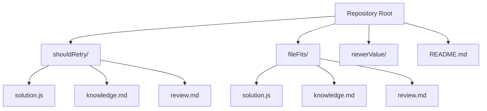
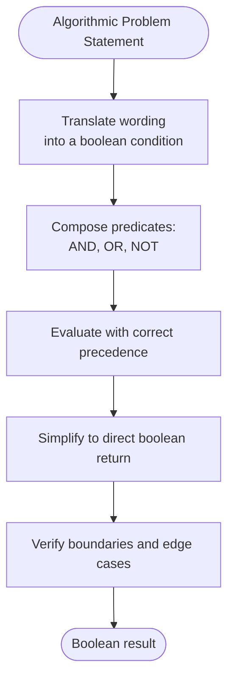
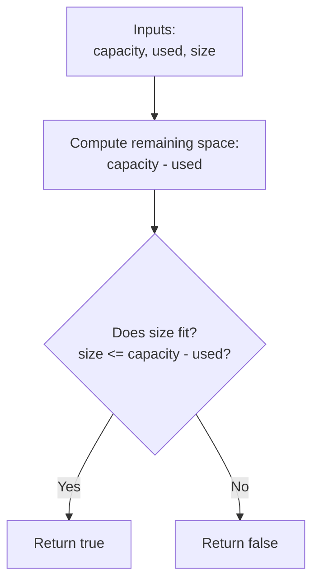
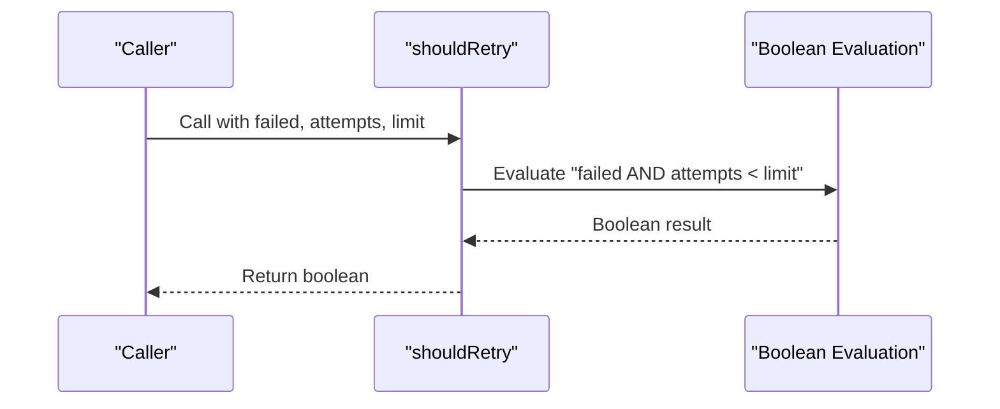
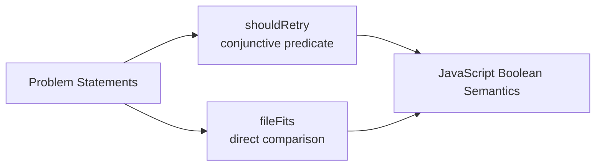

# Boolean Expression Patterns

<cite>
**Referenced Files in This Document**
- [README.md](file://README.md)
- [shouldRetry/solution.js](file://shouldRetry/solution.js)
- [shouldRetry/knowledge.md](file://shouldRetry/knowledge.md)
- [shouldRetry/review.md](file://shouldRetry/review.md)
- [fileFits/solution.js](file://fileFits/solution.js)
- [fileFits/knowledge.md](file://fileFits/knowledge.md)
- [fileFits/review.md](file://fileFits/review.md)
</cite>

## Table of Contents
1. [Introduction](#introduction)
2. [Project Structure](#project-structure)
3. [Core Components](#core-components)
4. [Architecture Overview](#architecture-overview)
5. [Detailed Component Analysis](#detailed-component-analysis)
6. [Dependency Analysis](#dependency-analysis)
7. [Performance Considerations](#performance-considerations)
8. [Troubleshooting Guide](#troubleshooting-guide)
9. [Conclusion](#conclusion)

## Introduction
This document focuses on practical patterns for simplifying and composing boolean logic in algorithmic problems. It is built around two concrete examples from the repository:

- `shouldRetry`: a retry-gating predicate that combines two conditions with logical AND.
- `fileFits`: a boundary-comparison function whose entire result is a direct boolean expression.

The goal is to help readers recognize when verbose conditional branches can be replaced by concise, readable boolean expressions, and to provide guidelines for avoiding common pitfalls such as unnecessary intermediate variables and operator-precedence confusion.

## Project Structure
Each problem lives in its own folder containing:

- A verbatim solution file.
- A structured write-up covering the problem, approach, complexity, and edge cases.
- An AI review highlighting correctness, edge cases, performance, and code quality.
- A reusable knowledge note distilling generalizable lessons.

**Diagram sources**
- [README.md:10-34](file://README.md#L10-L34)

**Section sources**
- [README.md:1-55](file://README.md#L1-L55)

## Core Components
This section summarizes the two core components relevant to boolean expression patterns.

### `shouldRetry` — Conjunctive Predicate Pattern
The original implementation uses an explicit branch to return `true` when both conditions hold, followed by a fallback `return false`. The condition is a conjunction:

- A failure has occurred.
- The number of attempts already made is still below the allowed limit.

The key simplification is to return the boolean expression directly instead of wrapping it in an `if` statement.

**Section sources**
- [shouldRetry/solution.js:1-8](file://shouldRetry/solution.js#L1-L8)
- [shouldRetry/review.md:1-74](file://shouldRetry/review.md#L1-L74)
- [shouldRetry/knowledge.md:1-54](file://shouldRetry/knowledge.md#L1-L54)

### `fileFits` — Direct Comparison Return Pattern
The original implementation assigns `true` or `false` to an intermediate variable inside an `if/else`, then returns that variable. The actual decision is simply whether the requested size fits into the remaining capacity.

The key simplification is to eliminate the intermediate variable and the branch entirely, returning the comparison expression itself.

**Section sources**
- [fileFits/solution.js:1-10](file://fileFits/solution.js#L1-L10)
- [fileFits/review.md:1-67](file://fileFits/review.md#L1-L67)
- [fileFits/knowledge.md:1-50](file://fileFits/knowledge.md#L1-L50)

## Architecture Overview
At a high level, these are small pure functions: they take numeric or boolean inputs, evaluate one or more boolean conditions, and return a boolean result. Their “architecture” is really a micro-pattern: translate natural-language requirements into a boolean expression, verify boundary behavior, and remove unnecessary control flow.

[No sources needed since this diagram shows conceptual workflow, not actual code structure]

## Detailed Component Analysis

### Pattern 1: Eliminate Redundant Boolean Assignments
#### What to look for
A boolean-laundering pattern occurs when code explicitly assigns `true` or `false` to a variable based on a condition, and then returns that variable. Typical forms include:

- An `if` branch setting a variable to `true` and an `else` branch setting it to `false`, followed by a return.
- A ternary returning `condition ? true : false`.
- An `if` that returns `true` and a trailing `return false`.

In all of these cases, the condition itself is already a boolean value. Returning or assigning the condition directly removes an unnecessary layer.

#### Example: `fileFits`
The original function computes remaining space as `capacity - used` and checks whether the requested `size` fits using `<=`. Instead of branching and storing the result in `returnVar`, the simplest form is to return the comparison directly.

**Diagram sources**
- [fileFits/solution.js:1-10](file://fileFits/solution.js#L1-L10)

#### Why this matters
- Fewer lines reduce the chance of accidentally changing one branch but not the other.
- The intent becomes clearer: the function’s job is to answer a yes/no question.
- There is no separate state to track; the value flows directly from input to output.

#### Guidelines
- If a branch only assigns `true` or `false` based on a condition, replace it with a direct return of that condition.
- Avoid naming variables like `result` or `returnVar` just to hold a boolean; prefer returning the expression itself.
- Keep ternaries when you must return non-boolean values, but not when you are merely choosing between `true` and `false`.

**Section sources**
- [fileFits/solution.js:1-10](file://fileFits/solution.js#L1-L10)
- [fileFits/knowledge.md:10-23](file://fileFits/knowledge.md#L10-L23)
- [fileFits/review.md:43-58](file://fileFits/review.md#L43-L58)

### Pattern 2: Compose Complex Predicates with Short-Circuit Evaluation
#### What to look for
When a requirement says something is allowed only when multiple conditions hold, use logical AND. When either alternative is sufficient, use logical OR. Negation applies to single conditions.

For retry-style policies, common wording includes:

- “Only retry if it failed and we have not reached the limit.”
- “Retry unless the attempt count equals the limit.”
- “Stop when the limit is reached.”

These map naturally to expressions such as `failed && attempts < limit`.

#### Example: `shouldRetry`
The original function returns `true` when both:

1. The last operation failed.
2. The current attempt count is strictly less than the limit.

After simplification, the function body becomes a direct return of the conjunction.

**Diagram sources**
- [shouldRetry/solution.js:1-8](file://shouldRetry/solution.js#L1-L8)

#### Short-circuit order
Logical AND short-circuits: if the left operand is false, the right operand is not evaluated. This is useful for safety and clarity:

- Put cheap or safety-critical checks first.
- Do not rely on short-circuiting to hide incorrect logic.
- In JavaScript, when both operands are booleans, `&&` returns a boolean, so it is safe to return directly.

#### Boundary semantics
The strict `<` operator is important here because reaching the limit means stopping. Equality belongs outside the allowed region. A discriminating test such as “attempts equal to limit” confirms whether `<` or `<=` is correct.

**Section sources**
- [shouldRetry/solution.js:1-8](file://shouldRetry/solution.js#L1-L8)
- [shouldRetry/knowledge.md:1-24](file://shouldRetry/knowledge.md#L1-L24)
- [shouldRetry/knowledge.md:25-54](file://shouldRetry/knowledge.md#L25-L54)
- [shouldRetry/review.md:14-29](file://shouldRetry/review.md#L14-L29)

### Pattern 3: Replace Verbose If-Else Chains with Concise Boolean Expressions
#### When simplification is possible
Simplification is appropriate when:

- Every branch returns exactly `true` or `false`.
- The branches collectively cover all possibilities.
- No additional side effects occur inside the branches.
- The condition is already a boolean expression.

#### When simplification is not appropriate
Do not collapse branches when:

- Branches return different non-boolean values.
- Branches perform unrelated work beyond computing a boolean.
- You need to handle distinct error paths with different messages or behaviors.
- The logic depends on ordering or side effects that would change under short-circuit evaluation.

#### Practice scenarios
Use these scenarios to practice transforming verbose conditionals into clean boolean expressions:

1. **Access gate:** Allow access if the user is logged in and their account is active.
   - Candidate expression: `loggedIn && active`
   - Pitfall: confusing `||` with `&&`; the policy requires both.

2. **Age-based eligibility:** Allow entry if the person is at least 18 or has parental consent.
   - Candidate expression: `age >= 18 || hasConsent`
   - Pitfall: treating `>=` as strict inequality.

3. **Capacity check:** Allow adding an item if its size is less than or equal to the remaining capacity.
   - Candidate expression: `size <= capacity - used`
   - Pitfall: forgetting that equality is allowed.

4. **Retry policy:** Retry only after a failure and before reaching the maximum attempt count.
   - Candidate expression: `failed && attempts < limit`
   - Pitfall: using `<=` and allowing retries at the exact limit.

5. **Exclusive-or-like rule:** Allow an action if exactly one of two flags is set.
   - Candidate expression: `(flagA && !flagB) || (!flagA && flagB)`
   - Pitfall: using `||` alone, which allows both flags.

6. **Negated guard:** Deny access unless the request is signed and not expired.
   - Candidate expression: `!signed || expired`
   - Pitfall: negating the wrong subexpression.

### Precedence and Parentheses
JavaScript evaluates relational operators such as `<`, `<=`, `>`, `>=` before logical operators like `&&` and `||`. This makes expressions like `failed && attempts < limit` safe without extra parentheses. Still, adding parentheses can improve readability when the expression grows complex, as long as it does not imply incorrect grouping.

**Section sources**
- [shouldRetry/review.md:22-29](file://shouldRetry/review.md#L22-L29)
- [fileFits/knowledge.md:10-23](file://fileFits/knowledge.md#L10-L23)

## Dependency Analysis
Both examples are independent, self-contained functions. There is no shared module, class hierarchy, or runtime dependency between them. The conceptual dependency is on JavaScript’s boolean semantics:

- Comparison expressions evaluate to booleans.
- Logical AND short-circuits.
- Boolean expressions can be returned directly.

**Diagram sources**
- [shouldRetry/solution.js:1-8](file://shouldRetry/solution.js#L1-L8)
- [fileFits/solution.js:1-10](file://fileFits/solution.js#L1-L10)

**Section sources**
- [shouldRetry/solution.js:1-8](file://shouldRetry/solution.js#L1-L8)
- [fileFits/solution.js:1-10](file://fileFits/solution.js#L1-L10)

## Performance Considerations
Both simplified patterns are constant-time and constant-space:

- `shouldRetry` performs one relational comparison and one logical AND.
- `fileFits` performs one subtraction and one comparison.

Removing redundant branches does not change asymptotic complexity, but it reduces cognitive load and eliminates unnecessary assignment or control-flow overhead.

**Section sources**
- [shouldRetry/review.md:31-41](file://shouldRetry/review.md#L31-L41)
- [fileFits/review.md:33-41](file://fileFits/review.md#L33-L41)

## Troubleshooting Guide
Common issues when working with boolean expressions and how to resolve them:

| Symptom | Likely Cause | Fix |
|---|---|---|
| A retry function allows retries at the exact limit | Using `<=` instead of `<` | Use strict inequality when the boundary means “stop.” |
| A retry function never retries after success | Missing the failure check or reversing the AND | Ensure both failure and budget conditions are present. |
| A fit-check rejects exact fills | Using `<` instead of `<=` | Use inclusive inequality when the wording allows exact equality. |
| Code is hard to read because of nested branches | Boolean laundering through `if/else` | Return the boolean expression directly. |
| A condition behaves unexpectedly due to precedence | Mixing comparisons and logical operators without clear grouping | Prefer safe precedence or add parentheses for clarity. |
| A ternary chooses between `true` and `false` unnecessarily | Treating a boolean expression as if it were not already boolean | Replace with `return condition;`. |

**Section sources**
- [shouldRetry/review.md:14-41](file://shouldRetry/review.md#L14-L41)
- [fileFits/review.md:14-58](file://fileFits/review.md#L14-L58)
- [fileFits/knowledge.md:10-23](file://fileFits/knowledge.md#L10-L23)

## Conclusion
Boolean expression simplification is a small but powerful skill in algorithmic programming. The two patterns demonstrated here apply broadly:

1. **Direct boolean returns:** If a function or branch only chooses between `true` and `false`, return the boolean expression itself.
2. **Composed predicates:** Combine simple conditions with AND, OR, and NOT according to the problem statement, paying attention to short-circuit order and precedence.
3. **Boundary discipline:** Choose `<`, `<=`, `>`, or `>=` based on exact wording, especially phrases like “exactly,” “at most,” “strictly less,” or “reaching the limit means stop.”

Applying these techniques turns verbose conditional chains into compact, readable, and easier-to-test boolean expressions.