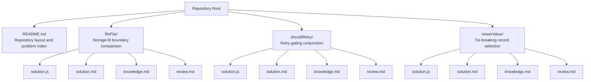
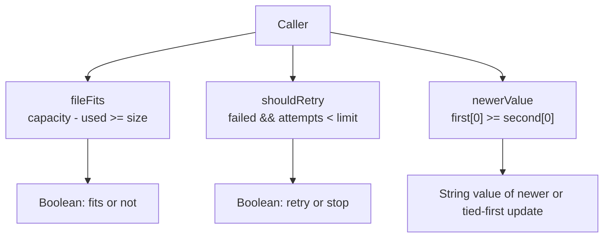
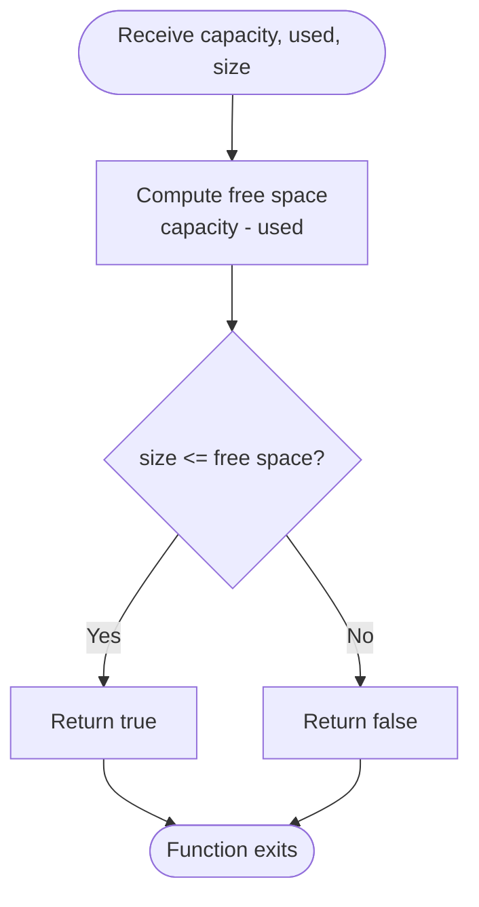
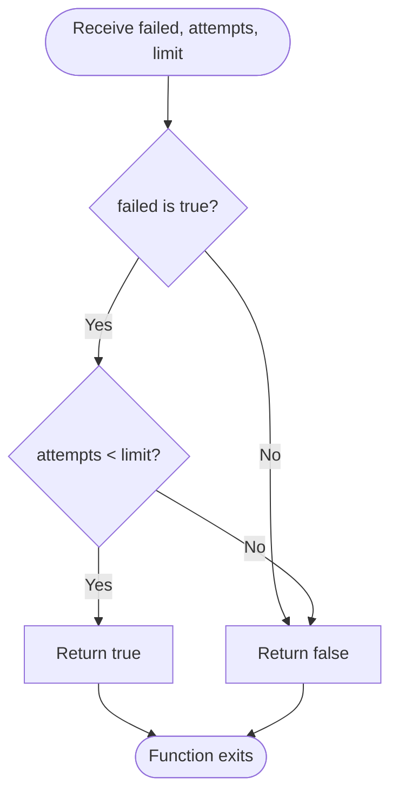
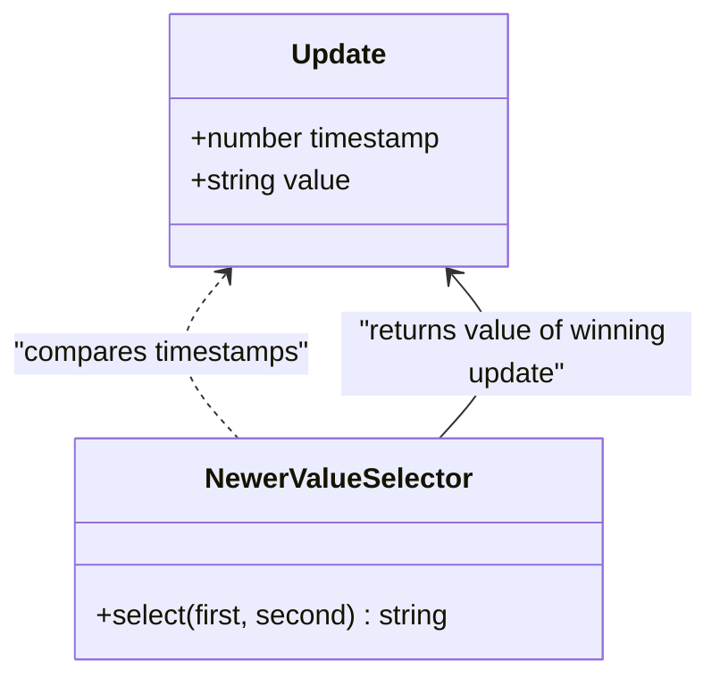
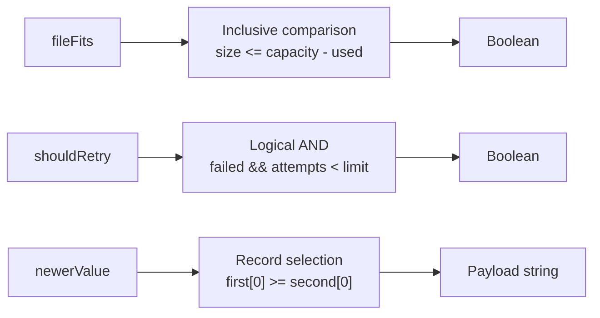

# Boundary and Constraint Handling

<cite>
**Referenced Files in This Document**
- [README.md](file://README.md)
- [fileFits/solution.js](file://fileFits/solution.js)
- [fileFits/solution.md](file://fileFits/solution.md)
- [fileFits/knowledge.md](file://fileFits/knowledge.md)
- [fileFits/review.md](file://fileFits/review.md)
- [shouldRetry/solution.js](file://shouldRetry/solution.js)
- [shouldRetry/solution.md](file://shouldRetry/solution.md)
- [shouldRetry/knowledge.md](file://shouldRetry/knowledge.md)
- [newerValue/solution.js](file://newerValue/solution.js)
- [newerValue/solution.md](file://newerValue/solution.md)
- [newerValue/knowledge.md](file://newerValue/knowledge.md)
</cite>

## Table of Contents
1. [Introduction](#introduction)
2. [Project Structure](#project-structure)
3. [Core Components](#core-components)
4. [Architecture Overview](#architecture-overview)
5. [Detailed Component Analysis](#detailed-component-analysis)
6. [Dependency Analysis](#dependency-analysis)
7. [Performance Considerations](#performance-considerations)
8. [Troubleshooting Guide](#troubleshooting-guide)
9. [Conclusion](#conclusion)
10. [Appendices](#appendices)

## Introduction
This document explains how to implement mathematical comparisons correctly in algorithmic solutions, with a focus on choosing between inclusive operators (≤, ≥) and strict operators (<, >). It draws directly from three JavaScript problems in the repository:

- `fileFits`: deciding whether a file fits into remaining drive space.
- `shouldRetry`: deciding whether another attempt is allowed under a retry limit.
- `newerValue`: selecting the newer update when timestamps may tie.

The central lesson is that natural-language requirements map to precise mathematical boundaries. Small wording differences — such as “exactly allowed,” “reaching the limit means stop,” or “ties go to the first” — determine whether the boundary is inclusive or exclusive. The documentation also covers zero-size inputs, exact boundary values, negative-number invariants, operator selection strategies, input-constraint validation, common mistakes, and practice scenarios for storage limits, retry thresholds, and range validations.

## Project Structure
Each problem lives in its own folder with four files:

| File | Purpose |
|---|---|
| `solution.js` | Submitted JavaScript implementation. |
| `solution.md` | Structured write-up including problem statement, constraints, analysis, pseudocode, complexity, verified edge cases, and takeaways. |
| `review.md` | AI review covering correctness, edge cases, performance, and code quality. |
| `knowledge.md` | Reusable, problem-agnostic lessons distilled from the solution. |

**Diagram sources**
- [README.md:9-36](file://README.md#L9-L36)

**Section sources**
- [README.md:1-55](file://README.md#L1-L55)

## Core Components
This section identifies the three core decision functions and their boundary semantics.

| Function | Inputs | Decision Rule | Boundary Operator | Key Boundary Case |
|---|---|---|---|---|
| `fileFits(capacity, used, size)` | Three non-negative integers up to 1000; `used ≤ capacity`. | File fits if free space can accommodate the requested size. | Inclusive (`<=`) because exact fill is allowed. | `(100, 70, 30)` → true. |
| `shouldRetry(failed, attempts, limit)` | Boolean and two integers in `[1, 10]`. | Retry only if the previous attempt failed **and** the limit has not been reached. | Strict (`<`) because reaching the limit means stop. | `(true, 3, 3)` → false. |
| `newerValue(first, second)` | Two pairs `[timestamp, value]`; timestamps in `[0, 1000]`. | Return the value of the newer timestamp; ties go to `first`. | Inclusive (`>=`) on the left operand so ties select `first`. | `([5, "first"], [5, "second"])` → `"first"`. |

These three functions share a common pattern: translate a short natural-language rule into one relational expression, then return the boolean or selected payload directly.

**Section sources**
- [fileFits/solution.md:1-22](file://fileFits/solution.md#L1-L22)
- [shouldRetry/solution.md:1-22](file://shouldRetry/solution.md#L1-L22)
- [newerValue/solution.md:1-22](file://newerValue/solution.md#L1-L22)

## Architecture Overview
At a high level, each problem is a pure predicate or selector function. There are no shared libraries, configuration layers, or external services. The “architecture” is a collection of independent decision functions whose correctness depends almost entirely on the chosen comparison operator and the interpretation of the problem’s boundary wording.

**Diagram sources**
- [fileFits/solution.js:1-10](file://fileFits/solution.js#L1-L10)
- [shouldRetry/solution.js:1-8](file://shouldRetry/solution.js#L1-L8)
- [newerValue/solution.js:1-5](file://newerValue/solution.js#L1-L5)

## Detailed Component Analysis

### Storage-Fit Boundary: `fileFits`
`fileFits` answers whether a file of `size` can be written to a drive with total `capacity`, of which `used` megabytes are already taken. The specification states that filling the drive exactly is allowed.

#### Natural-Language Translation
The requirement “free space must accommodate size” translates to:

`size <= capacity - used`

Equivalently:

`used + size <= capacity`

Both forms are mathematically equivalent here. The critical correctness decision is using `<=`, not `<`, because the problem explicitly allows the resulting total to equal `capacity`.

#### Boundary Logic Flowchart

**Diagram sources**
- [fileFits/solution.js:1-10](file://fileFits/solution.js#L1-L10)
- [fileFits/solution.md:24-45](file://fileFits/solution.md#L24-L45)

#### Edge Cases
| Scenario | Input `(capacity, used, size)` | Expected | Why It Matters |
|---|---|---|---|
| Example fit | `(100, 70, 20)` | true | Normal case below the boundary. |
| Exact fill | `(100, 70, 30)` | true | Discriminates `<=` from `<`. |
| One over | `(100, 70, 31)` | false | Confirms the upper boundary stops at capacity. |
| Full drive, empty file | `(100, 100, 0)` | true | Zero-size input needs no extra space. |
| Full drive, non-empty file | `(100, 100, 1)` | false | No room remains. |
| Minimum bounds | `(0, 0, 0)` | true | Zero capacity, zero usage, zero request. |
| Maximum bounds, exact fill | `(1000, 0, 1000)` | true | Upper bound is included. |
| Maximum bounds, full drive | `(1000, 1000, 1000)` | false | Already committed; adding more exceeds capacity. |

#### Implementation Notes
- The submitted implementation uses an explicit `if/else` assigning `true` or `false` to a local variable before returning it. This works but is redundant in JavaScript because the comparison itself evaluates to a boolean.
- No defensive branch for `size === 0` is required: the invariant `used ≤ capacity` guarantees free space is non-negative, so a zero-size file always fits.
- No overflow handling is needed because all inputs are bounded by 1000.

**Section sources**
- [fileFits/solution.js:1-10](file://fileFits/solution.js#L1-L10)
- [fileFits/solution.md:1-45](file://fileFits/solution.md#L1-L45)
- [fileFits/knowledge.md:1-20](file://fileFits/knowledge.md#L1-L20)
- [fileFits/review.md:1-40](file://fileFits/review.md#L1-L40)

### Retry Threshold Boundary: `shouldRetry`
`shouldRetry` decides whether another attempt should be made. A retry is allowed only when the previous attempt failed **and** the maximum number of attempts has not yet been reached.

#### Natural-Language Translation
The decision combines two conditions with logical AND:

`failed && attempts < limit`

The word “only” signals a conjunction, not a disjunction. The phrase “reaching the limit means stop” makes the boundary strict: equality belongs to the stop side, so `<` is correct, not `<=`.

#### Boundary Logic Flowchart

**Diagram sources**
- [shouldRetry/solution.js:1-8](file://shouldRetry/solution.js#L1-L8)
- [shouldRetry/solution.md:24-45](file://shouldRetry/solution.md#L24-L45)

#### Edge Cases
| Scenario | Input `(failed, attempts, limit)` | Expected | Why It Matters |
|---|---|---|---|
| Retry allowed | `(true, 2, 3)` | true | Failure occurred and budget remains. |
| Last attempt succeeded | `(false, 2, 3)` | false | Nothing failed, so nothing to retry. |
| Limit reached | `(true, 3, 3)` | false | Equality is the stop boundary. |
| Success at limit | `(false, 3, 3)` | false | Both failure condition and budget condition fail. |
| First attempt failed, budget left | `(true, 1, 3)` | true | Smallest valid attempt count. |
| Limit of 1 consumed | `(true, 1, 1)` | false | No room after one attempt. |
| One attempt remaining | `(true, 9, 10)` | true | Near upper bound but still allowed. |
| Max bounds, limit reached | `(true, 10, 10)` | false | Upper-bound equality must stop retries. |
| Attempts exceed limit | `(true, 10, 1)` | false | Invalid ordering per constraints, but still safely returns false. |

#### Operator Precedence and Short-Circuiting
- `<` binds tighter than `&&`, so parentheses around `attempts < limit` are optional but can improve readability.
- When `failed` is false, short-circuit evaluation skips the numeric comparison. This is harmless here and useful in real systems where the right-hand condition could be expensive or unsafe.

**Section sources**
- [shouldRetry/solution.js:1-8](file://shouldRetry/solution.js#L1-L8)
- [shouldRetry/solution.md:1-45](file://shouldRetry/solution.md#L1-L45)
- [shouldRetry/knowledge.md:1-20](file://shouldRetry/knowledge.md#L1-L20)
- [shouldRetry/review.md:1-40](file://shouldRetry/review.md#L1-L40)

### Tie-Breaking Selection Boundary: `newerValue`
`newerValue` receives two updates as `[timestamp, value]` pairs. The larger timestamp is newer. If timestamps are equal, the first argument wins. The function returns the **value**, not the timestamp.

#### Natural-Language Translation
With `first` tested as the left operand, the winner condition is:

`first[0] >= second[0]`

If true, `first` is selected; otherwise, `second` is selected. After selection, the value is read from index `1`.

An equivalent formulation from the other side is:

`second[0] > first[0] ? second : first`

Both produce the same result because ties fall to the else branch, which selects `first`.

#### Comparison Selection Diagram

**Diagram sources**
- [newerValue/solution.js:1-5](file://newerValue/solution.js#L1-L5)
- [newerValue/solution.md:24-55](file://newerValue/solution.md#L24-L55)

#### Edge Cases
| Scenario | Input `(first, second)` | Expected | Why It Matters |
|---|---|---|---|
| Second newer | `([10, "ready"], [12, "busy"])` | `"busy"` | Right operand wins when strictly newer. |
| First newer | `([20, "online"], [15, "offline"])` | `"online"` | Left operand wins when strictly newer. |
| Tie, first wins | `([5, "first"], [5, "second"])` | `"first"` | Discriminates `>=` from `>`. |
| Newer value is empty | `([0, "x"], [1, ""])` | `""` | Empty string is data, not absence. |
| Tie with empty first value | `([0, ""], [0, "x"])` | `""` | Truthiness must not replace a valid empty value. |
| Both values empty | `([7, ""], [7, ""])` | `""` | Both branches produce the same legal result. |
| Upper-bound timestamps | `([0, "min"], [1000, "max"])` | `"max"` | Boundary timestamps work normally. |

#### Common Mistake: Returning the Extremum Instead of the Record
A frequent error is calling something like `Math.max(a[0], b[0])`, which returns the larger timestamp rather than the associated record. When the answer requires a field attached to the winning record, you must select the record first and then extract the payload.

**Section sources**
- [newerValue/solution.js:1-5](file://newerValue/solution.js#L1-L5)
- [newerValue/solution.md:1-55](file://newerValue/solution.md#L1-L55)
- [newerValue/knowledge.md:1-30](file://newerValue/knowledge.md#L1-L30)
- [newerValue/review.md:1-35](file://newerValue/review.md#L1-L35)

## Dependency Analysis
All three functions are independent. There are no cross-imports between them, and none depend on external modules. Their dependencies are purely conceptual:

- `fileFits` depends on arithmetic subtraction and an inclusive comparison.
- `shouldRetry` depends on boolean logic and a strict comparison.
- `newerValue` depends on positional record access, an inclusive comparison on the left operand, and payload extraction.

**Diagram sources**
- [fileFits/solution.js:1-10](file://fileFits/solution.js#L1-L10)
- [shouldRetry/solution.js:1-8](file://shouldRetry/solution.js#L1-L8)
- [newerValue/solution.js:1-5](file://newerValue/solution.js#L1-L5)

There are no circular dependencies because each function is self-contained.

**Section sources**
- [README.md:9-36](file://README.md#L9-L36)
- [fileFits/solution.js:1-10](file://fileFits/solution.js#L1-L10)
- [shouldRetry/solution.js:1-8](file://shouldRetry/solution.js#L1-L8)
- [newerValue/solution.js:1-5](file://newerValue/solution.js#L1-L5)

## Performance Considerations
All three decisions are O(1) time and O(1) auxiliary space. They perform a fixed number of arithmetic, relational, logical, or indexing operations regardless of input magnitude. There is no iteration, recursion, allocation, or sorting.

| Function | Time | Space | Reason |
|---|---:|---:|---|
| `fileFits` | O(1) | O(1) | One subtraction and one comparison. |
| `shouldRetry` | O(1) | O(1) | One comparison and one logical AND. |
| `newerValue` | O(1) | O(1) | Two index reads, one comparison, one index read. |

Because each function evaluates constant-time predicates, optimization effort should focus on correctness and clarity rather than asymptotic performance.

**Section sources**
- [fileFits/solution.md:88-105](file://fileFits/solution.md#L88-L105)
- [shouldRetry/solution.md:88-105](file://shouldRetry/solution.md#L88-L105)
- [newerValue/solution.md:88-105](file://newerValue/solution.md#L88-L105)

## Troubleshooting Guide

### Choosing Between Inclusive and Strict Operators
Use this checklist when translating natural language into a comparison:

| Wording Pattern | Preferred Operator | Boundary Belongs To |
|---|---:|---|
| “fits”, “at most”, “filling exactly is allowed” | `<=` | Allowed region |
| “strictly less”, “must leave room” | `<` | Disallowed region |
| “at least”, “no fewer than” | `>=` | Allowed region |
| “reaching the limit means stop” | `<` | Disallowed region |
| “allowed up to and including the limit” | `<=` | Allowed region |
| “more than N” | `>` | Disallowed region |
| “newer wins, ties go to first” | `>=` on left operand | Tie goes to first |
| “newer wins, ties go to second” | `>` on left operand | Tie goes to second |

### Identifying Edge Cases
For every boundary problem, test at least these cases:

1. **Zero-size or zero-value input**: Does a zero request consume no resource?
2. **Exact boundary**: Is equality allowed or forbidden?
3. **One unit over**: Does the decision flip immediately after the boundary?
4. **Minimum bounds**: Often zero or one.
5. **Maximum bounds**: Usually the stated upper limit.
6. **Negative numbers**: Only include defensive checks if the specification does not guarantee non-negative inputs.
7. **Empty or neutral payloads**: Treat empty strings and zeros as data unless the contract says otherwise.

### Validating Input Constraints Before Computation
The repository’s solutions deliberately avoid defensive checks when the problem statement guarantees constraints:

- `fileFits` assumes `capacity`, `used`, and `size` are whole numbers in `[0, 1000]` and `used ≤ capacity`.
- `shouldRetry` assumes `attempts` and `limit` are integers in `[1, 10]` and `failed` is a boolean.
- `newerValue` assumes timestamps are integers in `[0, 1000]` and values are strings up to 20 characters.

Adding guards for impossible inputs can hide the real logic and introduce untested branches. Validation is appropriate when inputs come from untrusted sources outside the problem’s constraints.

### Common Mistakes
| Mistake | Symptom | Fix |
|---|---|---|
| Using `<` instead of `<=` for exact-fill problems | Boundary case fails when totals match exactly. | Use `<=` when equality is allowed. |
| Using `<=` instead of `<` for retry limits | One retry too many at `attempts === limit`. | Use `<` when reaching the limit means stop. |
| Using `>` instead of `>=` for tie rules | Tie goes to the wrong operand. | Choose operator based on tie rule and operand order. |
| Comparing payload instead of key | Returns wrong field or compares wrong type. | Compare the key field, then extract the payload. |
| Using truthiness on empty strings | Replaces valid `""` with fallback. | Return the stored value directly. |
| Boolean laundering | Extra `if/else` assigning `true`/`false` unnecessarily. | Return the boolean expression directly. |
| Off-by-one counting | Misinterpreting “already made” vs “next attempt.” | Read the noun phrase carefully; do not add or subtract without justification. |

**Section sources**
- [fileFits/knowledge.md:1-50](file://fileFits/knowledge.md#L1-L50)
- [shouldRetry/knowledge.md:1-54](file://shouldRetry/knowledge.md#L1-L54)
- [newerValue/knowledge.md:1-58](file://newerValue/knowledge.md#L1-L58)
- [fileFits/review.md:40-67](file://fileFits/review.md#L40-L67)
- [shouldRetry/review.md:40-74](file://shouldRetry/review.md#L40-L74)
- [newerValue/review.md:35-61](file://newerValue/review.md#L35-L61)

## Conclusion
Correct boundary and constraint handling is mostly about careful reading and precise translation:

- Identify the resource state after the proposed change.
- Pick the operator from the wording: inclusive when equality is allowed, strict when equality is the stopping point.
- Test the exact boundary, one unit beyond it, zero requests, minimum bounds, and maximum bounds.
- Exploit guaranteed invariants instead of writing defensive branches for impossible inputs.
- Keep the decision close to the specification: return the boolean expression or selected record directly, and verify each comparison against the natural-language requirement.

These principles appear consistently across storage-fit checks, retry gating, and tie-breaking selections.

## Appendices

### Practice Scenarios

#### Storage Limits
Write a function that accepts current usage, maximum capacity, and a requested amount, and returns whether the request fits. Include tests for:

- Request smaller than free space.
- Request exactly equal to free space.
- Request one unit over free space.
- Zero request on a full drive.
- Negative request (only if your contract permits it; otherwise reject or validate).

Recommended comparison: `requested <= capacity - currentUsage`.

#### Retry Thresholds
Write a function that accepts whether the last attempt failed, how many attempts have already been made, and the maximum allowed attempts. Return whether another attempt is allowed. Include tests for:

- Failure with budget remaining.
- Success even with budget remaining.
- Failure at the exact limit.
- Success at the exact limit.
- Minimum and maximum attempt counts.

Recommended comparison: `failed && attempts < limit`.

#### Range Validations
Write a function that accepts a score and a passing threshold, and returns whether the score passes. Include tests for:

- Score above threshold.
- Score exactly equal to threshold.
- Score one below threshold.
- Negative scores (depending on domain).
- Very large scores.

Recommended comparison depends on wording: use `>=` if the threshold is inclusive, `<` if the threshold is exclusive.

#### Tie-Breaking Selection
Write a function that compares two records by a numeric key and returns the entire record or a specific payload. Include tests for:

- Left record strictly greater.
- Right record strictly greater.
- Equal keys with the specified tie rule.
- Empty or zero payloads that must be preserved.

Recommended approach: compare the key field, select the record according to the tie rule, then extract the payload.

[No sources needed since this section provides general practice scenarios]