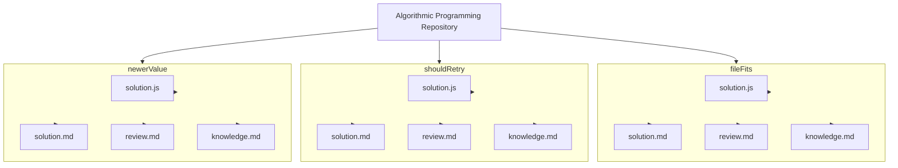
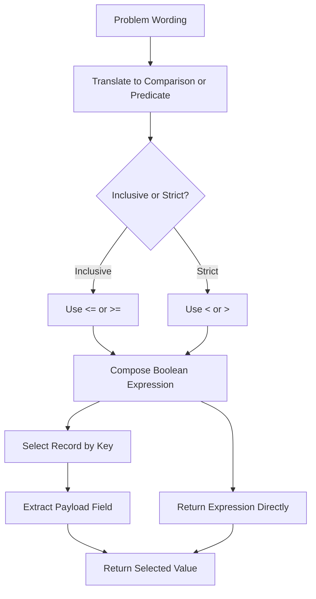

# Reusable Knowledge Base

<cite>
**Referenced Files in This Document**
- [README.md](file://README.md)
- [fileFits/knowledge.md](file://fileFits/knowledge.md)
- [shouldRetry/knowledge.md](file://shouldRetry/knowledge.md)
- [newerValue/knowledge.md](file://newerValue/knowledge.md)
</cite>

## Table of Contents
1. [Introduction](#introduction)
2. [Project Structure](#project-structure)
3. [Core Technique Categories](#core-technique-categories)
4. [Architecture Overview](#architecture-overview)
5. [Detailed Pattern Analysis](#detailed-pattern-analysis)
6. [Cross-Problem Reference Map](#cross-problem-reference-map)
7. [Practice Scenarios](#practice-scenarios)
8. [Common Pitfalls Checklist](#common-pitfalls-checklist)
9. [Conclusion](#conclusion)

## Introduction
This document distills reusable algorithmic patterns from three solved JavaScript problems: `fileFits`, `shouldRetry`, and `newerValue`. It focuses on generalizable techniques rather than problem-specific details, so readers can recognize when to apply these patterns in new challenges.

The repository is a learning archive where each problem lives in its own folder with four files: the submitted solution, a structured write-up, an AI review, and a knowledge entry capturing transferable lessons. The codebase uses plain JavaScript and has no external dependencies.

**Section sources**
- [README.md:1-55](file://README.md#L1-L55)

## Project Structure
Each problem folder follows the same layout:

| File | Purpose |
|---|---|
| `solution.js` | Submitted solution kept verbatim |
| `solution.md` | Problem overview, constraints, analysis, approach, complexity, edge cases, takeaways |
| `review.md` | AI review covering correctness, edge cases, performance, and code quality |
| `knowledge.md` | Generalizable, problem-agnostic lessons |

**Diagram sources**
- [README.md:8-40](file://README.md#L8-L40)

**Section sources**
- [README.md:1-55](file://README.md#L1-L55)

## Core Technique Categories
The three problems support three primary reusable technique categories:

1. **Boolean expression simplification and predicate composition**
   - Returning raw comparison or conjunction expressions instead of laundering booleans through `if/else`.
   - Composing multiple conditions with short-circuit semantics.
   - Deriving truth tables from wording such as “true only when A and B.”

2. **Boundary and constraint handling**
   - Choosing between inclusive (`<=`) and strict (`<`) operators based on exact phrasing.
   - Using guaranteed invariants to remove unnecessary defensive branches.
   - Testing equality boundaries explicitly because they distinguish operator choices.

3. **Selection and comparison for record processing**
   - Separating comparison keys from returned payloads.
   - Encoding tie rules through the choice of operator and operand order.
   - Treating empty strings and other falsy values as meaningful data rather than absence.

These categories are not isolated. A single problem may require translating wording into a boolean predicate, selecting the correct boundary operator, and then returning a selected record’s payload.

**Section sources**
- [fileFits/knowledge.md:1-50](file://fileFits/knowledge.md#L1-L50)
- [shouldRetry/knowledge.md:1-54](file://shouldRetry/knowledge.md#L1-L54)
- [newerValue/knowledge.md:1-58](file://newerValue/knowledge.md#L1-L58)

## Architecture Overview
At a high level, the reusable knowledge base is a set of pattern entries that share common decision points:

This flow applies across all three problems, even though the domain changes from storage capacity to retry policy to update records.

[No sources needed since this diagram shows conceptual workflow, not actual code structure]

## Detailed Pattern Analysis

### Boolean Expression Simplification and Predicate Composition
**Abstract technique:**
When a function’s contract is to return whether a condition holds, prefer returning the boolean expression itself. Avoid wrapping it in `if/else` branches that assign `true` or `false`, because that adds mutable state and invites inversion bugs during later edits. For multiple prerequisites, combine predicates with logical conjunction or disjunction, using short-circuit order deliberately.

**Concrete examples from the repository:**
- `fileFits/knowledge.md` documents that a comparison expression is already a boolean and should be returned directly instead of being laundered through conditional assignment.
- `shouldRetry/knowledge.md` extends this to conjunctive predicates, showing that “true only when A and B” maps to `A && B`, and warns about non-boolean operands leaking truthy values rather than producing a clean boolean.

**Recognition guidelines:**
- The function name suggests a yes/no decision: `fits`, `shouldRetry`, `isAllowed`, `isValid`.
- The specification contains phrases like “only when,” “must satisfy both,” “allowed if,” or “not allowed unless.”
- The implementation currently assigns `true`/`false` to a variable and returns it.

**Common pitfalls:**
- Returning the result of `&&` or `||` when one operand is not a boolean, which can leak truthy values.
- Assuming short-circuit evaluation is invisible; it changes which side effects occur.
- Writing only happy-path examples without testing the full truth table for compound conditions.

**Cross-references:**
- Boolean-laundering guidance appears in `fileFits/knowledge.md`.
- Conjunctive predicate guidance appears in `shouldRetry/knowledge.md`.

**Section sources**
- [fileFits/knowledge.md:10-25](file://fileFits/knowledge.md#L10-L25)
- [shouldRetry/knowledge.md:1-20](file://shouldRetry/knowledge.md#L1-L20)
- [shouldRetry/knowledge.md:29-44](file://shouldRetry/knowledge.md#L29-L44)

### Boundary and Constraint Handling
**Abstract technique:**
Operator selection is a translation problem. Read the exact phrase around the limit, decide whether the boundary belongs inside or outside the allowed region, and verify with an equality probe. When the problem statement guarantees an invariant, use it to eliminate unnecessary defensive checks.

**Concrete examples from the repository:**
- `fileFits/knowledge.md` maps phrases such as “fits,” “at most,” and “filling exactly is allowed” to `<=`, while “strictly less” maps to `<`. It also advises deriving consequences from invariants like `used <= capacity` rather than branching defensively.
- `shouldRetry/knowledge.md` distinguishes “reaching the limit means stop” from “allowed up to and including the limit,” and emphasizes verifying the equality case.

**Recognition guidelines:**
- The problem involves limits, capacities, thresholds, maximums, minimums, or counts.
- Phrases contain “at most,” “no more than,” “strictly less than,” “at least,” “more than N,” or similar boundary language.
- Tests pass for zero or small inputs but fail at the exact limit.

**Common pitfalls:**
- Confusing the count before the event with the count after the event.
- Treating the limit as part of the allowed region when the wording says reaching it stops the process.
- Adding defensive branches for states excluded by the problem’s constraints.

**Cross-references:**
- Boundary operator mapping and invariant usage appear in `fileFits/knowledge.md`.
- Stop-boundary wording and off-by-one awareness appear in `shouldRetry/knowledge.md`.

**Section sources**
- [fileFits/knowledge.md:1-15](file://fileFits/knowledge.md#L1-L15)
- [fileFits/knowledge.md:26-36](file://fileFits/knowledge.md#L26-L36)
- [fileFits/knowledge.md:38-50](file://fileFits/knowledge.md#L38-L50)
- [shouldRetry/knowledge.md:21-28](file://shouldRetry/knowledge.md#L21-L28)
- [shouldRetry/knowledge.md:30-38](file://shouldRetry/knowledge.md#L30-L38)

### Selection and Comparison Techniques for Record Processing
**Abstract technique:**
When choosing between two candidates, first identify the comparison key and the payload to return. Do not confuse positional order, temporal order, traversal order, and field access. Encode tie rules explicitly through the choice of operator and operand order. Treat falsy values such as empty strings as valid data.

**Concrete examples from the repository:**
- `newerValue/knowledge.md` separates positional, temporal, and traversal order, then prescribes selecting the record first and extracting its payload second.
- It shows how `>=` versus `>` encodes whether ties go to the first or second candidate.
- It warns against using `Math.max` on timestamps when the answer requires the associated value, index, or object.
- It treats empty strings as data, not absence, and cautions against truthiness shortcuts.

**Recognition guidelines:**
- The input includes pairs or records carrying both a sortable key and a payload.
- The specification mentions “first,” “second,” “newer,” “maximum,” “best,” or “tie goes to.”
- The return value is not the comparison key itself but something associated with the winning record.

**Common pitfalls:**
- Comparing one field and returning another.
- Assuming parameter order equals domain order.
- Using extremum functions when the problem needs record selection.
- Replacing empty strings with fallbacks through truthiness checks.
- Returning copies when the contract expects the original input element.

**Cross-references:**
- All selection, tie-breaking, and payload extraction guidance appears in `newerValue/knowledge.md`.

**Section sources**
- [newerValue/knowledge.md:1-17](file://newerValue/knowledge.md#L1-L17)
- [newerValue/knowledge.md:18-42](file://newerValue/knowledge.md#L18-L42)
- [newerValue/knowledge.md:43-58](file://newerValue/knowledge.md#L43-L58)

## Cross-Problem Reference Map
The following table links each reusable pattern to the problem where it was distilled.

| Pattern Category | Where It Appears | Key Lesson |
|---|---|---|
| Boolean expression simplification | `fileFits` | Return comparison expressions directly; avoid boolean laundering. |
| Conjunctive predicate composition | `shouldRetry` | “True only when A and B” is conjunction; check truth tables and short-circuit order. |
| Boundary operator selection | `fileFits`, `shouldRetry` | Choose `<=` vs `<` from wording; verify the equality boundary. |
| Invariant-driven simplification | `fileFits` | Use guaranteed constraints to remove unnecessary branches. |
| Record selection over extremum computation | `newerValue` | Compare keys, select records, then extract payloads. |
| Tie rule encoding | `newerValue` | Operator and operand order jointly determine tie behavior. |
| Falsy data safety | `newerValue` | Empty strings and zeros may be valid answers. |

**Section sources**
- [fileFits/knowledge.md:1-50](file://fileFits/knowledge.md#L1-L50)
- [shouldRetry/knowledge.md:1-54](file://shouldRetry/knowledge.md#L1-L54)
- [newerValue/knowledge.md:1-58](file://newerValue/knowledge.md#L1-L58)

## Practice Scenarios
Use these scenarios to practice recognizing opportunities for the documented patterns.

| Scenario | Likely Pattern | Recognition Cues | Suggested Edge Cases |
|---|---|---|---|
| A discount applies only when stock is available and price exceeds a threshold. | Conjunctive predicate composition | “Only when,” two independent requirements. | Zero stock, zero price, exact threshold, both true, one false. |
| A container accepts items up to its capacity, including exact fill. | Boundary operator selection | “Up to,” “exactly,” “capacity.” | Empty item, exact fill, one unit over, negative size if unsupported. |
| Return the larger timestamp together with its associated message. | Record selection and payload extraction | “Newer,” “associated value,” “message.” | Equal timestamps, null-like messages, empty string messages. |
| An operation is allowed unless the user is locked out. | Single negation predicate | “Unless,” “not allowed if.” | Locked-out with insufficient funds, unlocked with sufficient funds. |
| A retry may continue while failures remain below a hard limit. | Retry-gating predicate | “Attempts,” “limit,” “retry.” | Exactly at limit, zero attempts, success after failure, failure after success. |
| A scorecard chooses the higher score, breaking ties toward the first player. | Tie-rule encoding | “Higher,” “tie goes to first.” | Equal scores, swapped input order. |

**Section sources**
- [fileFits/knowledge.md:1-50](file://fileFits/knowledge.md#L1-L50)
- [shouldRetry/knowledge.md:1-54](file://shouldRetry/knowledge.md#L1-L54)
- [newerValue/knowledge.md:1-58](file://newerValue/knowledge.md#L1-L58)

## Common Pitfalls Checklist
Before finalizing any solution, run through this checklist.

**For boolean expressions:**
- Am I returning a boolean expression directly?
- Are both operands of `&&` or `||` actually booleans?
- Have I tested every combination of truth values for compound conditions?

**For boundaries:**
- Did I translate “at most” to `<=` and “strictly less” to `<`?
- Did I test the exact limit?
- Am I confusing the count before an event with the count after it?
- Am I adding defensive checks for states the problem excludes?

**For record selection:**
- Is my comparison key different from my returned payload?
- Does my operator encode the required tie rule?
- Did I test equal keys?
- Am I treating empty strings or zeros as meaningful data?
- Am I comparing fields and returning unrelated indices?

**Section sources**
- [fileFits/knowledge.md:10-50](file://fileFits/knowledge.md#L10-L50)
- [shouldRetry/knowledge.md:1-54](file://shouldRetry/knowledge.md#L1-L54)
- [newerValue/knowledge.md:1-58](file://newerValue/knowledge.md#L1-L58)

## Conclusion
These three problems illustrate a compact but powerful toolkit:

- Translate natural-language constraints into precise comparisons and boolean predicates.
- Choose boundary operators carefully and verify equality cases.
- Keep boolean logic simple by returning expressions directly.
- Separate record selection from payload extraction.
- Encode tie rules explicitly through operator choice.
- Treat falsy values as data unless the contract says otherwise.

When encountering a new problem, start by identifying which category it belongs to, write down the boundary and truth-table expectations, and implement the minimal expression or selection that satisfies them.

[No sources needed since this section summarizes without analyzing specific files]