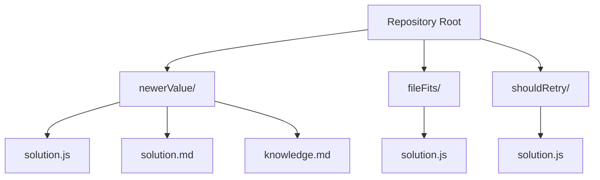
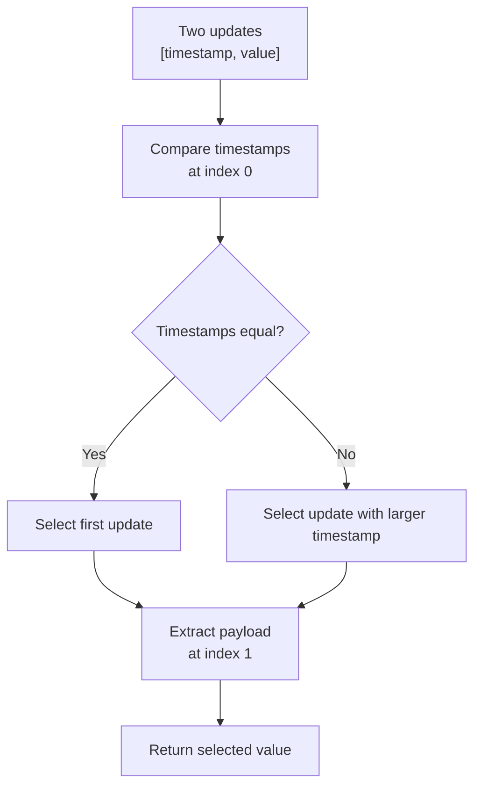
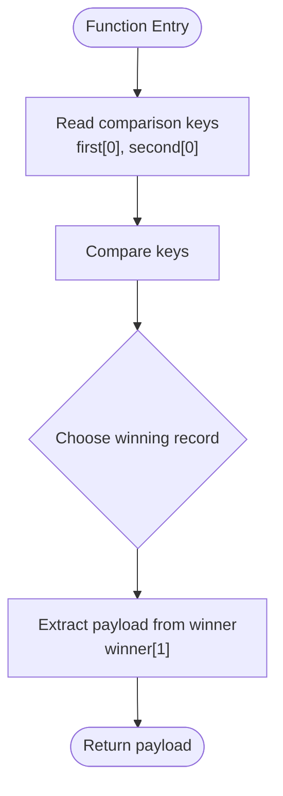
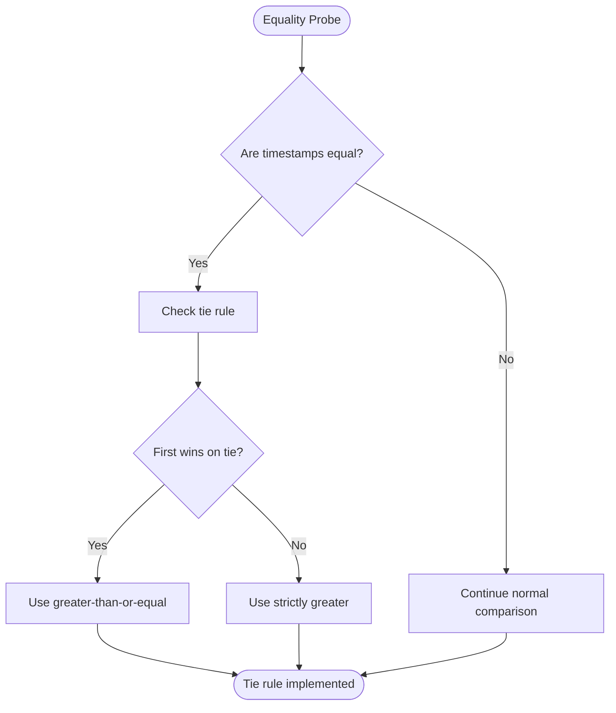
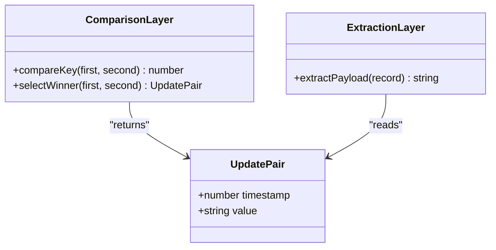
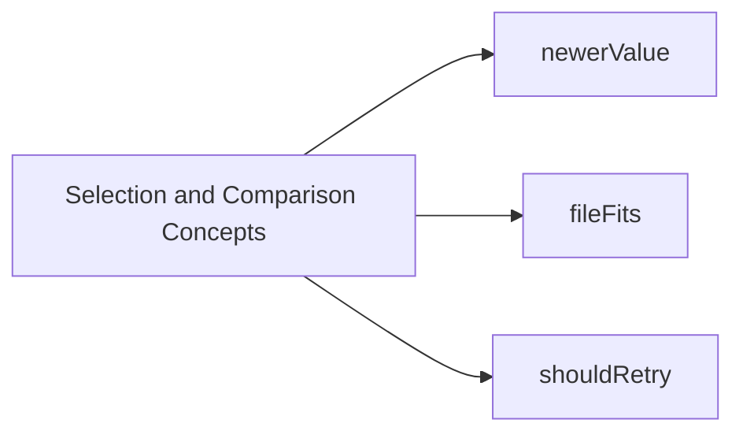

# Selection and Comparison Techniques

<cite>
**Referenced Files in This Document**
- [README.md](file://README.md)
- [newerValue/solution.js](file://newerValue/solution.js)
- [newerValue/solution.md](file://newerValue/solution.md)
- [newerValue/knowledge.md](file://newerValue/knowledge.md)
- [fileFits/solution.js](file://fileFits/solution.js)
- [shouldRetry/solution.js](file://shouldRetry/solution.js)
</cite>

## Table of Contents
1. [Introduction](#introduction)
2. [Project Structure](#project-structure)
3. [Core Components](#core-components)
4. [Architecture Overview](#architecture-overview)
5. [Detailed Component Analysis](#detailed-component-analysis)
6. [Dependency Analysis](#dependency-analysis)
7. [Performance Considerations](#performance-considerations)
8. [Troubleshooting Guide](#troubleshooting-guide)
9. [Conclusion](#conclusion)
10. [Appendices](#appendices)

## Introduction
This document explains selection and comparison techniques for choosing between alternatives based on multi-field criteria. It focuses on:

- Choosing a record rather than extracting an extremum value.
- Implementing tie-breaking rules explicitly.
- Separating comparison keys from payloads.
- Using the `newerValue` problem as the core example, where each update is `[timestamp, value]`, timestamps are compared, and the payload must be preserved.

The repository is a learning archive of small algorithmic problems. Each folder contains a solution, a structured write-up, an AI review, and reusable knowledge. The `newerValue` problem demonstrates how to compare one field while returning another.

**Section sources**
- [README.md:1-55](file://README.md#L1-L55)

## Project Structure
The project organizes every challenge under its own directory with four consistent files:

| File | Purpose |
|---|---|
| `solution.js` | Original submitted implementation. |
| `solution.md` | Problem statement, analysis, approach, pseudocode, complexity, edge cases, and takeaways. |
| `review.md` | AI critique covering correctness, edge cases, performance, and code quality. |
| `knowledge.md` | Generalizable lessons distilled from the problem. |

**Diagram sources**
- [README.md:7-44](file://README.md#L7-L44)

**Section sources**
- [README.md:1-55](file://README.md#L1-L55)

## Core Components
The three JavaScript solutions illustrate different aspects of simple algorithmic logic:

| Component | Role | Relation to Selection and Comparison |
|---|---|---|
| `newerValue` | Selects the newer update by timestamp and returns its payload. | Primary example of record selection, tie-breaking, and key/payload separation. |
| `fileFits` | Computes whether remaining capacity fits a file. | Demonstrates boundary comparison and boolean-return patterns. |
| `shouldRetry` | Combines failure state, attempt count, and retry limit. | Demonstrates conjunction-based gating that can appear inside larger selection logic. |

The `newerValue` function compares two-element arrays at index `0` and returns the payload at index `1`. It uses a ternary operator to select the whole record before reading its payload.

**Section sources**
- [newerValue/solution.js:1-5](file://newerValue/solution.js#L1-L5)
- [fileFits/solution.js:1-10](file://fileFits/solution.js#L1-L10)
- [shouldRetry/solution.js:1-8](file://shouldRetry/solution.js#L1-L8)

## Architecture Overview
At a conceptual level, selection problems separate into three layers:

1. **Data model**: records carry both a comparison key and a payload.
2. **Comparison layer**: decides which record wins using explicit equality handling.
3. **Extraction layer**: reads the payload from the winning record without mutating inputs.

[No sources needed since this diagram shows conceptual workflow, not actual code structure]

## Detailed Component Analysis

### Record Selection versus Extremum Finding
A common mistake is to use `Math.max` or `Math.min` when the problem requires selecting a record. Those functions return an extreme scalar value, not the record that produced it. When the answer needs associated data—such as a payload, original index, or object—the correct primitive is conditional selection.

In `newerValue`:

- The comparison key is `first[0]` and `second[0]`.
- The returned payload is the chosen record’s index `1`.
- The intermediate variable holds the entire winning pair so the payload stays attached to the decision.

**Diagram sources**
- [newerValue/solution.js:1-5](file://newerValue/solution.js#L1-L5)
- [newerValue/solution.md:38-69](file://newerValue/solution.md#L38-L69)

**Section sources**
- [newerValue/solution.js:1-5](file://newerValue/solution.js#L1-L5)
- [newerValue/solution.md:21-69](file://newerValue/solution.md#L21-L69)
- [newerValue/knowledge.md:15-28](file://newerValue/knowledge.md#L15-L28)

### Tie-Breaking Rule Implementation
Tie-breaking is encoded by the combination of:

- The comparison operator.
- The operand order.
- The true/false branches of the conditional.

For the rule “equal timestamps → first wins”:

| Requirement | Operator and Operand Order | Tie Goes To |
|---|---|---|
| Newer wins, ties → first | Compare `first[0] >= second[0]` and choose `first` on true | First |
| Newer wins, ties → second | Compare `first[0] > second[0]` and choose `first` on true | Second |
| Equivalent formulation | Compare `second[0] > first[0]` and choose `second` on true | First on false |

The equality case is the only input that distinguishes `>=` from `>`. A good practice is to add an equality probe test early, because it is easy to implement the strict inequality correctly while still violating the tie rule.

**Diagram sources**
- [newerValue/knowledge.md:29-43](file://newerValue/knowledge.md#L29-L43)
- [newerValue/solution.md:38-69](file://newerValue/solution.md#L38-L69)

**Section sources**
- [newerValue/knowledge.md:15-43](file://newerValue/knowledge.md#L15-L43)
- [newerValue/solution.md:38-69](file://newerValue/solution.md#L38-L69)

### Field Separation Strategies: Keys Versus Payloads
The most important structural distinction in this problem is that index `0` is the sort key and index `1` is the payload. They serve different jobs and must not be conflated.

Recommended strategy:

1. Identify the comparison key.
2. Identify the returned payload.
3. Decide the winner using only the key.
4. Extract the payload from the winning record.
5. Verify that both branches produce the same payload shape.

**Diagram sources**
- [newerValue/solution.md:21-37](file://newerValue/solution.md#L21-L37)
- [newerValue/knowledge.md:15-28](file://newerValue/knowledge.md#L15-L28)

**Section sources**
- [newerValue/solution.md:21-37](file://newerValue/solution.md#L21-L37)
- [newerValue/knowledge.md:15-28](file://newerValue/knowledge.md#L15-L28)

### Comparison Function Design Guidelines
Design comparison logic as a separate concern from data transformation. This makes tie-breaking easier to reason about and test.

Guidelines:

- Keep comparison pure: read keys, return a decision.
- Do not mutate inputs during comparison.
- Represent the tie rule explicitly in words before choosing operators.
- Test equality separately from strict ordering.
- Avoid truthiness shortcuts when valid data can be falsy, such as empty strings or zero.
- Prefer returning the whole record when the payload must stay attached to the decision.

These ideas are reflected in the reusable knowledge for this problem and in the solution’s emphasis on selecting the record first and extracting the payload afterward.

**Section sources**
- [newerValue/knowledge.md:1-58](file://newerValue/knowledge.md#L1-L58)
- [newerValue/solution.md:38-69](file://newerValue/solution.md#L38-L69)

### Related Boolean Patterns
Although not selection-by-key problems, `fileFits` and `shouldRetry` show related control-flow patterns often used alongside selection:

- `fileFits` computes a boolean result from a capacity boundary expression.
- `shouldRetry` combines multiple conditions with logical AND before deciding whether to retry.

These are useful when selection is part of a larger gate: for example, determining whether to select a candidate and then whether to act on it.

**Section sources**
- [fileFits/solution.js:1-10](file://fileFits/solution.js#L1-L10)
- [shouldRetry/solution.js:1-8](file://shouldRetry/solution.js#L1-L8)

## Dependency Analysis
Within this repository, the problems are independent; none imports another. The shared dependencies are conceptual:

- Array indexing for positional records.
- Relational comparisons for ordering.
- Conditional branching for selection.
- Boolean expressions for gating decisions.

[No sources needed since this diagram shows conceptual relationships, not code-level imports]

**Section sources**
- [README.md:46-55](file://README.md#L46-L55)

## Performance Considerations
Selection over two candidates has minimal cost:

- Time complexity: O(1), because there is one comparison and one payload access.
- Space complexity: O(1), because no new arrays or objects are created.
- No iteration, recursion, sorting, or accumulation is required.

General performance guidance for selection operations:

- Avoid unnecessary sorting when a direct comparison suffices.
- Separate comparison from payload extraction to prevent accidental extra work.
- Do not copy immutable payloads unless mutation safety is contractually required.
- Be careful with large datasets: selection over N items typically requires scanning all items unless an indexed structure already provides the best candidate.
- For repeated selection queries, consider maintaining an ordered or heap-based structure instead of recomparing everything.

**Section sources**
- [newerValue/solution.md:94-105](file://newerValue/solution.md#L94-L105)
- [newerValue/knowledge.md:45-58](file://newerValue/knowledge.md#L45-L58)

## Troubleshooting Guide
Common pitfalls and their remedies:

| Pitfall | Symptom | Remedy |
|---|---|---|
| Returning an extremum instead of the record | Timestamp is returned instead of value. | Select the winning record, then extract its payload. |
| Ignoring the tie rule | Equality cases return the wrong candidate. | Add an equality probe and confirm whether `>` or `>=` matches the tie rule. |
| Confusing parameter order with domain order | “First” is interpreted as chronologically first. | Treat `first` as positional first, not necessarily newer. |
| Using truthiness on payloads | Empty strings are replaced unexpectedly. | Return the selected payload directly without fallbacks. |
| Mutating inputs accidentally | Caller observes changed arrays. | Return references to existing values; avoid assignment into input elements. |
| Comparing payloads instead of keys | Wrong candidate is selected. | Compare index `0`; return index `1`. |

Relevant evidence from the documentation includes:

- Explicit warning against using `Math.max` when the associated record is needed.
- Emphasis on separating positional order, temporal order, and traversal order.
- Checklist for two-candidate comparison problems.
- Verified edge cases including ties and empty-string payloads.

**Section sources**
- [newerValue/knowledge.md:1-58](file://newerValue/knowledge.md#L1-L58)
- [newerValue/solution.md:21-69](file://newerValue/solution.md#L21-L69)
- [newerValue/solution.md:106-147](file://newerValue/solution.md#L106-L147)

## Conclusion
Selection and comparison problems are easiest when the design separates three concerns:

1. What is being compared?
2. How should ties be broken?
3. What payload must survive the comparison?

The `newerValue` problem demonstrates that the safest pattern is to select the winning record using an explicit comparison and then extract its payload. This avoids confusing scalars with records, preserves associated data, and makes tie-breaking visible. These principles extend naturally to priority queues, version selection, and winner determination algorithms, where the same discipline—explicit comparison, explicit equality handling, and clean key/payload separation—keeps correctness clear.

## Appendices

### Practice Scenarios

#### Priority Queue Selection
- Maintain a collection of tasks with priorities and identifiers.
- Compare primarily by priority and secondarily by identifier or arrival time.
- Extract the task payload after selection.
- Reuse the record-selection pattern instead of tracking only the maximum priority.

#### Version Selection
- Compare versions as tuples, such as major, minor, patch.
- Define tie-breaking across fields until a strict order is reached.
- Return the full version metadata once the newest version is selected.

#### Winner Determination Algorithms
- Define primary scoring criteria and secondary tie-breakers.
- Iterate through candidates, keeping the current winner record.
- Update only when the new candidate strictly beats the current one according to the defined rule set.
- Preserve the winner’s associated data throughout the scan.

[No sources needed since this section provides general practice scenarios]