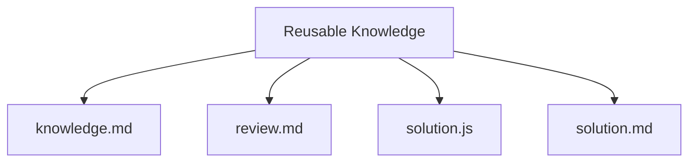
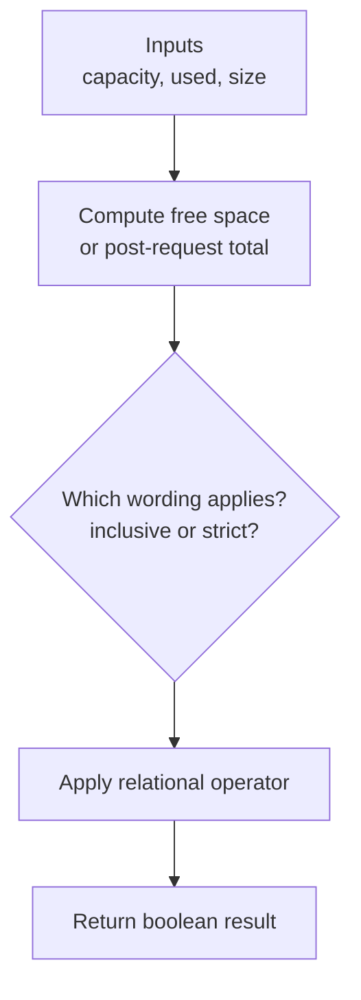
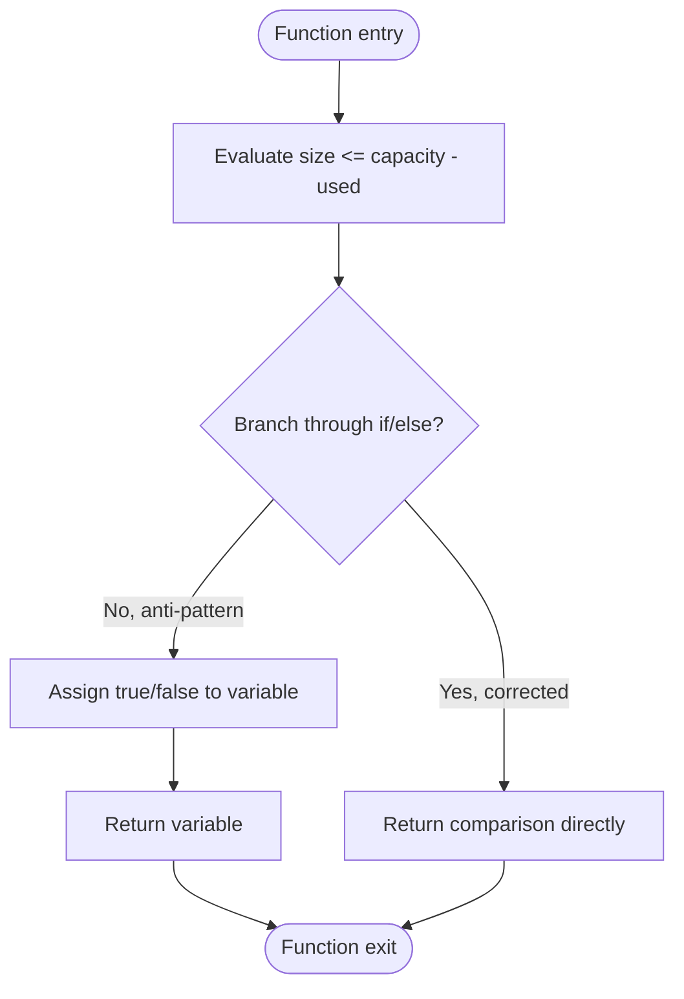
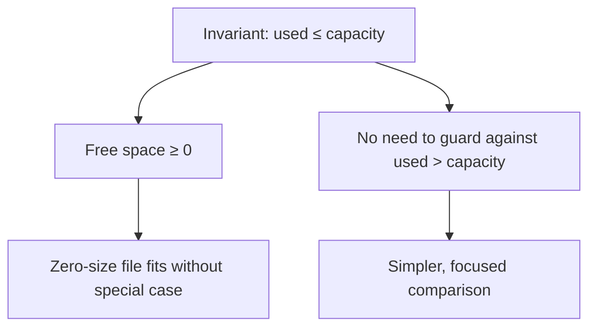
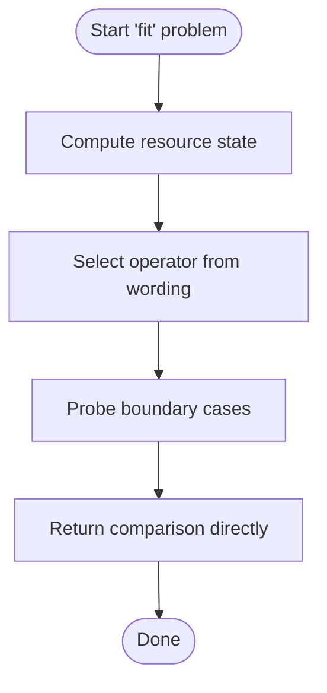

# Reusable Knowledge

<cite>
**Referenced Files in This Document**   
- [knowledge.md](file://fileFits/knowledge.md)
- [review.md](file://fileFits/review.md)
- [solution.js](file://fileFits/solution.js)
- [solution.md](file://fileFits/solution.md)
</cite>

## Table of Contents
1. [Introduction](#introduction)
2. [Project Structure](#project-structure)
3. [Core Principles](#core-principles)
4. [Architecture Overview](#architecture-overview)
5. [Detailed Principle Analysis](#detailed-principle-analysis)
6. [Decision Checklist](#decision-checklist)
7. [Transfer to Other Domains](#transfer-to-other-domains)
8. [Performance Considerations](#performance-considerations)
9. [Troubleshooting Guide](#troubleshooting-guide)
10. [Conclusion](#conclusion)

## Introduction
This reusable-knowledge section distills four generalizable lessons from the `fileFits` exercise: translating natural-language boundaries into relational operators, avoiding boolean laundering, exploiting guaranteed invariants to remove defensive branches, and applying a repeatable checklist for any "does X fit?" problem. The focus is on principles that transfer beyond disk-storage scenarios to inventory limits, memory allocation, scheduling windows, capacity planning, and any domain where a request must be compared against a remaining budget.

## Project Structure
The knowledge base lives inside a small exercise directory containing the source implementation, its written solution record, a review, and this reusable-knowledge entry.



**Diagram sources**
- [knowledge.md:1-50](file://fileFits/knowledge.md#L1-L50)
- [review.md:1-67](file://fileFits/review.md#L1-L67)
- [solution.js:1-10](file://fileFits/solution.js#L1-L10)
- [solution.md:1-138](file://fileFits/solution.md#L1-L138)

**Section sources**
- [knowledge.md:1-50](file://fileFits/knowledge.md#L1-L50)
- [review.md:1-67](file://fileFits/review.md#L1-L67)
- [solution.js:1-10](file://fileFits/solution.js#L1-L10)
- [solution.md:1-138](file://fileFits/solution.md#L1-L138)

## Core Principles
The repository identifies four reusable ideas:

| # | Principle | What it means | Why it matters |
|---|-----------|---------------|----------------|
| 1 | Wording-to-operator translation | Map phrases like "fits", "exactly allowed", "more than", and "at most" to `<`, `<=`, `>=`, or strict inequalities. | Boundary wording is often the only thing separating correct logic from an off-by-one error. |
| 2 | Boolean-laundering anti-pattern | Do not wrap a boolean-valued expression in `if/else` just to assign `true` or `false`. | It adds noise, introduces mutable state, and obscures the real condition. |
| 3 | Invariant exploitation | Derive consequences from constraints such as `used ≤ capacity`; do not defensively branch on impossible states. | Fewer branches mean fewer untested paths and clearer intent. |
| 4 | Fit-decision checklist | Compute free space, choose the operator, probe boundaries, and simplify the return. | Gives a repeatable process for new problems. |

**Section sources**
- [knowledge.md:1-50](file://fileFits/knowledge.md#L1-L50)
- [solution.md:6-12](file://fileFits/solution.md#L6-L12)
- [solution.md:70-85](file://fileFits/solution.md#L70-L85)

## Architecture Overview
At the algorithmic level, the decision has two layers:

1. **State layer:** derive the relevant resource quantity (free space or post-request total).
2. **Boundary layer:** select the correct relational operator based on whether the boundary is inclusive or exclusive.



**Diagram sources**
- [solution.md:22-40](file://fileFits/solution.md#L22-L40)
- [solution.md:60-85](file://fileFits/solution.md#L60-L85)

## Detailed Principle Analysis

### 1. Wording-to-Operator Translation Table
Natural-language requirements are contracts about boundaries. The table below captures the mapping demonstrated by the exercise.

| Requirement phrase | Intended meaning | Relational operator | Typical form |
|---|---|---:|---|
| "fits", "at most", "filling exactly is allowed" | The boundary value itself is acceptable | `<=` | `size <= capacity - used` |
| "strictly less", "must leave room" | The boundary value is not acceptable | `<` | `size < capacity - used` |
| "at least", "no fewer than" | The minimum is included | `>=` | `count >= minimum` |
| "more than" | Strictly greater | `>` | `value > threshold` |

The exact-fill sentence exists precisely to disambiguate `<=` from `<`. When such wording appears, include a boundary test at the limit.

**Section sources**
- [knowledge.md:4-15](file://fileFits/knowledge.md#L4-L15)
- [solution.md:22-34](file://fileFits/solution.md#L22-L34)

#### Example Scenario: Inventory Capacity
Suppose a warehouse can hold at most 500 units and currently holds 320. A shipment of 180 arrives.

- Remaining capacity: `500 - 320 = 180`.
- Wording: "at most" → use `<=`.
- Decision: `180 <= 180` → true; the shipment fits exactly.

If the wording were "must leave room," the operator would become `<`, and the same input would fail because the boundary is excluded.

**Section sources**
- [knowledge.md:4-15](file://fileFits/knowledge.md#L4-L15)

### 2. Boolean-Laundering Anti-Pattern
Boolean laundering occurs when a boolean-valued expression is wrapped in control flow solely to assign `true` or `false`.

Anti-pattern structure:

```text
let result
if (booleanExpression) {
  result = true
} else {
  result = false
}
return result
```

Correction:

```text
return booleanExpression
```

In the exercise, the original implementation computes `size <= capacity - used` but assigns its result to `returnVar` through an `if/else` before returning it. The review explicitly calls this redundant control flow and recommends replacing the whole block with a direct return of the comparison.



**Diagram sources**
- [solution.js:1-10](file://fileFits/solution.js#L1-L10)
- [review.md:38-67](file://fileFits/review.md#L38-L67)

Why avoid it:
- The expression already evaluates to a boolean.
- It removes a mutable local variable.
- It reduces the number of executable paths.
- It makes the intent transparent: the function returns a condition, not a constructed value.

A ternary remains useful when returning non-boolean values, such as labeling a result rather than merely classifying it.

**Section sources**
- [knowledge.md:17-33](file://fileFits/knowledge.md#L17-L33)
- [review.md:38-67](file://fileFits/review.md#L38-L67)
- [solution.js:1-10](file://fileFits/solution.js#L1-L10)

### 3. Invariant Exploitation
The problem guarantees `used ≤ capacity`. From that invariant:

- Free space `capacity - used` is always non-negative.
- A zero-size file trivially fits because `0 ≤ free space`.
- Defensive checks for negative inputs or `used > capacity` describe states the specification excludes.

Defensive branches may feel safe, but they add untested code paths, obscure the core decision, and can mislead readers into thinking those states are possible. Instead, rely on the stated invariants and document them.



**Diagram sources**
- [knowledge.md:35-48](file://fileFits/knowledge.md#L35-L48)
- [solution.md:22-34](file://fileFits/solution.md#L22-L34)
- [solution.md:86-100](file://fileFits/solution.md#L86-L100)

**Section sources**
- [knowledge.md:35-48](file://fileFits/knowledge.md#L35-L48)
- [solution.md:22-34](file://fileFits/solution.md#L22-L34)
- [solution.md:86-100](file://fileFits/solution.md#L86-L100)

### 4. Four-Step Checklist for "Does X Fit?" Problems
Use this checklist whenever a request must be compared against a remaining budget.

1. **Compute the relevant resource state.** Choose either remaining budget (`capacity - used`) or post-request total (`used + size`), not both.
2. **Choose the boundary operator from the wording.** "Exactly allowed" → `<=`; "must leave room" → `<`; "at least" → `>=`.
3. **Validate with boundary probes.** Test at the limit, one unit over, and zero request.
4. **Simplify the return.** Return the comparison directly unless you need to produce a non-boolean label.



**Diagram sources**
- [knowledge.md:49-50](file://fileFits/knowledge.md#L49-L50)
- [solution.md:60-85](file://fileFits/solution.md#L60-L85)

#### Applying the Checklist to New Scenarios

**Memory allocation:** Can a buffer of 4 KiB accommodate a payload of 4096 bytes?
- State: remaining memory is `4096 - allocated`.
- Wording: "exactly allowed" → `<=`.
- Boundary: test payload equal to remaining, one byte more, and zero-byte payload.
- Return: `payload <= remaining`.

**Scheduling window:** Can a meeting of 90 minutes start at time `T` within a `[start, end]` window?
- State: remaining window is `end - T`.
- Wording: "meeting ends exactly at the boundary is allowed" → `<=`.
- Boundary: meeting ending at `end`, ending one minute later, and a zero-length meeting.
- Return: `duration <= end - T`.

**Inventory limit:** Can we order 200 more widgets when current stock plus reserved items equals 980 out of a maximum of 1000?
- State: remaining quota is `1000 - 980 = 20`.
- Wording: "at most" → `<=`.
- Boundary: order equal to remaining, one over, and zero-order.
- Return: `order <= remainingQuota`.

**Section sources**
- [knowledge.md:49-50](file://fileFits/knowledge.md#L49-L50)
- [solution.md:60-85](file://fileFits/solution.md#L60-L85)

## Decision Checklist
The checklist should be applied consistently across domains:

| Step | Question | Example outcome |
|---|---|---|
| 1 | What single arithmetic expression represents the decision? | `capacity - used` or `used + size` |
| 2 | Is the boundary inclusive or exclusive? | "Exactly allowed" ⇒ `<=` |
| 3 | Which three boundary inputs validate the choice? | Exact fill, one over, zero request |
| 4 | Can the result be returned directly? | Yes, when the expression is already boolean |

**Section sources**
- [knowledge.md:49-50](file://fileFits/knowledge.md#L49-L50)
- [solution.md:60-85](file://fileFits/solution.md#L60-L85)

## Transfer to Other Domains
These principles generalize because they address common computational patterns, not disk storage specifically.

| Domain | Capacity concept | Decision question | Key lesson |
|---|---|---|---|
| Inventory management | Maximum stock | Can adding N units exceed the cap? | Translate "at most" to `<=`; boundary tests matter. |
| Memory allocation | Heap or buffer limit | Can allocating K bytes overflow? | Use remaining budget or post-allocation total; avoid defensive checks for impossible heap states. |
| Scheduling | Time window | Does a task finish within the deadline? | Inclusive boundaries decide whether touching the endpoint is allowed. |
| API rate limiting | Request quota | Can another request be served now? | Compare requested increment against remaining allowance using the correct inequality. |
| Financial budgeting | Budget ceiling | Can a purchase stay within budget? | "At most" maps to `<=`; zero-cost purchases fit automatically under nonnegative budgets. |

The transfer works because each scenario shares the same skeleton: define a bounded resource, compute what remains or what would follow the change, pick the right operator, verify boundaries, and return the boolean result.

**Section sources**
- [knowledge.md:1-50](file://fileFits/knowledge.md#L1-L50)
- [solution.md:6-12](file://fileFits/solution.md#L6-L12)
- [solution.md:60-85](file://fileFits/solution.md#L60-L85)

## Performance Considerations
The `fileFits` decision is O(1) time and O(1) auxiliary space: one subtraction, one comparison, and no data structures. The review confirms this is optimal because every input can affect the answer, so no algorithm can perform fewer essential operations.

Removing boolean laundering improves readability and eliminates a mutable variable, but does not change asymptotic complexity. Avoid adding validation for negative numbers or over-committed states unless the surrounding system relaxes the stated invariants.

**Section sources**
- [review.md:47-67](file://fileFits/review.md#L47-L67)
- [solution.md:101-115](file://fileFits/solution.md#L101-L115)

## Troubleshooting Guide
Common mistakes and their remedies:

| Symptom | Likely cause | Fix |
|---|---|---|
| Off-by-one at the boundary | Chose `<` when the requirement allows exact equality | Switch to `<=` when wording includes "exactly allowed", "at most", or "fits". |
| Code passes happy path but fails exact-fill test | Boundary operator too strict | Add a test where `used + size == capacity`. |
| Extra branch for zero-size files | Not exploiting the invariant | Remove the branch once you confirm free space is nonnegative. |
| Function looks longer than necessary | Boolean laundering | Return the comparison directly. |
| Tests pass locally but fail under different constraints | Hidden assumptions about input ranges | Make invariants explicit in documentation and preconditions. |
| Defensive checks mask real errors | Guarding against impossible states | Keep guards only for contract violations that can actually occur in your runtime. |

**Section sources**
- [knowledge.md:17-48](file://fileFits/knowledge.md#L17-L48)
- [review.md:15-67](file://fileFits/review.md#L15-L67)
- [solution.md:86-115](file://fileFits/solution.md#L86-L115)

## Conclusion
The `fileFits` exercise demonstrates how much clarity comes from treating boundary wording as a contract, treating comparisons as booleans, trusting documented invariants, and following a repeatable checklist. These habits reduce accidental complexity, make tests meaningful, and transfer cleanly to inventory, memory, scheduling, budgeting, and other capacity-comparison problems. The most impactful refactor is often the smallest: replace boolean laundering with a direct return, choose the operator deliberately, and verify the boundary.