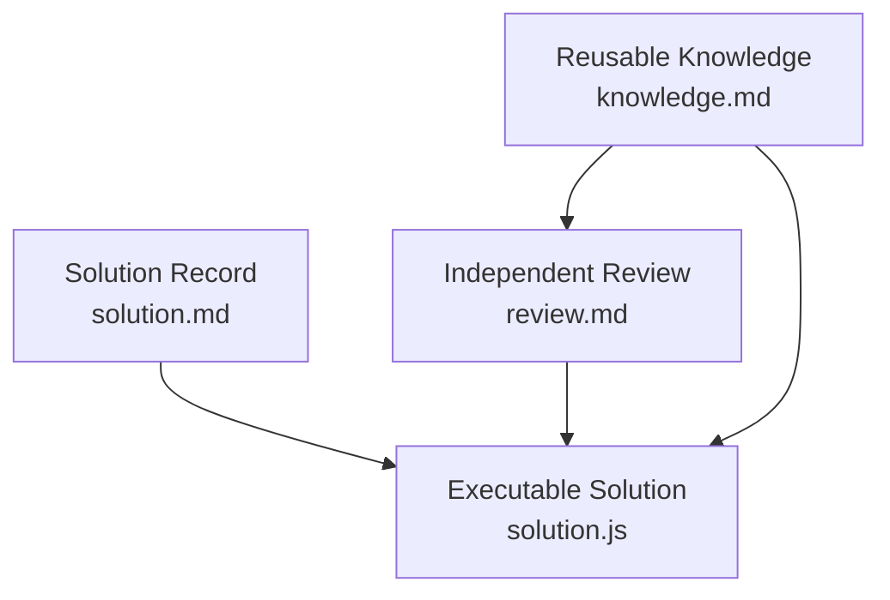
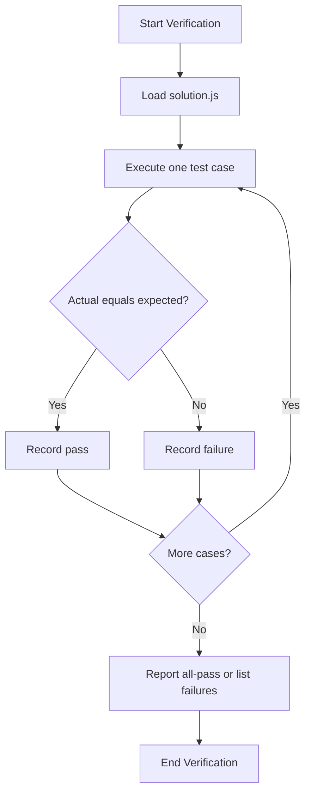
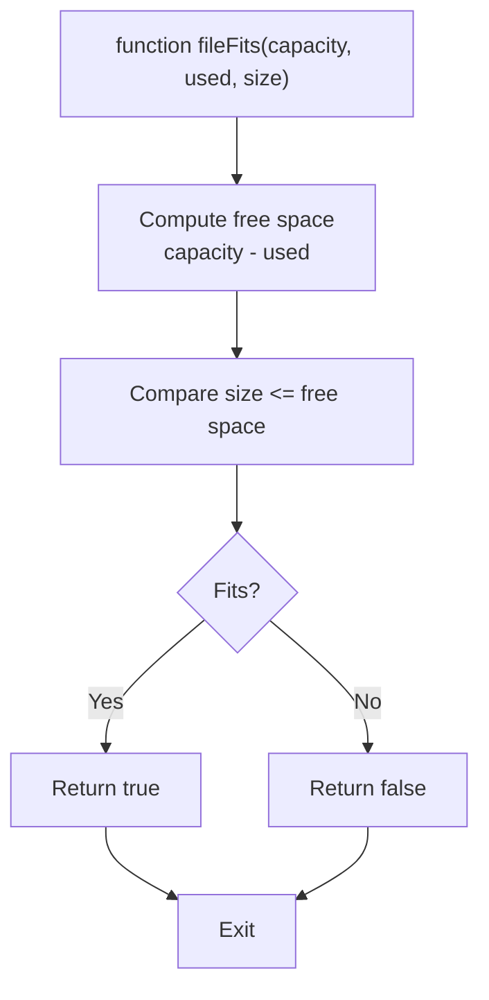
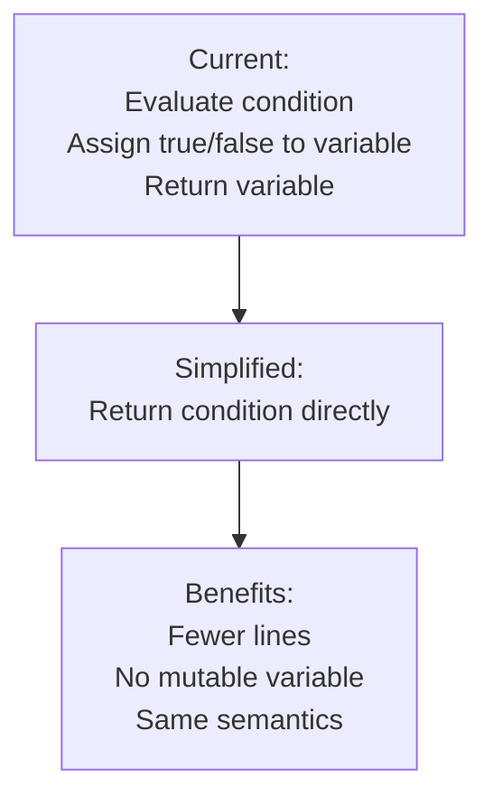

# Verification & Test Results

<cite>
**Referenced Files in This Document**
- [solution.js](file://fileFits/solution.js)
- [review.md](file://fileFits/review.md)
- [knowledge.md](file://fileFits/knowledge.md)
- [solution.md](file://fileFits/solution.md)
</cite>

## Table of Contents
1. [Introduction](#introduction)
2. [Project Structure](#project-structure)
3. [Core Components](#core-components)
4. [Architecture Overview](#architecture-overview)
5. [Detailed Component Analysis](#detailed-component-analysis)
6. [Dependency Analysis](#dependency-analysis)
7. [Performance Considerations](#performance-considerations)
8. [Troubleshooting Guide](#troubleshooting-guide)
9. [Conclusion](#conclusion)
10. [Appendices](#appendices)

## Introduction
This document reports the verification and testing results for the `fileFits` exercise, which decides whether a file fits on a drive given its capacity, already used space, and the file size. The function is implemented in JavaScript and was executed with Node.js v24.22.1. All nine test cases passed independently, confirming that the implementation is correct under the stated constraints: non-negative inputs up to 1000, `used ≤ capacity`, exact fill allowed, and zero-size files requiring no extra space.

The purpose of this review is not only to record the verdict but also to make the testing strategy explicit so readers can reproduce it, interpret failures, and apply the same approach to other algorithmic exercises.

## Project Structure
The repository for this exercise contains four files:

| File | Purpose |
|---|---|
| [solution.js](file://fileFits/solution.js) | Executable solution implementing `fileFits(capacity, used, size)` |
| [solution.md](file://fileFits/solution.md) | Problem statement, analysis, pseudocode, complexity, and edge-case table |
| [review.md](file://fileFits/review.md) | Independent correctness review, executed test results, performance assessment, code-quality finding, and recommended changes |
| [knowledge.md](file://fileFits/knowledge.md) | Reusable knowledge about boundary comparisons and boolean-return patterns in JavaScript |

**Diagram sources**
- [solution.md:1-138](file://fileFits/solution.md#L1-L138)
- [solution.js:1-10](file://fileFits/solution.js#L1-L10)
- [review.md:1-67](file://fileFits/review.md#L1-L67)
- [knowledge.md:1-50](file://fileFits/knowledge.md#L1-L50)

**Section sources**
- [solution.js:1-10](file://fileFits/solution.js#L1-L10)
- [solution.md:1-138](file://fileFits/solution.md#L1-L138)
- [review.md:1-67](file://fileFits/review.md#L1-L67)
- [knowledge.md:1-50](file://fileFits/knowledge.md#L1-L50)

## Core Components
The solution consists of a single function:

- **Function:** `fileFits(capacity, used, size)`
- **Inputs:** three whole numbers in `[0, 1000]`, with the invariant `used ≤ capacity`.
- **Decision:** returns `true` if the file fits into the remaining free space, otherwise `false`.
- **Boundary rule:** filling the drive exactly is allowed, so the comparison must be inclusive.
- **Zero-size behavior:** a zero-size file needs no extra space and therefore always fits when the invariant holds.

The current implementation computes free space as `capacity - used` and compares `size` against it using an inclusive bound. It then assigns the result to a local variable before returning it.

**Section sources**
- [solution.js:1-10](file://fileFits/solution.js#L1-L10)
- [solution.md:1-138](file://fileFits/solution.md#L1-L138)

## Architecture Overview
At a high level, the verification workflow has two layers:

1. **Execution layer:** Node.js runs the function against nine concrete input triples.
2. **Verification layer:** Each actual output is compared with the expected output recorded by the reviewer.

[No sources needed since this diagram shows conceptual verification workflow, not a specific source structure]

**Section sources**
- [review.md:1-67](file://fileFits/review.md#L1-L67)

## Detailed Component Analysis

### Function Behavior
The function performs constant work:

1. Subtract `used` from `capacity` to obtain remaining free space.
2. Check whether `size` is less than or equal to that remainder.
3. Return the resulting boolean.

**Diagram sources**
- [solution.js:1-10](file://fileFits/solution.js#L1-L10)

**Section sources**
- [solution.js:1-10](file://fileFits/solution.js#L1-L10)

### Correctness Verdict
The independent review concludes that the solution is **correct**:

- The inclusive comparison handles the exact-fill requirement.
- Free space is computed correctly as `capacity - used`.
- No additional validation is required because negative inputs and `used > capacity` are excluded by the problem constraints.
- All nine executed test cases passed.

**Section sources**
- [review.md:1-67](file://fileFits/review.md#L1-L67)
- [solution.md:1-138](file://fileFits/solution.md#L1-L138)

### Reproduced Test Cases
The following table reproduces all nine executed cases. Inputs are ordered as `(capacity, used, size)`.

| # | Scenario | Input `(capacity, used, size)` | Expected | Actual | Status |
|---|---|---|---:|---:|---:|
| 1 | Example fit | `(100, 70, 20)` | `true` | `true` | Pass |
| 2 | One unit over | `(100, 70, 31)` | `false` | `false` | Pass |
| 3 | Exact fill | `(100, 70, 30)` | `true` | `true` | Pass |
| 4 | Full drive, zero-size file | `(100, 100, 0)` | `true` | `true` | Pass |
| 5 | Full drive, non-zero file | `(100, 100, 1)` | `false` | `false` | Pass |
| 6 | Minimum bounds | `(0, 0, 0)` | `true` | `true` | Pass |
| 7 | Maximum bounds, exact fill | `(1000, 0, 1000)` | `true` | `true` | Pass |
| 8 | Maximum bounds, full drive | `(1000, 1000, 1000)` | `false` | `false` | Pass |
| 9 | No usage, zero-size file | `(100, 0, 0)` | `true` | `true` | Pass |

All nine cases were executed and verified as passing.

**Section sources**
- [review.md:1-67](file://fileFits/review.md#L1-L67)
- [solution.md:1-138](file://fileFits/solution.md#L1-L138)

### Testing Strategy
The tests probe six important dimensions:

| Dimension | Representative Case(s) | Why It Matters |
|---|---|---|
| Inclusive boundary | `(100, 70, 30)` | Confirms that exact fill is accepted (`≤`, not `<`). |
| Strict boundary just above | `(100, 70, 31)` | Confirms that one unit over capacity is rejected. |
| Minimum bounds | `(0, 0, 0)` | Confirms behavior at the lower input limit. |
| Maximum bounds | `(1000, 0, 1000)` and `(1000, 1000, 1000)` | Confirms behavior at the upper input limit. |
| Exact-fill condition | `(100, 70, 30)` and `(1000, 0, 1000)` | Confirms that equality is included in the fit decision. |
| Fully occupied drive | `(100, 100, 0)` and `(100, 100, 1)` | Confirms that zero-size files still fit while any positive file does not. |
| Empty drive | `(0, 0, 0)` and `(100, 0, 0)` | Confirms that unused capacity is available and zero-size requests behave consistently. |
| Zero-size request | `(100, 100, 0)` and `(100, 0, 0)` | Confirms that no extra space is needed; this follows from the invariant rather than a special branch. |

The strategy deliberately avoids defensive checks for invalid states because the problem guarantees them impossible. Instead, it focuses on the boundary where the decision flips — exactly the most likely place for an off-by-one error.

**Section sources**
- [review.md:1-67](file://fileFits/review.md#L1-L67)
- [knowledge.md:1-50](file://fileFits/knowledge.md#L1-L50)
- [solution.md:1-138](file://fileFits/solution.md#L1-L138)

### Performance Assessment
The performance assessment is straightforward:

- **Time complexity:** O(1). The function performs one subtraction and one comparison, regardless of the numeric values.
- **Space complexity:** O(1). The current implementation uses one local variable; the simplified form would use none.
- **Optimality:** Because every input value can change the answer, no algorithm can solve the problem with fewer than one comparison. Thus, O(1) time and space is optimal.

**Section sources**
- [review.md:1-67](file://fileFits/review.md#L1-L67)
- [solution.md:1-138](file://fileFits/solution.md#L1-L138)

### Code-Quality Finding: Boolean Laundering
The main code-quality finding is **boolean laundering**: assigning `true` or `false` to a variable through an `if/else` around a comparison expression that is already a boolean.

Current pattern:
- Evaluate `size <= capacity - used`.
- Assign `true` in the `if` branch.
- Assign `false` in the `else` branch.
- Return the variable.

Recommended fix:
- Replace the entire `if/else` block and temporary variable with a direct return of the comparison expression.

This preserves the author's logic exactly while removing redundant control flow and mutable state. It also eliminates the naming issue of `returnVar`, which describes the mechanism rather than the meaning.

**Diagram sources**
- [solution.js:1-10](file://fileFits/solution.js#L1-L10)
- [review.md:1-67](file://fileFits/review.md#L1-L67)
- [knowledge.md:1-50](file://fileFits/knowledge.md#L1-L50)

**Section sources**
- [review.md:1-67](file://fileFits/review.md#L1-L67)
- [knowledge.md:1-50](file://fileFits/knowledge.md#L1-L50)
- [solution.js:1-10](file://fileFits/solution.js#L1-L10)

## Dependency Analysis
There is minimal coupling in this exercise:

- [solution.js](file://fileFits/solution.js) defines the executable function.
- [solution.md](file://fileFits/solution.md) documents the problem, analysis, and edge cases for the same function.
- [review.md](file://fileFits/review.md) independently verifies the function and proposes a simplification.
- [knowledge.md](file://fileFits/knowledge.md) generalizes reusable lessons from the exercise.

**Diagram sources**
- [solution.js:1-10](file://fileFits/solution.js#L1-L10)
- [solution.md:1-138](file://fileFits/solution.md#L1-L138)
- [review.md:1-67](file://fileFits/review.md#L1-L67)
- [knowledge.md:1-50](file://fileFits/knowledge.md#L1-L50)

**Section sources**
- [solution.js:1-10](file://fileFits/solution.js#L1-L10)
- [solution.md:1-138](file://fileFits/solution.md#L1-L138)
- [review.md:1-67](file://fileFits/review.md#L1-L67)
- [knowledge.md:1-50](file://fileFits/knowledge.md#L1-L50)

## Performance Considerations
Because the problem reduces to one arithmetic comparison, there is no loop, recursion, branching over input magnitude, or data structure allocation. The O(1) time and O(1) space classification is both accurate and optimal. Adding unnecessary input validation would increase constant work without improving correctness under the stated constraints.

[No sources needed since this section provides general guidance based on previously analyzed files]

## Troubleshooting Guide
When re-running these tests or applying the same template to another exercise, watch for the following common issues:

| Issue | Symptom | Fix |
|---|---|---|
| Confusing `<` with `<=` | Exact-fill case fails; boundary between fit and overflow is wrong. | Read wording carefully: “exactly allowed” means `<=`; “must leave room” usually means `<`. |
| Misreading “remaining space” as used space | Tests with small `size` fail unexpectedly. | Remaining space is `capacity - used`, not `used`. Do not compare `size` against `used`. |
| Forgetting that `capacity` and `used` are bounded | Overcomplicated validation code. | The problem constrains inputs to `[0, 1000]`; rely on the given invariant `used ≤ capacity`. |
| Adding a special case for zero-size files | Unnecessary branch; may hide the real condition. | Zero-size files follow automatically because free space is non-negative under the invariant. |
| Treating boolean laundering as meaningful logic | Harder-to-read code with a mutable intermediate variable. | Return the comparison directly instead of assigning `true`/`false` through `if/else`. |
| Interpreting failure as algorithmic error too quickly | Wasting time changing a correct core idea. | First check boundary operators, then input interpretation, then invariants. |

To re-run the tests:

1. Open Node.js v24.22.1 or later.
2. Import or load `fileFits` from [solution.js](file://fileFits/solution.js).
3. Call it with each of the nine input triples listed in the reproduced test cases.
4. Compare each actual result with the expected result in the table.
5. If a case fails, inspect:
   - Whether the operator is inclusive or strict.
   - Whether the comparison uses remaining free space or used space.
   - Whether the exact-fill boundary is handled.
   - Whether minimum and maximum bounds are covered.
   - Whether zero-size requests are considered.

Use this same checklist as a template for verifying other exercises: identify the decision variable, choose the correct operator from the wording, probe the boundary, probe extremes, and handle guaranteed invariants without defensive noise.

**Section sources**
- [review.md:1-67](file://fileFits/review.md#L1-L67)
- [knowledge.md:1-50](file://fileFits/knowledge.md#L1-L50)
- [solution.js:1-10](file://fileFits/solution.js#L1-L10)

## Conclusion
The `fileFits` solution is correct, optimal, and fully covered by the nine executed test cases. Its core logic — comparing the requested size against remaining free space with an inclusive bound — passes inclusive boundaries, minimum and maximum bounds, exact-fill conditions, fully occupied drives, empty drives, and zero-size requests. The only recommended improvement is stylistic: return the comparison directly and remove the redundant `if/else` plus temporary variable. Readers can reproduce the results by running the same nine cases against `solution.js`, interpreting failures through the troubleshooting checklist, and applying the same boundary-probing strategy to future algorithmic exercises.

[No sources needed since this section summarizes without analyzing specific files]

## Appendices

### Appendix A: How to Interpret a Failure
If a test fails after rerunning:

1. **Check the operator first.** Most failures in this kind of problem come from `<` vs `<=`.
2. **Check the operands next.** Make sure you are comparing `size` against `capacity - used`, not against `used`.
3. **Check the boundary.** Confirm that exact fill is treated as fitting.
4. **Check invariants.** If the problem guarantees `used ≤ capacity`, do not add defensive branches for impossible states unless the judge explicitly relaxes the contract.
5. **Check edge cases.** Add a minimum-bound case, a maximum-bound case, an exact-fill case, and a zero-size case if they are missing.

**Section sources**
- [knowledge.md:1-50](file://fileFits/knowledge.md#L1-L50)
- [solution.md:1-138](file://fileFits/solution.md#L1-L138)